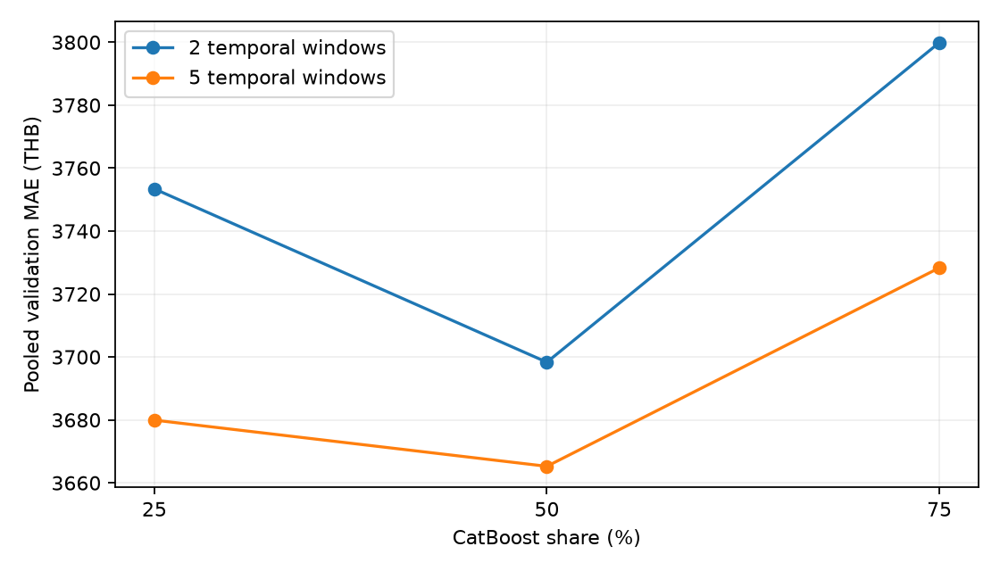

# รายงานเปรียบเทียบ validation 2 ช่วงและ 5 ช่วงของ Model V2

เอกสารเปรียบเทียบแผน validation ของโครงการ เก็บผลทดลองและหลักฐานประกอบใน .local การทดลองนี้เป็นส่วนหนึ่งของ Model V2 ไม่ใช่เวอร์ชันใหม่ และไม่ได้เปลี่ยน config หรือโมเดลใช้งานจากผลทดลอง

## ผลสรุปและแนวทางที่เลือกใช้

เลือกคง validation แบบ **2 ช่วงเป็นแผนหลักของ V2** และเก็บผลแบบ **5 ช่วงเป็นการตรวจสอบเพิ่มเติม** ทั้งสองแผนเลือกน้ำหนัก HGB/CatBoost **50/50 เหมือนกัน** จึงไม่จำเป็นต้องเปลี่ยนหรือฝึกโมเดลใช้งานใหม่จากผลทดลองนี้

แบบ 5 ช่วงมี MAE รวมลดลงเพียง **33.07 บาท หรือ 0.89%** แต่ RMSE สูงขึ้น และผลแยกกลุ่มไม่ได้ดีขึ้นพร้อมกัน จึงยังไม่มีหลักฐานว่าการเปลี่ยนแผนหลักเป็น 5 ช่วงจะทำให้โมเดลใช้งานแม่นขึ้น

เหตุผลที่คง 2 ช่วงในงานนี้คือผลเลือกการตั้งค่าไม่เปลี่ยน ผลประเมินไม่ได้ดีขึ้นทุกด้าน และสามารถคงแผนหลักที่ทำซ้ำได้พร้อมเปิดเผยผลตรวจเพิ่มเติม ไม่ได้สรุปว่า 2 ช่วงดีกว่า 5 ช่วงโดยทั่วไป หรือว่าข้อมูล Android ทำให้ใช้ 5 ช่วงไม่ได้

## วิธีทดลอง

- ใช้ชุดฝึกปัจจุบัน 9,100 แถว ฟีเจอร์ 13 ตัว seed 42 และพารามิเตอร์ HGB/CatBoost เดิม
- ทั้งสองแผนทำนาย validation 955 ประกาศชุดเดียวกัน ตั้งแต่ 2024-01-01 ถึงก่อน 2025-01-09 ไม่มีประกาศวันเดียวกันข้ามฝั่ง
- 2 รอบใช้ช่วงจาก config ปัจจุบัน 5 รอบใช้ quantile ของจำนวนแถวตามวันที่เพื่อให้แต่ละช่วงมีจำนวนใกล้กัน ไม่ใช้ราคาเลือกขอบเขต ช่วงเวลาจึงยาวไม่เท่ากัน
- Train ขยายเมื่อเริ่มช่วงใหม่ เติม missing/encode จาก train ของแต่ละรอบเท่านั้น
- ฝึก HGB/CatBoost แยกกันหนึ่งครั้งต่อช่วง แล้วใช้ผลสมาชิกเดียวกันเฉลี่ยด้วยสามน้ำหนัก วิธีนี้เทียบเท่าการฝึก ensemble เดิม เพราะน้ำหนักเฉลี่ยไม่ได้เปลี่ยนการเรียนรู้ของสมาชิก
- รัน 2 รอบซ้ำแล้วได้ MAE ตรงรายงานเดิมทั้งสามตัวเลือกภายใน 0.000001 บาท
- เลือกน้ำหนักด้วย pooled MAE ที่ถ่วงตามจำนวนประกาศ ไม่เฉลี่ย MAE ของแต่ละ fold แบบให้น้ำหนักเท่ากัน ไม่ใช้จำนวนครั้งที่ชนะราย fold เป็นเกณฑ์

แผนหลักแบบ 2 ช่วงที่คงไว้:

| ช่วง | จำนวน Train | ช่วงวันที่ validation | จำนวน Validation |
|---|---|---|---|
| 1 | 7,463 | 1 ม.ค.–21 พ.ค. 2024 | 270 |
| 2 | 7,733 | 22 พ.ค. 2024–7 ม.ค. 2025 | 685 |

ทั้งสองแผนใช้ validation รวม 955 ประกาศเท่ากัน ส่วน train ขยายตามเวลา ช่วงแรกของแต่ละแผนเริ่มจาก train 7,463 ประกาศชุดเดียวกัน

## ผลเลือกน้ำหนัก

| HGB / CatBoost | 2 รอบ: MAE (บาท) | 5 รอบ: MAE (บาท) |
|---|---|---|
| 75 / 25 | 3,753.40 | 3,679.93 |
| 50 / 50 | 3,698.34 | 3,665.27 |
| 25 / 75 | 3,799.88 | 3,728.32 |

ทั้งสองแผนเลือก 50/50 แต่ในแผน 5 รอบ 50/50 ชนะ 75/25 เพียง 14.67 บาท จึงไม่ควรอ้างว่าเป็นน้ำหนักที่ดีที่สุดอย่างแน่นอน

## ผลของน้ำหนักที่เลือก

| ตัววัด validation 955 แถว | 2 รอบ | 5 รอบ |
|---|---|---|
| MAE (บาท) | 3,698.34 | 3,665.27 |
| RMSE (บาท) | 6,034.70 | 6,276.60 |
| Median absolute error (บาท) | 2,025.52 | 1,857.48 |
| R² | 0.8171 | 0.8021 |
| ภายใน ±20% (%) | 51.20 | 51.20 |
| Bias (บาท) | 71.49 | -391.36 |

MAE ลด 33.07 บาท (0.89%) แต่ RMSE เพิ่ม 241.90 บาท และสัดส่วนภายใน ±20% เท่าเดิม จึงไม่ใช่การดีขึ้นทุกด้าน ไม่ได้ทดสอบนัยสำคัญทางสถิติ

## รายช่วงของแผน 5 รอบ

| รอบ | Train | Validation | ช่วง validation | Android | MAE ของ 50/50 | CatBoost ที่ MAE ต่ำสุดในรอบ |
|---|---|---|---|---|---|---|
| 1 | 7463 | 178 | 2024-01-02 ถึง 2024-05-14 | 13 | 2,286.95 | 75% |
| 2 | 7641 | 198 | 2024-05-15 ถึง 2024-05-30 | 52 | 5,550.24 | 75% |
| 3 | 7839 | 195 | 2024-05-31 ถึง 2024-08-05 | 62 | 5,111.83 | 25% |
| 4 | 8034 | 167 | 2024-08-07 ถึง 2024-11-26 | 68 | 3,864.90 | 25% |
| 5 | 8201 | 217 | 2024-11-27 ถึง 2025-01-07 | 188 | 1,622.39 | 75% |

50/50 ไม่ใช่อันดับหนึ่งในแต่ละช่วง แต่เป็นจุดประนีประนอมที่ pooled MAE ต่ำสุดจากสามน้ำหนัก ช่วงที่ 2 และ 3 ยังผิดมากกว่า 5,000 บาท ส่วนผสมรุ่น/ยี่ห้อและช่วงราคาต่างกัน จึงไม่ควรนำความต่างนี้ไปตีความเป็นการแกว่งสุ่มเพียงอย่างเดียว ชุด train ของรอบต่าง ๆ ซ้อนกัน จึงไม่ใช่การทดลองอิสระห้าครั้ง

## ผล validation แยกกลุ่มที่ 50/50

| กลุ่ม validation | จำนวน | MAE 2 รอบ | MAE 5 รอบ |
|---|---|---|---|
| iPhone | 537 | 2,566.09 | 3,077.39 |
| Android | 383 | 4,621.03 | 4,382.44 |
| other | 35 | 10,973.45 | 4,836.99 |

Android MAE ลดเล็กน้อย แต่ iPhone MAE เพิ่ม ขณะที่กลุ่ม other ซึ่งมีเพียง 35 แถวเปลี่ยนมาก กลุ่ม other ไม่ถูกบังคับนับเป็น Android การดูคะแนนรวมอย่างเดียวจึงกลบ trade-off นี้

## ผลย้อนหลังและโมเดลใช้งาน

ทั้งสองแผนเลือกน้ำหนักเดียวกันและใช้ train ก่อนวันตัดเดียวกัน 8,418 แถว จึงให้โมเดลประเมินสุดท้ายแบบเดียวกัน ผลบน 682 ประกาศย้อนหลังเท่ากัน: MAE 3,597.24 บาท, RMSE 6,038.96 บาท, R² 0.7738, ภายใน ±20% 59.09% และ Android MAE 5,445.43 บาท

ในการตรวจผลขั้นนี้ใช้สมาชิก HGB/CatBoost ของ evaluation artifact เดิมที่ผ่าน checksum เพราะการเรียนรู้สมาชิกไม่เปลี่ยนตามจำนวน validation folds หรือสัดส่วนเฉลี่ย เลือกน้ำหนักทั้งสองแผนและบันทึก selection.json ก่อนคำนวณผลย้อนหลัง ไม่มีการอ้างว่าได้โมเดลใหม่ที่แม่นขึ้น และชุดย้อนหลังยังเป็นชุดที่เคยเปิดดู ไม่ใช่ fresh holdout

การเพิ่ม fold ทำให้ train อัปเดตบ่อยขึ้นระหว่าง validation แม้ทำนายประกาศชุดเดียวกัน คะแนนจึงเปลี่ยนได้จากความสดของ train ไม่ใช่การเปลี่ยนคุณภาพโมเดลใช้งานเพียงอย่างเดียว ไม่มีการเพิ่มข้อมูล Android หรือยืนยันว่าไม่มี overfitting

## ข้อจำกัดของข้อสรุป

- การใช้ 2 ช่วงยังตรวจความสม่ำเสมอข้ามเวลาได้จำกัด ผล 5 ช่วงจึงมีประโยชน์เป็นหลักฐานเพิ่มเติม แม้ไม่เปลี่ยนน้ำหนักโมเดลที่เลือก
- Android มีข้อมูลกระจายหลายรุ่นและบางช่วงมีตัวอย่างน้อย แต่ validation แบบ 5 ช่วงยังทำได้จริง ไม่ควรใช้เหตุผลว่า Android น้อยเป็นข้อยืนยันว่าต้องเลือก 2 ช่วง
- ชุดย้อนหลังเคยถูกเปิดดูและข้อมูลผ่านการคัด EDA ก่อนแบ่งแล้ว จึงไม่ใช่การทดสอบอิสระใหม่ และไม่ได้ทดสอบนัยสำคัญทางสถิติของความต่างคะแนน
- หากปรับแผน validation ในอนาคต ควรกำหนดช่วงและเกณฑ์ก่อนดูคะแนน พร้อมรายงานผลรายกลุ่ม ไม่เลือกจำนวนช่วงเพียงเพราะให้คะแนนรวมที่ดูดีกว่า

## ไฟล์หลักฐาน

- [สคริปต์ทดลอง](../v2_fold_comparison.py) — รันได้จาก working directory อื่น
- [แผนที่บันทึกก่อนทดลอง](plan.json)
- [น้ำหนักที่เลือกก่อนประเมินย้อนหลัง](selection.json)
- [ผลรวม](summary.json)
- [ผลรายรอบ](fold_metrics.csv)
- [ผลรายกลุ่ม](validation_group_metrics.csv)
- [ผลย้อนหลัง](retrospective_metrics.csv)

ตรวจ hash แล้วข้อมูล โมเดล config และรายงานหลักไม่เปลี่ยน การทดลองทั้งหมดใช้เวลาประมาณ 77.3 วินาที
