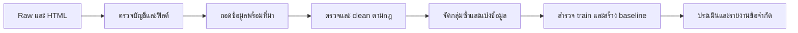

# คู่มือข้อมูล: เก็บ ตรวจ clean รวมและคัดชุด

<a id="current-dataset"></a>

**ชุดใช้ต่อคือ [data/final/dataset.csv](../data/final/dataset.csv) จำนวน 9,210 แถว**: ENNXO 1,202 และ Mac2Hand 8,008 มี source ทุกแถวและ schema กลาง 13 คอลัมน์ เป็นชุดก่อน split ที่ใช้ฝึกแล้ว ส่วนชุดรวม 10,032 แถวเป็นข้อมูลก่อนคัด เก็บเป็นประวัติใน intermediate

[datasets.json](../data/datasets.json) ระบุ path/จำนวนและ `default_dataset: model_input_dataset` ไฟล์หลักพร้อมไฟล์กำกับใน final รวมใน Git; raw, intermediate และ final เฉพาะเว็บเก็บในเครื่อง ตารางอธิบายทุกไฟล์อยู่ในหัวข้อด้านล่าง

`data/final/condition_features.csv` เป็น sidecar 9,210 แถว: listing_id + battery_health_pct/warranty_days/box_mentioned ไม่มีข้อความหรือข้อมูลติดต่อ ใช้ rebuild V2 หลัง clone โดยคง schema ชุดหลักเดิม ค่าว่างคือไม่ทราบ อ่าน [การใช้ features และโมเดล](modeling.md)

ข้อจำกัดที่ตรวจเพิ่ม: พบ 15 แถวที่ความจุประกาศไม่อยู่ในสเปก iPhone ของรุ่นที่ normalize ไว้ ยังไม่ยืนยันว่ารุ่นหรือความจุผิด จึงคงข้อมูลเดิมและบันทึกไว้ใน [ผลตรวจความจุ](assets/modeling/tables/storage_reference_audit.csv) หน้าเว็บใช้ตัวเลือกความจุจากผู้ผลิตแล้ว การผ่าน clean หมายถึงผ่านกฎและหลักฐานของ snapshot ไม่ใช่การยืนยันสภาพเครื่องหรือทุกสเปกจากผู้ผลิต

เนื้อหารายขั้นบันทึกผล ณ รอบที่ทำ; การแบ่ง/ฝึกเสร็จแล้ว อ่านผลล่าสุดใน [รายงานโมเดล](modeling.md)

## สารบัญตามขั้นตอน

| หัวข้อ | เนื้อหา |
|---|---|
| [ภาพรวมวิธีดำเนินงาน](#workflow) | ลำดับตั้งแต่เก็บข้อมูลจนฝึกโมเดล |
| [ENNXO](#ennxo) | เก็บ raw, audit, extraction, clean และ review พร้อมหลักฐาน |
| [Mac2Hand](#mac2hand) | เก็บรายละเอียด, clean, review และส่งมอบ |
| [รวมและคัดข้อมูล](#stage-combined_dataset) | schema กลาง ตรวจรายเว็บ และคัดชุด 9,210 แถว |
| [รายการไฟล์ตามขั้น](#stage-data_guide) | แต่ละไฟล์เก็บอะไร อยู่ raw/intermediate/final ไหน |

รายละเอียดรายเว็บอยู่ในหัวข้อที่กดเปิดได้ด้านล่าง ตัวเลขระหว่างทางเป็นบันทึกย้อนหลัง ไม่ใช่คิวที่ต้องทำต่อ หน้าที่เครื่องมือและ config อ่านใน [ภาพรวมโครงการ](project.md)

<a id="workflow"></a>

## ภาพรวมวิธีดำเนินงาน

เป้าหมายคือประมาณ **ราคาตั้งขายมือถือ หน่วยบาท** หนึ่งแถวคือหนึ่งประกาศจาก ENNXO หรือ Mac2Hand ไม่ใช่หนึ่งเครื่องที่ยืนยันตัวตนแล้วหรือการขายสำเร็จ ใช้ทุกวันที่ใน snapshot

<a id="workflow-1-เก็บข้อมูลและรักษาต้นฉบับ"></a>

### 1. เก็บข้อมูลและรักษาต้นฉบับ

เก็บหน้าหมวดทุกหน้าเพื่ออ่านการ์ดและ URL แล้วอ่านรายละเอียดรายสินค้า ENNXO ใช้ข้อมูลที่ฝังในหน้าและ HTML; Mac2Hand อ่าน Product JSON-LD ที่รหัสตรงกับประกาศร่วมกับข้อความรายละเอียด

| เว็บ | หน้าหมวด / ประกาศ | สคริปต์หลักใน script/scraper/ |
|---|---|---|
| ENNXO | 58 หน้า / 1,381 ประกาศ | `ennxo/collect_ennxo.py` |
| Mac2Hand | 171 หน้า / 10,220 ประกาศ | `mac2hand/run_mac2hand_collection.py` |

HTML อยู่ `data/raw/<รอบ>/{pages,details}/`; `listings.jsonl` เก็บบัญชีประกาศ พร้อม manifest/checkpoint สำหรับ cache และรันต่อ Mac2Hand เว้นอย่างน้อย 2 วินาทีระหว่าง request ใหม่ สำเร็จ 10,137 รายละเอียดและล้มเหลว 83 ตาม snapshot ไม่อ้างว่าเป็นข้อมูลทุกประกาศบนเว็บตลอดเวลา

<a id="workflow-2-ตรวจ-ถอดข้อมูล-และ-clean-แยกเว็บ"></a>

### 2. ตรวจ ถอดข้อมูล และ clean แยกเว็บ

ตรวจไฟล์ดิบและรหัส ถอดค่าพร้อมหลักฐาน แล้วใช้กฎตรวจขอบเขตสินค้า รุ่น ความจุ ราคา วันที่ และสภาพ ตรวจความขัดแย้งจากส่วนรายละเอียด คำตัดสินรายประกาศเก็บใน ledger พร้อมเหตุผลและที่มา ขั้นนี้อ่าน raw แบบ offline

ค่าที่มีใน HTML แต่ JSON ไม่มีใช้หลักฐาน HTML พร้อมบันทึกที่มา ค่าที่เว็บไม่ได้ระบุคง missing แยก storage จาก RAM ราคาเงินดาวน์/bundle และเครื่องเสีย/ล็อกออกจากเครื่องปกติ ป้าย `new` ไม่ถูกตัดเพียงอย่างเดียวตามนโยบายโครงการ ค่าที่ไม่ชัดไม่เติมด้วยการเดา

โค้ดอยู่ `script/preparation/{ennxo,mac2hand}/`; กฎอยู่ `config/<เว็บ>/`; extraction/clean/review และกลุ่มแยกออกอยู่ `data/intermediate/<เว็บ>/<รอบ>/` ผลผ่านอยู่ `data/intermediate/<เว็บ>/<รอบ>/accepted/` Raw ไม่ถูกแก้ ผ่าน ENNXO 1,279 และ Mac2Hand 8,753 ประกาศ

<a id="workflow-3-รวม-schema-และทำ-eda"></a>

### 3. รวม schema และทำ EDA

`script/preparation/shared/prepare_combined_dataset.py` ตรวจชุดผ่านทั้งคู่ ปรับ alias รุ่น ชนิดข้อมูล หน่วย GB/บาท และวันที่ไทย ใช้ 13 คอลัมน์ร่วมกัน เก็บ `source`, `product_id`, `url` และ lineage ย้อนต้นฉบับ รวม **10,032 แถว** ก่อนคัด

`script/analysis/eda/run_eda.py` สำรวจค่าขาด รุ่น ราคา สภาพ ความจุ วันที่และสัดส่วนเว็บ ใช้ IQR ภายในกลุ่มเว็บ/รุ่น/ความจุ/สภาพ/ปีเมื่อมีอย่างน้อย 10 แถว ตรวจ candidate ข้อความซ้ำด้วยข้อความ normalized ยาวอย่างน้อย 80 ตัวอักษรและข้อมูลสินค้าที่ตรงกัน เป็นสัญญาณ ไม่ใช่ยืนยันว่าเครื่องเดียวกัน

ผลอยู่ `docs/assets/eda/`; คิวรายแถวอยู่ `data/intermediate/eda/` EDA ไม่แก้ dataset

<a id="workflow-4-คัดชุดสำหรับโมเดล"></a>

### 4. คัดชุดสำหรับโมเดล

ตามนโยบายโครงการ ตัดสมาชิกคิว EDA **822 แถว** รวมเหตุผลที่ซ้อนกันก่อนนับ ใช้ `script/preparation/shared/select_model_input.py` และ `config/shared/model_input_policy.json` เหลือ **9,210 แถว** (ENNXO 1,202 / Mac2Hand 8,008) ที่ `data/final/dataset.csv` บันทึกเหตุผลของทุกแถวและคงต้นฉบับไว้

การคัดใช้ EDA ทั้ง snapshot ก่อน split คะแนนจึงอธิบายประชากรหลังคัดนี้ ไม่ใช่ประกาศทุกชนิดบนเว็บ

<a id="workflow-5-ฝึกและประเมินโมเดล"></a>

### 5. ฝึกและประเมินโมเดล

ใช้ forward validation ตามเวลา เลือกวิธีจาก MAE บน validation แล้วแยก estimator สำหรับเปรียบเทียบย้อนหลังกับ estimator สำหรับใช้งานที่ฝึกครบ รายละเอียด features, folds, พารามิเตอร์, ตัววัด และกราฟอยู่ใน [รายงานโมเดล V2 ไฟล์เดียว](modeling.md)

หน้าที่เครื่องมืออ่าน [ภาพรวมโครงการ](project.md) ข้อมูลและนโยบายคัดอ่าน [ข้อมูล](data.md) วิธีเฉพาะเว็บอ่าน [ENNXO](#ennxo) หรือ [Mac2Hand](#mac2hand)

<a id="ennxo"></a>

<details>
<summary><strong>เปิดรายละเอียด ENNXO: raw → clean → review → final</strong></summary>

## ENNXO: วิธีเก็บ ตรวจ และ clean

**สถานะปัจจุบัน:** raw 1,381 ประกาศ → ผ่าน clean 1,279 → หลังคัด EDA เหลือ 1,202 แถวสำหรับโมเดล คิวเดิมปิดแล้ว เครื่องเสีย/ล็อก 49 รายการเก็บศึกษาแยก ไม่ใช้ในโมเดลรอบแรก

รายละเอียดด้านล่างเรียงตามขั้นและมีบันทึกกลางทาง ตัวเลข/คำแนะนำคิวในบันทึกเดิมไม่ใช่งานค้างปัจจุบัน

| ขั้น | ไปอ่าน |
|---|---|
| วิธีดำเนินงาน | [รายละเอียด](#ennxo-stage-methodology) |
| ไฟล์ raw | [รายละเอียด](#ennxo-stage-raw) |
| ถอดข้อมูลจาก HTML | [รายละเอียด](#ennxo-stage-extraction) |
| clean และกฎตรวจ | [รายละเอียด](#ennxo-stage-cleaning) |
| ตรวจคิวและบันทึกคำตัดสิน | [รายละเอียด](#ennxo-stage-review) |

<a id="ennxo-stage-methodology"></a>

<a id="ennxo-วิธีทำ-ennxo-จาก-raw-ให้ตรวจสอบและทำซ้ำได้"></a>

### วิธีทำ ENNXO จาก raw ให้ตรวจสอบและทำซ้ำได้

<a id="ennxo-เป้าหมายและหน่วยข้อมูล"></a>

#### เป้าหมายและหน่วยข้อมูล

ทำนาย **ราคาตั้งขายมือถือมือสอง หน่วยบาท** จากข้อมูลสินค้าที่ผู้ใช้ระบุ หนึ่งแถวคือหนึ่งประกาศ ไม่ใช่หนึ่งเครื่องหรือหนึ่งการซื้อขายสำเร็จ ราคาที่ผู้ขายกรอกเป็น target ที่ยังต้องตรวจว่าเป็นราคาเงินสดของโทรศัพท์รายชิ้น

Snapshot เริ่มเก็บ 2026-10-05 เวลา 23:18:33 และจบหน้ารวมเวลา 23:22:46 (Asia/Bangkok) หมวดมือถือ ENNXO มีหลายยี่ห้อ รวม 58 หน้ารวมและ 1,381 ประกาศ ครบตาม pagination ที่เก็บในรอบนั้น ไม่ใช่การรับรองทุกประกาศที่เคยมีบนเว็บไซต์ เก็บทุกวันที่และยังไม่ใช้ cutoff ย้อนหลัง

HTML เป็นหลักฐานต้นทาง `listings.jsonl` และ `ennxo_public_payload.json` เป็นข้อมูลที่โค้ดเดิมถอดจาก HTML จึงต้องตรวจ parser อีกชั้น งานใหม่ไม่ใช้คำตัดสินจาก pipeline เก่า

<a id="ennxo-ลำดับงานและสิ่งที่ต้องส่งมอบ"></a>

#### ลำดับงานและสิ่งที่ต้องส่งมอบ



| ขั้น | สิ่งที่ทำ | ผลที่ต้องตรวจได้ | สถานะ |
|---|---|---|---|
| 1. ตรวจ raw | ตรวจ hash จำนวน schema ค่าขาด URL และ HTML | รายงาน audit กับบัญชีไฟล์ | ทำแล้ว |
| 2. ถอดข้อมูลใหม่ | อ่านข้อความ/ช่องสินค้าจาก HTML จับคู่ด้วยรหัสประกาศ | ทุกแถวมีค่าเดิมและตำแหน่งหลักฐาน | ทำแล้ว |
| 3. ตรวจและ clean | แปลงรูปแบบตามกฎ ตรวจข้อขัดแย้ง ขอบเขต ราคา และสภาพ | ค่าใหม่ เหตุผล กฎที่ใช้ และรายการที่พัก | รันกฎแล้ว; คิวตรวจยังค้าง |
| 4. จัดกลุ่มและแบ่ง | ตรวจประกาศซ้ำก่อน split กำหนด seed/เวลาและแช่แข็ง test | บัญชี train/validation/test และกลุ่มซ้ำ | ยังไม่ทำ |
| 5. EDA และ baseline | สำรวจ train สร้างตัวทำนายง่ายเพื่อใช้เทียบ | รายงานกลุ่มข้อมูลและคะแนน validation | ยังไม่ทำ |
| 6. ประเมิน | ทดสอบโมเดลที่เลือกกับ test ที่กันไว้ | MAE หน่วยบาท คะแนนแยกกลุ่มและข้อจำกัด | ยังไม่ทำ |

<a id="ennxo-ขั้นที่-1--ทำซ้ำได้อย่างไร"></a>

#### ขั้นที่ 1 — ตรวจข้อมูลดิบ

ต้องมี raw snapshot ในเครื่อง สคริปต์ audit อ่านไฟล์ที่มีเท่านั้น ไม่เรียก ENNXO ไม่แก้ raw ไม่เติมค่า และไม่ตัดประกาศออก Output แยกอยู่ที่ `data/intermediate/ennxo/ennxo_20261005T231833_239519_Asia-Bangkok/raw_audit/`

| ไฟล์ผลลัพธ์ | ใช้ทำอะไร |
|---|---|
| `metadata.json` | report_text: สรุปอ่านง่ายสำหรับรายงาน/นำเสนอ |
| `profile.json` | ข้อค้นพบทั้งหมด จำนวนซ้ำ ค่าขาด ช่วงราคา และข้อจำกัด |
| `field_profile.csv` | ตรวจทุกฟิลด์ว่า absent/null/blank และชนิดข้อมูลเป็นอะไร |
| `issues.csv` | แถวที่มีข้อสังเกต พร้อม URL; ไม่ใช่รายการตัดออก |
| `page_accounting.json` | เทียบจำนวนและ URL ใน JSON กับการ์ดใน HTML ทีละหน้า |
| `raw_checksums.json` | SHA-256 ของไฟล์ raw ทุกไฟล์ |
| `metadata.json` | provenance: เวลา Python/BeautifulSoup/SoupSieve และ hash ของโค้ดที่ใช้ |

เมื่อ raw, โค้ด และ environment เดียวกัน ไฟล์ผลควรเหมือนกันทุก byte ยกเว้น `metadata.json#provenance` ซึ่งบันทึกเวลาแต่ละรัน สคริปต์ไม่ยอมเขียนผลทับโฟลเดอร์ raw

ผลตรวจบัญชีผ่านหมายถึง URL/จำนวนในไฟล์ที่เก็บตรงกัน ยังไม่พิสูจน์ว่าเนื้อหา สเปค ราคา และสภาพสินค้าถูกต้อง `model_contains_only_brand` ตรวจชื่อยี่ห้อที่พบในชุดนี้ เป็นสัญญาณคุณภาพ ไม่ใช่การเลือกหรือแก้รุ่น

<a id="ennxo-ขั้นที่-2--ถอดข้อมูลจาก-html"></a>

#### ขั้นที่ 2 — ถอดข้อมูลจาก HTML

อ่าน HTML ใหม่ จับคู่ครบทุกประกาศ เก็บค่าการ์ด ข้อมูลฝัง และ raw เดิมแยกกันพร้อมที่มา ผลอยู่ใน `data/intermediate/ennxo/<รอบ>/extraction/` ยังไม่ clean หรือตัดออก ดู [รายละเอียดและผลที่พบ](#ennxo-stage-extraction)

<a id="ennxo-ขั้นที่-3--ตรวจและ-clean"></a>

#### ขั้นที่ 3 — ตรวจและ clean

กฎเวอร์ชัน 6 พร้อม ledger และบันทึกตรวจคิว126รายการรันแล้วกับทุกประกาศ ผลแยก accepted/needs_review/excluded และนับกลับได้ครบ 1,381 แถว ดู [กฎ ตัวอย่าง คำแก้ และผลลัพธ์](#ennxo-stage-cleaning) คิวที่ยังไม่ยืนยันไม่ถูกนำไปฝึกอัตโนมัติ หลักการที่ใช้มีดังนี้:

- แยกค่าจากการ์ด ช่องสินค้า และรายละเอียด ไม่เขียนทับกัน แต่ละค่าผูกกับ URL/รหัสประกาศและ HTML ที่ตรวจได้
- แปลงหน่วยและชื่อเฉพาะเมื่อมีกฎชัด เช่นตัวพิมพ์/ช่องว่าง ไม่เดารุ่นย่อยหรือความจุจากราคาหรือรุ่นยอดนิยม
- ถ้าค่าขัดกัน ต้องตรวจว่าเป็น parser ผิดหรือผู้ขายให้ข้อมูลขัดกัน ถ้ายืนยันไม่ได้ให้พักพร้อม reason code
- บันทึกเกณฑ์สินค้าที่รับเข้า เช่น มือสองใช้งานปกติ ราคาของโทรศัพท์รายชิ้น และวิธีจัดการของใหม่ บริการ เครื่องเสีย ราคาเงินดาวน์ หรือ bundle
- ความจุที่เป็น RAM/เมมเสริมไม่ใช่ storage; คะแนนสภาพไม่ใช่สุขภาพแบต และคำกล่าวของร้านไม่เท่ากับสภาพเครื่อง
- เก็บรายการตัดออกและเหตุผลไว้เสมอ ต้องนับกลับได้ว่า raw = รับเข้า + ตัดออก + พัก โดยไม่เสีย URL
- ราคาสูง/ต่ำและชื่อเหมือนกันเป็นข้อสังเกต ไม่ตัดออกทันทีด้วยความรู้สึก หากใช้เกณฑ์ outlier ที่เรียนจากข้อมูล ให้เรียนจาก train เท่านั้น

<a id="ennxo-การแบ่งข้อมูลและวัดโมเดลภายหลัง"></a>

#### การแบ่งข้อมูลและวัดโมเดลภายหลัง

ประกาศซ้ำ/ลงใหม่อาจทำให้ train และ test มีเครื่องเดียวกัน ต้องกันทั้งกลุ่มไว้ฝั่งเดียว เก็บ seed และบัญชี URL ของ split ถ้ามีวันที่ประกาศที่เชื่อถือได้และต้องการประเมินการใช้งานในอนาคต ให้พิจารณาทดสอบตามลำดับเวลา พร้อมตรวจกลุ่มซ้ำที่ข้ามช่วง

หลังกัน test ให้ใช้ train/validation เพื่อสำรวจ เลือกฟีเจอร์ และปรับโมเดล Imputer, encoder, scaler และการเรียนรู้เกณฑ์ทางสถิติต้อง fit บน train เท่านั้น หลีกเลี่ยงข้อความที่มีราคาใน input เพราะจะรั่วคำตอบ เริ่มเทียบกับ baseline ราคามัธยฐานจาก train ก่อนวัด MAE เป็นบาท และรายงานขนาดตัวอย่าง/คะแนนแยกรุ่นหรือช่วงราคา

AI ช่วยอธิบายข้อผิดปกติได้ แต่การเปลี่ยนค่าต้องมีกฎหรือหลักฐานที่ตรวจได้ กรณีอ่านรายรายการให้เก็บคำตัดสินและสุ่มตรวจความผิดพลาด แยกจากค่าต้นทาง ไม่ใช้คำตัดสิน AI เป็น ground truth

<a id="ennxo-ข้อจำกัดและสิ่งที่นำเสนอ"></a>

#### ข้อจำกัดและสิ่งที่นำเสนอ

นี่เป็น snapshot ของประกาศบน ENNXO ไม่ใช่ตัวแทนมือถือทั้งหมดของไทย ไม่มีราคาซื้อขายสำเร็จ การอยู่ในประกาศไม่รับรองสถานะพร้อมขายหรือสภาพจริง และภาพ/ข้อความของผู้ขายอาจมีข้อมูลติดต่ออยู่ เก็บ raw ภายในสำหรับตรวจหลักฐาน ไฟล์ raw และผลลัพธ์ต้องสำรองแยกจาก Git

นำเสนอเป้าหมาย → แหล่งข้อมูล/เวลา → ผล audit → กฎ clean → จำนวนก่อน/หลัง → วิธี split → baseline/ผลทดสอบ → ข้อจำกัด ตอนนี้รายงานได้ถึงผล clean ตามกฎและคิวที่ค้าง ยังไม่รายงาน split หรือผลโมเดลเป็นงานสำเร็จ

<a id="ennxo-แนวทางอ้างอิง"></a>

#### แนวทางอ้างอิง

โครงสร้างนี้นำหลักการบันทึกที่มา องค์ประกอบ การเก็บและเตรียมข้อมูลจาก [Datasheets for Datasets](https://www.microsoft.com/en-us/research/publication/datasheets-for-datasets/) มาปรับใช้กับโปรเจค ไม่ได้อ้างว่าเป็นการรับรองมาตรฐาน ดูแนวทางงานวิจัยที่ทำซ้ำได้ใน [Good Enough Practices in Scientific Computing](https://arxiv.org/abs/1609.00037) และการป้องกัน data leakage ใน [เอกสาร scikit-learn](https://scikit-learn.org/stable/common_pitfalls.html)

<a id="ennxo-stage-raw"></a>

<a id="ennxo-เริ่ม-ennxo-จาก-raw"></a>

### เริ่ม ENNXO จาก raw

Raw ที่ใช้เริ่มใหม่อยู่ใน `data/raw/ennxo_20261005T231833_239519_Asia-Bangkok/` ต้นฉบับยังไม่เปลี่ยนและยังมีประกาศครบ 1,381 รายการ รวมรายการที่เคยตัดออก

| ไฟล์/โฟลเดอร์ | ความหมาย |
|---|---|
| `listings.jsonl` | ข้อมูลการ์ดสินค้า 1,381 ประกาศ หนึ่ง JSON ต่อบรรทัด |
| `pages/` | HTML หน้ารวม 58 หน้า รวมข้อมูลผู้ขายที่ฝังในหน้า |
| `ennxo_summary.json` | จำนวนหน้ารวม ประกาศ เวลาเก็บ และสถานะจบการเก็บ |
| `ennxo_public_payload.json` | ข้อมูลที่เคยถอดจาก HTML เก็บเป็นหลักฐานประกอบ; การเริ่มใหม่ควรตรวจเทียบกับ HTML |
| `details/` | หน้าสินค้าที่เคยดาวน์โหลดบางส่วนและ manifest ไม่ใช่หน้ารายชิ้นครบทั้งหมด |

ข้อมูลดิบไม่เท่ากับข้อมูลพร้อมฝึก รุ่น ความจุ ราคา และสภาพอาจขัดกัน ต้องสำรวจและตรวจด้วยกฎใหม่ก่อนใช้ ไม่มีการนำค่าที่แก้หรือการตัดออกจาก pipeline เดิมมาใช้โดยอัตโนมัติ

สร้างขั้นตรวจ raw ใหม่แล้ว โดยอ่านจากไฟล์ต้นฉบับและเก็บรายงานแยก ยังไม่แก้ค่าหรือสร้าง clean dataset ถอดข้อมูลจาก HTML ใหม่พร้อมหลักฐานแล้ว ดู [วิธีทำ ENNXO](#ennxo-stage-methodology) สำหรับผลและหลักฐาน

<a id="ennxo-stage-extraction"></a>

<a id="ennxo-ennxo--ถอดข้อมูลใหม่จาก-html"></a>

### ENNXO — ถอดข้อมูลใหม่จาก HTML

ขั้นที่ 2 ต่อจาก [การตรวจ raw](#ennxo-stage-methodology) อ่าน HTML หน้ารวมโดยตรง ไม่ใช้คำตัดสินเก่าและไม่ใช้ `ennxo_public_payload.json` เดิมเป็นต้นทาง ไม่มีการเรียกเว็บไซต์เพิ่ม

<a id="ennxo-เครื่องมือที่ใช้ในการถอดข้อมูล"></a>

#### เครื่องมือที่ใช้ในการถอดข้อมูล

`extract_ennxo_raw.py` อ่านทุกประกาศจากบัญชี raw จับคู่การ์ดและข้อมูลฝังด้วยรหัสสินค้า ตรวจจำนวน URL และบันทึกผล `ennxo_html.py` เป็นโมดูลอ่าน HTML/JSON ที่ตัวรันใช้ ไม่ใช่ตัวรันแยก

ผลอยู่ใน `data/intermediate/ennxo/ennxo_20261005T231833_239519_Asia-Bangkok/extraction/` Output ต้องแยกจาก raw

<a id="ennxo-ข้อมูลที่เก็บต่อประกาศ"></a>

#### ข้อมูลที่เก็บต่อประกาศ

| กลุ่ม | ข้อมูล |
|---|---|
| `url`, `product_id`, `source` | ตัวตนประกาศสำหรับนับและจับคู่ |
| `raw_listing` | แถว JSON เดิมครบทุกฟิลด์ รวมค่าที่ขาด/คลาดเคลื่อน |
| `card` | ชื่อ ข้อความสเปคบนการ์ด ราคาแบบข้อความ จังหวัด และรูป |
| `embedded_product` | ช่องและข้อความของประกาศที่เว็บฝังใน HTML |
| `observations` | ข้อสังเกต เช่น ช่องรุ่นไม่ได้ระบุ หรือ JSON เดิมกับข้อมูลฝังไม่ตรงกัน |
| `provenance` | ไฟล์ต้นทาง hash ตำแหน่งการ์ดและ JSON และเลขบรรทัด raw |

`card` เก็บ `url`, `card_index`, `name`, `info_text`, `info_parts`, `price_texts`, `location`, `image_url` ยังไม่ตีความข้อความสองส่วนว่าเป็นรุ่นหรือยี่ห้อโดยเดา

`embedded_product` เก็บ `public_id`, `name`, `condition`, `detail`, `price`, `subfields`, `is_sold_out`, `is_expired`, `create_date` ตามที่มีจริงในเว็บ `subfields` มี maker/model/capacity พร้อมข้อมูลกำกับ เช่น name/slug/public_id ไม่เปลี่ยน “อื่นๆ” ให้เป็นรุ่นที่คาดเดา

`provenance` เก็บ `raw_line`, `page_file`, `page_sha256`, `card_index`, `product_json_offsets`, `description_reference` offsets เป็นตำแหน่งในข้อความ Flight ที่ประกอบจาก script เพื่ออ่าน JSON ไม่ใช่ตำแหน่ง byte ในไฟล์ HTML รายละเอียดที่อ้างอิงข้อความแยกอ่านด้วยขนาด UTF-8 bytes; ไม่รัน JavaScript

<a id="ennxo-ผลที่พบ"></a>

#### ผลที่พบ

- จับคู่การ์ดและข้อมูลฝังได้ครบ 1,381 ประกาศจาก 58 หน้า มีรายละเอียดผู้ขายครบ 1,381
- เว็บระบุยี่ห้อเฉพาะ 1,365 แถว อีก 16 แถวไม่ได้ระบุเฉพาะ
- JSON เดิมขาดยี่ห้อ 223 แถว แต่ 207 แถวพบยี่ห้อเฉพาะในข้อมูลฝัง จึงมีหลักฐานสำหรับแก้ parser ไม่ต้องเดาจากชื่อ
- เว็บระบุรุ่นเฉพาะ 1,158 แถว อีก 223 แถวเป็น “อื่นๆ” หรือไม่มีรุ่นเฉพาะ ต้องตรวจข้อความก่อน clean
- ช่องสภาพผู้ขายเลือก used 1,265 แถว และ new 116 แถว ยังไม่คัดออกหรือยืนยันสภาพตัวเครื่อง
- ชื่อจาก JSON เดิมกับข้อมูลฝังต่างกัน 83 แถว ยังไม่เลือกว่าชื่อไหนถูก
- ผลข้อมูลฝังตรงกับ payload เดิมครบ แต่ความตรงกันนี้ไม่ยืนยันคำกล่าวของผู้ขาย

ตัวเลขช่องรุ่นมีแต่ยี่ห้อจาก audit ขั้นที่ 1 เป็น 183 เพราะใช้รายชื่อแบรนด์ที่พบในช่อง brand ของ JSON เดิม ขั้นที่ 2 เทียบกับ maker ที่เว็บระบุโดยตรง จึงพบ 207 แถว รวมยี่ห้อที่ parser เดิมไม่เคยอ่านลงช่อง brand

<a id="ennxo-ไฟล์ผลการตรวจสอบ"></a>

#### ไฟล์ผลการตรวจสอบ

| ไฟล์ | หน้าที่ |
|---|---|
| `ennxo_extracted.jsonl` | ทุกประกาศพร้อมค่าแยกตามแหล่งและหลักฐาน |
| `observations.csv` | รายการที่มีข้อสังเกตพร้อมค่าเดิมและค่าของเว็บ |
| `metadata.json` | summary: จำนวน/ความครบและผลเปรียบเทียบ payload เดิม; report_text: สรุปอ่านง่าย |
| `raw_checksums.json` | Hash ของ raw ที่อ่าน |
| `metadata.json` | provenance: เวลา environment และ hash ของโค้ดทั้งสามโมดูล |

สคริปต์หยุดเมื่อจับคู่การ์ด/ข้อมูลฝังไม่ได้ เมื่อข้อความอ้างอิงอ่านไม่สำเร็จ หรือเมื่อพบ object ของรหัสเดียวกันแต่ข้อมูลต่างกัน โดยไม่เลือกค่าแทนผู้ใช้ ผลที่รันซ้ำควรตรงกันทุก byte ยกเว้น metadata ของเวลา

ยังไม่ได้ normalize รุ่น/ความจุ/ราคา ไม่สร้างค่า final หรือ accepted และไม่คัดประกาศออก ขั้นต่อไปคือกำหนดกฎตรวจและ clean ให้ใช้ค่าเว็บที่มีหลักฐาน แยกข้อขัดแย้งออกไว้ตรวจ

<a id="ennxo-stage-cleaning"></a>

<a id="ennxo-ennxo--ตรวจและ-clean-ตามกฎ"></a>

### ENNXO — ตรวจและ clean ตามกฎ

<a id="ennxo-ขอบเขตและวิธีทำ"></a>

#### ขอบเขตและวิธีทำ

หนึ่งแถวคือหนึ่งประกาศขายมือถือมือสอง ราคาเป้าหมายคือราคาตั้งขายทั้งเครื่อง ขั้นนี้อ่าน extraction ที่ถอดจาก HTML ในเครื่อง ไม่เรียกเว็บ ไม่แก้ raw และไม่ใช้คำตัดสินจาก pipeline ที่พักไว้

ใช้ **rule-based validation, normalization และ correction ledger**: กฎที่ทำซ้ำได้ตรวจทุกแถว ส่วนข้อขัดแย้งอยู่ในคิวตรวจพร้อมหลักฐาน ไม่มีการเติมข้อมูลจากราคา ค่าเฉลี่ย หรือการคาดเดา AI

| สถานะ | ความหมาย |
|---|---|
| `accepted` | ผ่านกฎปัจจุบัน มีฟิลด์หลักครบ และไม่มีเหตุผลที่ยังค้าง |
| `needs_review` | ข้อมูลขาด ขัดกัน หรือกฎยังไม่รองรับ ต้องตรวจเพิ่ม |
| `excluded` | นอกขอบเขต เช่น อะไหล่ บริการ หรืออุปกรณ์ชนิดอื่น; ไม่ตัดออกเพียงเพราะสภาพ new |

`accepted` ไม่รับรองว่าสเปค/สภาพจริงถูกต้อง และยังไม่ใช่ชุดฝึกที่เสร็จแล้ว ทุกสถานะยังเก็บแถวไว้ครบ หากมีทั้งข้อขัดแย้งและเหตุผลนอกขอบเขต จะจัดเป็น excluded แต่เก็บเหตุผลทั้งสองไว้

<a id="ennxo-กฎเวอร์ชัน-6"></a>

#### กฎเวอร์ชัน 6

ปรับขอบเขตตามผู้ใช้เมื่อ 2026-10-11: รับประกาศที่ผู้ขายเลือกทั้ง `new` และ `used` ไม่ตัดออกหรือพักเพียงเพราะคำกล่าวว่าใหม่ขัดกับช่องสภาพ เก็บความขัดแย้งนี้เป็น note และเก็บสภาพต้นทางไว้ ผลเวอร์ชัน 1 อยู่ใน `data/intermediate/ennxo/<รอบ>/history/rules_v1/`

เวอร์ชัน 3 เพิ่มชื่อรุ่น 50 key จากแหล่งผู้ผลิตพร้อม URL/วันที่ตรวจ แก้การอ่าน ROM/RAM/SD รูปแบบภาษาไทยและวงเล็บ เพิ่มการตรวจชื่อรุ่นย่อย OPPO และการตรวจเคส/บอร์ด/Wi-Fi ที่หลุดคิวเดิม ดู [ผลตรวจคิว](#ennxo-stage-review) ผลเวอร์ชัน 2 เก็บในโฟลเดอร์ประวัติ `rules_v2/`

เวอร์ชัน 4 และ 5 ใช้รายละเอียดส่วนสินค้าเป็นหลักสำหรับยี่ห้อ รุ่น และความจุ ตามนโยบายผู้ใช้ แยกบรรทัดเป็นสินค้า (`item`), การผ่อน (`financing`) และติดต่อ (`contact`) ด้วย marker ที่ชัดเจน เช่น รับเทิร์น/วางดาวน์/ติดต่อ; หัวข้อสเปคหรือรายละเอียดสินค้าเริ่มส่วนสินค้าใหม่ได้ เก็บข้อความและเลขบรรทัดใน `evidence.description_sections` และหลักฐานรายฟิลด์ ไม่จำกัดเพียงสี่บรรทัดแรก หากไม่มีข้อมูลชัดเจนให้ใช้กฎเดิมเป็น fallback; หากรายละเอียดเองมีหลายค่าให้พัก การแยกส่วนเป็น heuristic จึงยังต้องตรวจตัวอย่างผล

เวอร์ชัน 5 แก้ parser รุ่นที่ติดยี่ห้อ รุ่นย่อย และ Unicode; แก้การอ่าน `ความจุ 8/128GB` และขีดจำกัดขยายหน่วยความจำ เพิ่ม reference รวมเป็น 118 key และตรวจรายแถวผ่าน ledger 24 รายการ ขยายการพักอาการเสีย/ล็อก/ภาระผ่อนที่พบจริง เช่น ห้ามรีเซ็ต จอกระพริบ กล้องเบลอ ยังไม่ยืนยันตัวเครื่องจริง

เวอร์ชัน 6 ตรวจคิวเดิม 126 รายการครบ เพิ่ม reference รวม 142 key และคำแก้รวม 60 รายการ รองรับการเพิ่มเหตุผลพักที่พบในการตรวจ เช่น ความจุที่ยังยืนยันไม่ได้ โดยไม่รับเข้าเพียงเพราะแก้รุ่นแล้ว ดู [ผลตรวจรายรายการ](#ennxo-stage-review)

| เรื่อง | วิธีใช้หลักฐาน |
|---|---|
| ยี่ห้อ | ใช้ยี่ห้อชัดเจนในส่วนสินค้าของรายละเอียดก่อน maker/ชื่อประกาศ; หลายยี่ห้อภายในรายละเอียดให้พัก |
| รุ่น | ใช้ชื่อรุ่นชัดเจนในบรรทัดที่ระบุยี่ห้อหรือหัวข้อรุ่นของส่วนสินค้า หากไม่ตรงช่องเลือก/ชื่อให้ใช้รายละเอียดและเก็บ note/ค่าก่อนหน้า; หลายรุ่นในรายละเอียดหรือรุ่นนอก catalog ยังพัก |
| ชื่อรุ่น | ปรับตัวพิมพ์ ช่องว่าง และคำเทียบที่กำหนด เช่น Pro Max/โปรแม็กซ์, Galaxy Z Fold/Fold; ไม่รวม Pro/Plus/Lite/FE เข้ากับรุ่นหลัก |
| รุ่นนอก catalog | เก็บชื่อที่อ่านได้ แต่พักเพื่อตรวจเพิ่ม catalog รวมช่องรุ่นเฉพาะใน snapshot กับชื่อที่ตรวจจากผู้ผลิต การไม่พบใน catalog ไม่ได้แปลว่ารุ่นไม่มีอยู่จริง |
| 5G | ไม่ใช้คำว่า 5G ใน key เทียบชื่อรุ่น หลักฐานข้อความยังเก็บครบ key นี้ยังไม่ใช่การยืนยันรุ่นย่อย 4G/5G หรือสเปคสำหรับฝึกโมเดล |
| ความจุ | ใช้ ROM/รอม/storage/GB/TB/กิ๊ก หรือคู่ RAM/ROM เช่น 8/128 ในส่วนสินค้าก่อน capacity/ชื่อ แยก RAM/SD ไม่ใช้สเปคผู้ผลิตเติมความจุ; หลายความจุภายในรายละเอียดให้พัก |
| ความจุ 8GB | ถ้ามาจากช่องเลือกอย่างเดียวและไม่ใช่ Nokia ให้พัก เพราะอาจเลือก RAM ลงในช่อง storage ไม่เดาความจุใหม่ |
| ราคา | ต้องเป็นตัวเลขบวก เทียบ JSON เดิม การ์ด และป้ายราคาขายในรายละเอียด แม้ไม่เขียนบาท; ถ้าช่องราคาตรงข้อเสนอ “มารับเอง” ที่ระบุชัดให้ note เงื่อนไข ไม่แทนราคาขัดกันหรือ 1/99,999 โดยอัตโนมัติ |
| เงินดาวน์/bundle | ข้อความระบุราคาดาวน์หรือขายเป็นชุดให้พัก; คำว่า “ผ่อนได้” อย่างเดียวไม่พอที่จะตัดประกาศออก |
| สภาพ | รับทั้ง used/new โดยคงค่าที่ผู้ขายเลือกไว้ ถ้าข้อความไม่ตรงกันให้ note ไม่ถือว่ารับรองสภาพจริง; ฟิลด์สภาพที่ไม่รู้จักยังต้องตรวจ |
| อาการเสีย/ล็อก | คำแจ้งอาการในชื่อหรือรายละเอียดทำให้พัก ตรวจคำปฏิเสธและคำว่า “ประกันจอแตก” เพื่อไม่ตีความเป็นเครื่องเสีย |
| วันที่ | วันประกาศต้องอ่านได้ มี timezone และไม่อยู่หลังเวลา scrape ของแถวนั้น |
| ประกาศซ้ำ | URL ต้องไม่ซ้ำ ภาพ URL เดียวกันเป็นเพียง candidate group ไม่ลบแถวและยังไม่ยืนยันว่าเป็นเครื่องเดียวกัน |

ค่าเกณฑ์และ regex ส่วนหนึ่งอยู่ใน `config/ennxo/cleaning_rules.json` วิธีประมวลผลอยู่ใน `script/preparation/ennxo/cleaning_rules.py` เก็บ hash ของโค้ดและสำเนา config ต่อรอบ กฎข้อความมีขอบเขตจำกัด จึงต้องตรวจตัวอย่างก่อนใช้ฝึกจริง

<a id="ennxo-ตัวอย่างจากข้อมูลจริง"></a>

#### ตัวอย่างจากข้อมูลจริง

| ประกาศ | หลักฐานและการจัดการ |
|---|---|
| [1207153](https://www.ennxo.com/product/1207153) | JSON เดิมไม่มี brand แต่ HTML ระบุ Samsung จึงกู้ brand ได้ ชื่อระบุ Fold 8 แต่ไม่มีใน catalog ของ snapshot จึงยังพักตรวจรุ่น |
| [645521](https://www.ennxo.com/product/645521) | ช่องเลือก Samsung S23 Ultra 256GB แต่รายละเอียดระบุ iPhone 13 128GB กฎ v4 ใช้ Apple/iPhone 13/128 พร้อม note และเก็บค่าต้นทางครบ ผ่านกฎอื่นแล้ว |
| [615210](https://www.ennxo.com/product/615210) | ราคาช่องสินค้า 14,000 บาท แต่รายละเอียดระบุราคา 10,400 บาท จึงพักตรวจราคา |
| [876833](https://www.ennxo.com/product/876833) | ช่องสภาพเป็น new แต่ชื่อระบุ “มือสอง” กฎเวอร์ชัน 2 รับเข้ามาพิจารณาและบันทึก note โดยคงค่า new เดิม |

ตัวอย่างอ้าง HTML ที่เก็บเมื่อ 2026-10-05; หน้าเว็บสดอาจเปลี่ยนแล้ว

<a id="ennxo-หลักฐานและไฟล์ผลลัพธ์"></a>

#### หลักฐานและไฟล์ผลลัพธ์

Input: `data/intermediate/ennxo/ennxo_20261005T231833_239519_Asia-Bangkok/extraction/`

Output: `data/intermediate/ennxo/ennxo_20261005T231833_239519_Asia-Bangkok/clean/`

| ไฟล์ | เก็บอะไร |
|---|---|
| `metadata.json` | report_text/summary: จำนวนก่อน/หลังและเหตุผลรวม |
| `review_plan.json` | จำนวนคิวแยกตามปัญหาและวิธีตรวจต่อ; แต่ละกลุ่มซ้อนกันได้ |
| `ennxo_cleaned.jsonl` | ทุกแถว: ค่า clean, สถานะ, เหตุผล, หลักฐาน, input hash และ extraction เดิมครบ |
| `accepted.csv` | แถวผ่านกฎปัจจุบัน |
| `needs_review.csv` | คิวตรวจพร้อมชื่อ รายละเอียด URL เหตุผล และ hash |
| `excluded.csv` | แถวนอกขอบเขตพร้อมเหตุผล ไม่ได้ลบทิ้ง |
| `metadata.json` | rules: สำเนากฎและคำแก้ที่ใช้รอบนี้ |
| `model_catalog.json` | ชื่อรุ่นจากช่องเลือกและแหล่งผู้ผลิต พร้อม key ที่ใช้เทียบ; URL ผู้ผลิตอยู่ใน rules และหลักฐานรายแถว |
| `metadata.json` | validation: ผลตรวจจำนวน URL ค่าเดิม และความคงเดิมของ raw; provenance: Python เวลา และ hash ของ input/config/โค้ด |

ผลควรเหมือนกันทุก byte เมื่อ input/config/โค้ดเดียวกัน ยกเว้นเวลาใน `metadata.json#provenance`

<a id="ennxo-บันทึกคำตอบและแก้ข้อมูล"></a>

#### บันทึกคำตอบและแก้ข้อมูล

ใช้ `config/ennxo/corrections.json` เป็น correction ledger ปัจจุบันมีคำแก้/คำตัดสิน 60 รายการโดย Codex ช่วยอ่านหลักฐาน ไม่มีคำตัดสินเก่าถูกนำกลับมา คำตอบแชตไม่ได้เปลี่ยน raw โดยตรง ผู้ตรวจบอก URL/รหัสประกาศ ฟิลด์ที่ยืนยัน ค่าใหม่ และเหตุผล แล้วบันทึกเป็นรายการก่อนรัน cleaner ซ้ำ

ตัวอย่างโครงสร้าง ledger สำหรับการตรวจรายแถว (ไม่ได้บันทึกจริง; 645521 ปัจจุบันแก้ด้วยกฎ v4 แล้ว):

```json
{
  "url": "https://www.ennxo.com/product/645521",
  "input_sha256": "คัดลอกจากแถวปัจจุบันใน CSV หรือ JSONL",
  "action": "correct",
  "values": {"brand": "Apple", "model": "iPhone 13", "storage_gb": 128},
  "reason": "ตรวจชื่อและรายละเอียดตรงกันว่าเป็น iPhone 13 128GB",
  "reviewer": "ชื่อผู้ตรวจที่ตัดสินจริง",
  "evidence": "ชื่อสินค้าและข้อความต้นทางใน pages/page_22.html"
}
```

ต้องใช้ `page_file` ของแถวจริงแทน path ตัวอย่าง และ input hash ต้องตรงข้อมูลรอบที่กำลังตรวจ สคริปต์หยุดถ้า hash เปลี่ยน URL ไม่รู้จัก คำแก้ซ้ำ หรือค่าใหม่ผิดชนิด

`action: exclude` ใช้พักออกจากชุดใช้งานพร้อม reason/reviewer/evidence สำหรับการตรวจยืนยันข้อสังเกตที่ไม่ใช่ฟิลด์ ใช้ `action: correct`, `values: {}` และ `resolved_reasons: ["รหัสเหตุผลที่ตรวจยืนยันแล้ว"]` ต้องมีหลักฐานเสมอ

ใช้ `additional_hold_reasons` เพื่อบันทึกปัญหาที่พบใหม่ เช่น `reviewed_storage_unconfirmed`, `reviewed_identity_conflict`, `reviewed_price_unconfirmed`, `reported_damage_or_lock` หรือ `possible_bundle` ต้องมีหลักฐานและไม่ใช้เพื่อเติมค่าที่ไม่ทราบ

การแก้ฟิลด์เคลียร์เฉพาะเหตุผลของฟิลด์นั้น อาการเสีย ราคา หรือข้อขัดแย้งอื่นยังค้างได้ การเปลี่ยน brand ต้องตรวจ model ด้วย ประวัติคำแก้เก็บใน JSONL และสำเนา ledger ของผลแต่ละรอบ หลักฐานแต่ละรอบแยกเก็บคนละโฟลเดอร์

<a id="ennxo-การตรวจและงานถัดไป"></a>

#### การตรวจและงานถัดไป

ตรวจทุกแถวด้วยกฎและตรวจบัญชีว่า **1,381 = accepted + needs_review + excluded** ทดสอบกรณีค่าขัดกัน รุ่นย่อย RAM/SD/TB คำปฏิเสธ สภาพของใหม่ ราคาที่ไม่ตรง หลักฐานคำแก้ และการรันซ้ำ นอกจากนี้ตรวจตัวอย่างผลเพื่อหากฎที่พลาด; ไม่อ้างว่าตรวจสเปคหรือสภาพจริงครบทุกเครื่องแล้ว

ขั้นต่อไป: ตรวจคิว needs_review และสุ่มตรวจ accepted → ตรวจกลุ่มประกาศซ้ำ → กำหนด split → EDA บน train → baseline/โมเดล ข้อความ description มีราคาและข้อมูลติดต่อ จึงยังไม่ใช้เป็นฟีเจอร์ตรงๆ หรือเผยแพร่เป็นชุดข้อมูลสาธารณะ

ดู [สรุป ENNXO](#ennxo-stage-cleaning) และ รายงานผลเต็ม (`data/intermediate/ennxo/ennxo_20261005T231833_239519_Asia-Bangkok/clean/metadata.json#report_text`)

<a id="ennxo-stage-review"></a>

<a id="ennxo-ennxo--ผลตรวจคิวรายรายการ"></a>

### ENNXO — ผลตรวจคิวรายรายการ

รอบ 2026-10-11 ตรวจคิวเดิมครบ **126 รายการ** จากชื่อ ช่องที่ผู้ขายเลือก และรายละเอียดต้นทาง โดยใช้รายละเอียดส่วนสินค้าเป็นหลัก เก็บผู้ตรวจเป็น `Codex — assisted evidence review` การตรวจนี้ยืนยันข้อความในประกาศ ไม่ใช่การตรวจตัวเครื่องจริง

<a id="ennxo-ผลรอบนี้"></a>

#### ผลรอบนี้

| ผลตรวจคิว 126 รายการ | จำนวน | การจัดการ |
|---|---:|---|
| ผ่านหลังตรวจ | 37 | เพิ่มใน accepted เมื่อไม่มีเหตุผลค้าง |
| แยกออก | 5 | ขายทั้งชุด 3, อะไหล่ 1, ประชาสัมพันธ์ 1; เก็บต้นฉบับครบ |
| ยืนยันข้อความแจ้งเสีย/ล็อก | 49 | ผู้ใช้เลือกเก็บศึกษาแยก ไม่ใช้กับโมเดลรอบแรก |
| หลักฐานยังไม่พอหรือขัดกัน | 35 | ตรวจแล้ว แต่ยังใช้ฝึกไม่ได้; ไม่เดารุ่น ความจุ หรือราคา |

ผลทั้งชุด: **1,279 accepted + 84 needs_review + 18 excluded = 1,381** ใน cleaner ยังเก็บเครื่องเสีย 49 รายการเป็น needs_review ตามนโยบายแยกจากเครื่องปกติ จึงไม่ควรอ่านจำนวน 84 ว่าเป็นรายการที่ยังไม่ได้ตรวจ ทั้ง 126 มีบันทึกผลครบแล้ว

<a id="ennxo-วิธีตรวจและหลักฐาน"></a>

#### วิธีตรวจและหลักฐาน

- อ่านรายละเอียดเต็มพร้อมเลขบรรทัด ไม่ตัดสินจากชื่อเพียงอย่างเดียว คำว่าใช้งานปกติไม่ลบคำแจ้งจอแตกหรือข้อจำกัดรีเซ็ต
- เทียบ HTML รายสินค้าเดิมได้ 78 รายการ ข้อมูลสินค้า ราคา ช่องเลือก และรายละเอียดตรงกับ extraction; ต่างเฉพาะวันประกาศที่หน้าแสดงเป็นข้อความสัมพัทธ์ ไม่ใช้ข้อความนี้แทนวันที่ต้นทาง
- กฎ v6 เพิ่ม reference ผู้ผลิตจากการตรวจชื่อรุ่น ปัจจุบันรวม 142 key พร้อม URL และวันที่ ใช้ยืนยันชื่อและตีความรูปแบบ ไม่เติมสเปคเครื่องที่ขายจากตัวเลือกผู้ผลิต
- บันทึกคำแก้/เหตุผลเพิ่ม 36 รายการ รวม ledger ปัจจุบัน 60 รายการ คำแก้ผูกกับ input SHA-256 และเก็บค่าต้นฉบับครบ เพิ่ม hold ที่ค้นพบใหม่ได้โดยไม่เคลียร์เหตุผลอื่น
- รัน cleaner ใหม่และตรวจบัญชีคิวครบ ไม่มีสถานะของแถวนอกคิว 126 เปลี่ยนจากรอบ v5 ไม่มี request เพิ่มไป ENNXO และ raw ไม่เปลี่ยน

ตัวอย่าง: `1186868` รายละเอียดระบุ A56 จึงแก้ช่อง Z Flip5; `1188925` ระบุ A6x แต่ parser อ่าน A6 จึงแก้ suffix; `788304` ราคา `14,50O` ใช้ O แทน 0 และช่อง 14,500 ตรงกัน; `629628` รายละเอียด `S24512GB/12` ระบุ S24 / ROM512 ต่างจากชื่อ S23 และช่อง128 จึงใช้รายละเอียดตามนโยบายและเก็บค่าทั้งหมดไว้

ยังตัดสินไม่ได้ เช่น `1165091` รายละเอียดระบุทั้ง256และ512GB, `1174732` ระบุราคาขายทั้ง25,900และ25,000, `1205745` ไม่ระบุรุ่น Honor ส่วน `1187218` ระบุห้ามรี/ห้ามอัพเดทชัดเจน จึงเก็บกลุ่มล็อก

<a id="ennxo-ไฟล์ผลการตรวจคิว"></a>

#### ไฟล์ผลการตรวจคิว

รอบข้อมูลคือ `ennxo_20261005T231833_239519_Asia-Bangkok`:

| ตำแหน่ง | เนื้อหา |
|---|---|
| `metadata.json` | report_text: สรุป 126 รายการและสิ่งที่ยังต้องยืนยัน 35 รายการ |
| `reviewed.csv` ในโฟลเดอร์เดียวกัน | ผลและเหตุผลรายแถวครบ 126 |
| `review_evidence.json` | ข้อความต้นทางครบ เลขบรรทัด ช่องเลือก HTML/hash และคำแก้ |
| `accepted_from_queue.csv`, `excluded_from_queue.csv` | รายการผ่านเพิ่ม37 และแยกออกเพิ่ม5 |
| `confirmed_damage_or_lock.csv` | 49 รายการเก็บศึกษาแยก |
| `awaiting_evidence.csv` | 35 รายการที่ยังต้องมีข้อมูลเพิ่ม บางรายการมีอาการเสียด้วย |
| `config/ennxo/manual_review.json` | บันทึกการตรวจครบ 126 และขอบเขตโมเดลที่ผู้ใช้เลือก |
| `config/ennxo/corrections.json` | คำแก้/การแยกออกที่ cleaner นำไปใช้ |
| `data/intermediate/ennxo/<รอบ>/clean/` | ผลข้อมูลทุก 1,381 แถว แยก accepted/needs_review/excluded |
| `data/intermediate/ennxo/<รอบ>/history/rules_v5/` | ผลก่อนรอบนี้ พร้อมกฎและledgerเดิม; v1–v4ยังเก็บไว้ |
| `data/intermediate/ennxo/<รอบ>/review/` | บัญชีภาพรวมเทียบคิว264ของv4กับผลปัจจุบัน |

เปิด รายงานรอบนี้ (`data/intermediate/ennxo/ennxo_20261005T231833_239519_Asia-Bangkok/manual_review/metadata.json#report_text`), ผลทุกแถว (`data/intermediate/ennxo/ennxo_20261005T231833_239519_Asia-Bangkok/manual_review/reviewed.csv`) หรือ หลักฐานเต็ม (`data/intermediate/ennxo/ennxo_20261005T231833_239519_Asia-Bangkok/manual_review/review_evidence.json`)

<a id="ennxo-รันซ้ำ"></a>

#### หลักฐานการทำซ้ำ

Cleaner อ่าน extraction + กฎ + คำแก้ → ผล clean; ตัวทำบัญชีคิวเทียบ v4 → ผลปัจจุบัน; ตัว finalize อ่านผลปัจจุบัน + บันทึกการตรวจ + baseline v5 → รายงานรอบ126 ตรวจ coverage ซ้ำ/ขาด, hash, ข้อความอ้างอิงและเลขบรรทัด ก่อนเขียนผล ไม่มีสคริปต์ใดตัดสิน manual review แทนผู้ตรวจโดยอัตโนมัติ

`fail-ENNXO` ถูกลบตามคำสั่งผู้ใช้เมื่อ 2026-10-11 งานปัจจุบันไม่ใช้คำตัดสินจาก pipeline เก่า ยังไม่ได้แบ่ง train/test หรือฝึกโมเดล

</details>

<a id="mac2hand"></a>

<details>
<summary><strong>เปิดรายละเอียด Mac2Hand: raw → clean → review → final</strong></summary>

## Mac2Hand: วิธีเก็บ ตรวจ และ clean

**สถานะปัจจุบัน:** raw 10,220 ประกาศ → ผ่าน clean 8,753 → หลังคัด EDA เหลือ 8,008 แถวสำหรับโมเดล รายละเอียดสำเร็จ 10,137 และล้มเหลว 83 ใน snapshot คิวเดิมปิดแล้ว

รายละเอียดด้านล่างเรียงตามขั้นและมีบันทึกกลางทาง ตัวเลข/คำแนะนำคิวในบันทึกเดิมไม่ใช่งานค้างปัจจุบัน

| ขั้น | ไปอ่าน |
|---|---|
| เก็บข้อมูลจากเว็บ | [รายละเอียด](#mac2hand-stage-pipeline) |
| clean และกฎตรวจ | [รายละเอียด](#mac2hand-stage-cleaning) |
| ตรวจคิวและบันทึกคำตัดสิน | [รายละเอียด](#mac2hand-stage-review) |
| ส่งมอบข้อมูลที่ผ่าน | [รายละเอียด](#mac2hand-stage-finalization) |

<a id="mac2hand-stage-pipeline"></a>

<a id="mac2hand-เก็บข้อมูล-mac2hand"></a>

### เก็บข้อมูล Mac2Hand

คู่มือนี้อธิบายการเก็บ raw และรายละเอียดทุกวันที่จากหมวด [iPhone](https://mac2hand.com/17/iphone) หน้ารวมรอบ 2026-10-06 เก็บครบ 171 หน้า 10,220 ประกาศ รายละเอียดรอบทุกวันที่จบแล้ว ดู [ชุดข้อมูลล่าสุด](#mac2hand-stage-finalization)

<a id="mac2hand-สคริปต์ที่ใช้"></a>

#### สคริปต์ที่ใช้

| สคริปต์ | หน้าที่ | ผลที่เขียน |
|---|---|---|
| `run_mac2hand_collection.py` | เริ่มตัวเก็บและอัปเดตความคืบหน้า | `collection_progress.json`, `collection.log` ใน raw |
| `collect_mac2hand.py` | เก็บหน้าเว็บ ใช้ cache และบันทึกข้อผิดพลาด | HTML และ `details/manifest.json` |
| `mac2hand.py` | parser ที่ตัวเก็บใช้ จับคู่สินค้าด้วยรหัส | คืนข้อมูลให้ตัวเก็บ ไม่เขียนไฟล์เอง |
| `monitor_mac2hand.py` | แสดงจำนวนที่เก็บ สำเร็จ/ล้มเหลว PID และ log | อ่านอย่างเดียว |

<a id="mac2hand-รันต่อและ-monitor"></a>

#### รันต่อและ monitor

การเก็บข้อมูลใช้ตัวเก็บหนึ่งงานต่อรอบ เพื่อไม่ให้ checkpoint ขัดกัน

ตรวจความคืบหน้าในอีก Terminal:

Monitor อ่าน checkpoint เพื่อแสดงความคืบหน้าโดยไม่ส่ง request ไปเว็บ ตัวเลขประมวลผลรวมการอ่าน cache เดิม จึงอาจต่างจากจำนวนหน้าที่มีผลเก็บแล้ว

<a id="mac2hand-หลักฐานที่เก็บ"></a>

#### หลักฐานที่เก็บ

Raw อยู่ใน `data/raw/mac2hand_20261006T172805_252838_Asia-Bangkok/`:

- `listings.jsonl`, `pages/`, `mac2hand_summary.json`: ข้อมูลการ์ดและ HTML หน้ารวม
- `details/product_<id>.html`: HTML รายสินค้า
- `details/manifest.json`: รหัสประกาศ ไฟล์ เวลา ผลสำเร็จ/ล้มเหลวและข้อผิดพลาด
- `collection_progress.json`, `collection.log`: ความคืบหน้าปัจจุบัน

ตัวเก็บเว้นอย่างน้อย 2 วินาทีระหว่างการดึงหน้าใหม่และใช้ cache เมื่อรันต่อ ข้อผิดพลาดรายหน้าถูกบันทึกแล้วทำรายการถัดไป สคริปต์ปัจจุบันไม่ได้ clean/review หรือสร้างโมเดล

Parser เลือก Product JSON-LD ที่ sku ตรงกับรหัสประกาศ อ่านข้อความผู้ขายเฉพาะสินค้าหลัก ไม่รัน JavaScript ของเว็บ เก็บเวลาใน Asia/Bangkok หมวด iPhone อาจมีสินค้าอื่นปะปน ต้องตรวจขอบเขตภายหลัง

<a id="mac2hand-การเตรียมข้อมูล"></a>

#### การเตรียมข้อมูล

ผลล่าสุดอยู่ที่ `data/intermediate/mac2hand/<รอบ>/dataset.csv` ดู [ขั้นส่งมอบ](#mac2hand-stage-finalization) และ [วิธีตรวจ clean baseline](#mac2hand-stage-cleaning) ยังไม่มี train/test ราคาที่เก็บเป็นราคาประกาศและสภาพเป็นข้อมูลผู้ขาย ดู [คู่มือไฟล์](#stage-data_guide) และ [ข้อมูลดิบ](#stage-data_schema)

<a id="mac2hand-stage-cleaning"></a>

<a id="mac2hand-ตรวจและ-clean-mac2hand"></a>

### ตรวจและ clean Mac2Hand

> ขั้น clean baseline ก่อน review และ finalization; ชุดที่ใช้ปัจจุบันดู [finalization](#mac2hand-stage-finalization)

ใช้ข้อมูลทุกวันที่ของ snapshot เดิม ไม่ส่ง request เพิ่ม ไม่แก้ raw และไม่ทำ EDA ในขั้นนี้ ENNXO พักไว้เพื่อทำ EDA พร้อมกันภายหลัง

<a id="mac2hand-ขั้นตอนและตำแหน่ง"></a>

#### ขั้นตอนและตำแหน่ง

ทั้งสองสคริปต์ใช้กับ Mac2Hand เท่านั้น อ่านข้อมูลที่เก็บไว้และไม่แก้ข้อมูลดิบ

| สคริปต์ | อ่าน | หน้าที่ | เขียน |
|---|---|---|---|
| `prepare_mac2hand.py` | `data/raw/mac2hand_20261006T172805_252838_Asia-Bangkok/` | ตรวจบัญชีประกาศ/หน้า/manifest อ่าน HTML รายสินค้าทุกไฟล์ใหม่ จับคู่ Product sku ตรวจ hash ก่อนและหลัง | `data/intermediate/mac2hand/<รอบ>/raw_audit/` และ `extraction/` |
| `clean_mac2hand.py` | extraction, raw checksums และ `config/mac2hand/cleaning_rules.json` | อ่านค่าชัดเจน ตรวจความขัดแย้ง แยกผลพร้อมเหตุผล | `data/intermediate/mac2hand/<รอบ>/clean/` |

ตัวเตรียมข้อมูลจะปฏิเสธเมื่อสถานะการเก็บยังไม่จบ ตัว clean ตรวจ hash ของ raw และ extraction ก่อนทำงาน ผลเดิมใน `archive/mac2hand/mac2hand_20261006T172805_252838_Asia-Bangkok/legacy_preparation/` เป็นงานเก่าที่ไม่ควรใช้แทนรอบนี้

<a id="mac2hand-กฎเวอร์ชัน-1"></a>

#### กฎเวอร์ชัน 1

- ขอบเขตโครงการคือประกาศขายมือถือ; รุ่น iPhone normalize ได้ในกฎรอบนี้ มือถือยี่ห้ออื่นเก็บในคิวรอตรวจ ไม่ตัดออกเพียงเพราะไม่ใช่ iPhone แยกอุปกรณ์เสริม สินค้าที่ไม่ใช่มือถือ และประกาศรับซื้อ/บริการเมื่อชื่อระบุชัด
- รุ่นอ่านจากช่องสเปคและชื่อสินค้า รองรับ 3G/3GS, 6s Plus, เครื่องหมาย + และ PM ที่ติดกับ iPhone ตรวจรายละเอียดช่วงต้นประกอบ ถ้าหลายรุ่นหรือขัดกันให้รอตรวจ SE ที่ไม่ระบุรุ่นย่อยจะพักไว้ ชื่อที่ normalize เป็นคำผู้ขาย ไม่ได้ยืนยันว่าเป็นเครื่องรุ่นนั้นจริง
- ความจุอ่านจากหน่วย GB/TB หรือข้อความระบุ storage/ความจุ ไม่เดาจากตัวเลขราคา ไม่ใช้ RAM หรือ 4G/5G เป็น storage ถ้ามีหลายค่าให้พัก ไม่เติมค่าที่ขาด
- ราคาใช้ Product JSON-LD ที่ sku ตรง ตรวจเทียบการ์ด และบรรทัดที่ระบุราคาโดยตรง พักราคาศูนย์/ไม่ใช่ตัวเลข/ค่าคล้าย placeholder/เงินดาวน์/สัญญาผ่อน ไม่มีการลบ outlier ด้วยสถิติ
- สภาพเก็บ new/used ตามช่องผู้ขาย ข้อความของใหม่แต่เลือก used ยังเก็บตามนโยบายผู้ใช้ ตรวจคำเสีย/ล็อก รวมปุ่มและสแกนหน้า/นิ้ว โดยคำนึงถึงคำปฏิเสธและข้อความรับประกัน เก็บแยกจากกลุ่มปกติ ไม่แปลงเปอร์เซ็นต์ผู้ขายเป็นผลตรวจสภาพจริง
- รายละเอียดหลักอ่านก่อนหัวข้อร้าน/ติดต่อที่กฎรู้จัก หลักฐานส่วนที่ใช้และข้อความเต็มเก็บไว้ทุกแถว การแยกส่วนยังมีโอกาสผิดในประกาศอิสระ จึงต้องตรวจตัวอย่างต่อ
- ไม่จำกัดย้อนหลัง 12 เดือน ตรวจวันที่รูปแบบถูกต้อง เทียบการ์ด/รายละเอียด และพักวันที่หลังวันเก็บ snapshot
- กลุ่มข้อความซ้ำจากผู้ขายเดียวกัน เป็นเพียง candidate ไม่ลบทิ้งหรือยืนยันว่าเครื่องซ้ำ ยังต้องตรวจและจัดกลุ่มก่อนแบ่ง train/test

<a id="mac2hand-ผลลัพธ์"></a>

#### ผลลัพธ์

| ไฟล์ | อ่านเพื่ออะไร |
|---|---|
| `metadata.json` | report_text/summary: ความครบ ข้อมูลขาด และข้อผิดพลาด |
| `raw_audit/issues.json`, `raw_checksums.json` | เหตุผลรายประกาศและ hash ต้นฉบับ |
| `extraction/mac2hand_extracted.jsonl` | ค่าที่ parse ใหม่ พร้อม card เดิม path และ hash ของ HTML |
| `clean/mac2hand_cleaned.jsonl` | ทุกแถว: `clean`, `status`, เหตุผล, `evidence`, `original`, hash ของ input |
| `clean/accepted.csv` | ผ่านกฎเตรียมข้อมูล ยังไม่ถือว่าพร้อมฝึกทันที |
| `clean/needs_review.csv` | คิวข้อมูลขาด ขัดกัน ราคาไม่ชัด หรืออาการเสีย/ล็อก |
| `clean/excluded.csv` | นอกขอบเขต แต่ยังเก็บต้นฉบับครบ |
| `clean/candidate_duplicate_groups.json` | กลุ่มที่ต้องตรวจประกาศซ้ำ |
| `metadata.json` | summary/report_text: จำนวนแต่ละสถานะและเหตุผล (เหตุผลซ้อนกันได้); validation/provenance/rules: ผลตรวจ input/raw โค้ดและ config ที่ใช้ ทำซ้ำได้ |

คิวที่ขาดหน้าสินค้าจะไม่ใช้ค่าการ์ดแทนข้อมูลที่ยืนยันแล้วโดยอัตโนมัติ การ clean รอบนี้ใช้กฎตรวจหลักฐาน ไม่ใช่ manual review ทุกประกาศ ยังไม่รวม schema กลางกับ ENNXO และยังไม่แบ่ง train/test

<a id="mac2hand-ผล-clean-baseline"></a>

#### ผล clean baseline

จาก 10,220 ประกาศ ผ่าน 8,322 รอตรวจ 1,789 นอกขอบเขต 109 การอ่าน HTML สำเร็จ 10,137 และมีข้อผิดพลาด 83 รายการ ข้อผิดพลาด 2 รายการอยู่กลุ่มนอกขอบเขต จึงเห็นเหตุผล detail_unavailable ในคิวรอตรวจ 81 ไม่ใช่ 83

ตรวจตัวอย่าง 36 รายการจากกลุ่มผ่าน/พัก/แยกออกและเหตุผลที่ต้องเน้น พบกรณี regex อ่านรุ่นย่อยผิด ข้อความประกัน และรุ่นที่ผู้ขายอยากเปลี่ยน จึงปรับกฎก่อนเผยแพร่ผล บัญชีตัวอย่างอยู่ที่ `data/intermediate/mac2hand/<รอบ>/review/spot_check.json` การตรวจนี้ไม่ใช่ manual review ทั้ง 10,220 รายการหรือทั้งคิวรอตรวจ

| รหัสเหตุผลหลัก | ความหมาย |
|---|---|
| `storage_missing` | ไม่พบความจุที่ระบุชัด ไม่เดาจากตัวเลขลอยๆ |
| `model_missing_or_unrecognized` | ชื่อรุ่น/ยี่ห้ออื่น/คำย่อที่กฎยังอ่านไม่ได้ |
| `se_generation_unspecified` | ระบุ SE แต่ไม่บอกรุ่นย่อย |
| `multiple_or_conflicting_models`, `model_description_conflict` | ชื่อ ช่องเลือก หรือรายละเอียดระบุรุ่นต่างกัน |
| `storage_conflict_or_multiple_options` | มีหลายความจุหรือขายหลายตัวเลือก |
| `card_detail_price_conflict`, `description_price_conflict` | ราคาจากแหล่งต่างๆ ไม่ตรงกัน |
| `possible_damage_or_lock` | พบข้อความที่อาจเป็นอาการเสีย/ล็อก ยังไม่ยืนยัน ต้องเก็บแยกจากกลุ่มปกติ |
| `detail_unavailable_or_unverified` | อ่านหน้าสินค้าไม่ได้หรือข้อมูลไม่ตรง manifest |

อ่านจำนวนทั้งหมดที่ [สรุป]() คิวอยู่ใน `clean/needs_review.csv` หลักฐานเต็มใน `clean/mac2hand_cleaned.jsonl` จำนวนแต่ละเหตุผลซ้อนกันได้

<a id="mac2hand-stage-review"></a>

<a id="mac2hand-ตรวจคิว-mac2hand"></a>

### ตรวจคิว Mac2Hand

> เอกสารนี้เป็นขั้น manual ก่อนส่งมอบ ผลล่าสุดอ่าน [finalization](#mac2hand-stage-finalization) และใช้ `accepted/dataset.csv`

เริ่มจาก clean v1 ที่รอตรวจ 1,789 รายการ ไม่ลบทิ้งทั้งหมด เพราะบางรายการมีข้อมูลอยู่แต่กฎอ่านคำย่อไม่ได้ ส่วนที่ขาดจริง ขัดกัน หรือมีอาการเสียต้องเก็บรอหลักฐาน

<a id="mac2hand-วิธีทำ"></a>

#### วิธีทำ

1. ใช้สคริปต์จัดกลุ่มปัญหาและรวบรวมหลักฐานทุกแถว ไม่ถือว่าการจัดกลุ่มเท่ากับตรวจ manual แล้ว
2. อ่านชื่อ ช่องเลือก และรายละเอียดหลักรายประกาศ บันทึกคำตัดสินพร้อมข้อความที่ใช้และเหตุผล หากไม่ชัดให้ค้างไว้
3. ใช้สคริปต์ตรวจ hash ของ baseline และแถว ตรวจว่าข้อความหลักฐานมีจริง แล้วนำคำแก้ไปสร้างผลใหม่ ไม่แก้ raw หรือ clean baseline

ใช้กับ Mac2Hand เท่านั้น ไม่ส่ง request เพิ่ม ไม่ทำ EDA และไม่แก้ ENNXO

<a id="mac2hand-อ่านอะไร-เขียนอะไร"></a>

#### ข้อมูลเข้าและผลลัพธ์

อ่าน `data/intermediate/mac2hand/<รอบ>/clean/mac2hand_cleaned.jsonl` และ `config/mac2hand/manual_reviews.json` ผลอยู่ใน `data/intermediate/mac2hand/<รอบ>/manual_review/`

| ไฟล์ผลลัพธ์ | เก็บอะไร |
|---|---|
| `queue_plan.csv` | คิวเดิมครบ 1,789 แถว กลุ่มปัญหา งานถัดไป สถานะล่าสุด และว่า review แล้วหรือยัง |
| `queue_evidence.json` | ข้อความเต็ม ค่าต้นทาง เหตุผล hash แถว และคำตัดสินถ้ามี |
| `mac2hand_reviewed.jsonl` | ทุกประกาศ 10,220 แถวหลังใช้คำแก้ พร้อม original และบันทึก manual review |
| `accepted.csv` | ข้อมูลหลักของกลุ่มผ่านล่าสุด ทั้งกลุ่มเดิมและที่รับเพิ่ม |
| `needs_review.csv` | กลุ่มที่ยังติดปัญหาล่าสุด ไม่รวมแถวที่รับแล้ว |
| `excluded.csv` | กลุ่มนอกขอบเขตเดิม ไม่มีการลบทิ้ง |
| `manual_reviews.json` | สำเนา ledger ที่ใช้ในรอบนี้ |
| `metadata.json` | summary/report_text: จำนวนก่อน/หลังและขอบเขตที่ตรวจ สำหรับเครื่องและคนอ่าน; validation: ผลตรวจว่าต้นฉบับ จำนวนแถว และแถวที่อยู่นอกคิวไม่เปลี่ยน; provenance: เวลา path และ hash ของ baseline, ledger และโค้ด |

<a id="mac2hand-ผลรอบแรก"></a>

#### ผลรอบแรก

จัดกลุ่มคิวครบ 1,789 รายการ และตรวจ manual **19 รายการ** รับเพิ่ม **13** พักไว้ **6** อีก **1,770 ยังไม่ตรวจ manual** ผลล่าสุดรวมผ่าน **8,335** รอตรวจ **1,776** นอกขอบเขต **109** ไม่อ้างว่าปิดคิวทั้งหมดแล้ว

| ตัวอย่าง | พบอะไร | ผล |
|---|---|---|
| `390523` | `iPhone 14 Pro Max 128 สี Deep Purple ... 20500 บาท` อยู่ทั้งชื่อและรายละเอียดหลัก เลข 128 อยู่ตำแหน่งความจุ แยกจากราคา/แบต | อ่านความจุแบบย่อเป็น 128 GB ผ่าน manual interpretation พร้อมบันทึกเหตุผล ไม่ใช่ยืนยันความจุจริง |
| `328074` | ชื่อและรายละเอียดระบุ `Samsung S23 Ultra 5G 256GB` กฎเดิม normalize เฉพาะ iPhone | บันทึก Samsung / Galaxy S23 Ultra รับเข้า |
| `381012` | ชื่อ `16 Pro 256 GB` รายละเอียดไม่ระบุยี่ห้อ | ค้างไว้ ไม่เติม Apple เพียงเพราะหมวด iPhone |
| `377711` | ส่วนสเปคบอก iPhone 14 Pro Max แต่มีข้อความว่าแก้อาการจอเขียวแล้ว | เก็บให้ตรวจประวัติซ่อม/สภาพก่อนเข้ากลุ่มปกติ |
| `285234` | ชื่อมีปี 2021 และ `(Se3)` พร้อมบอกใส่ได้แต่ True | รอหลักฐานรุ่นย่อยและข้อจำกัดซิม |

คำตัดสินรอบนี้ใช้การอ่านหลักฐานโดย Codex ช่วยทุ่นแรง เป็น manual review ที่ตรวจสอบย้อนกลับได้ ไม่ใช่การตรวจเครื่องจริง และไม่ถือว่าข้อความชื่อซ้ำในรายละเอียดเป็นหลักฐานอิสระสองแหล่ง

<a id="mac2hand-บันทึกคำแก้รอบต่อไป"></a>

#### บันทึกคำแก้รอบต่อไป

Ledger มี `baseline_sha256` ผูกกับไฟล์ clean และ `reviews` รายแถว แต่ละรายการเก็บ `product_id`, `url`, `input_sha256`, `disposition`, `patch`, `resolved_reasons`, `rationale`, `evidence`, ผู้ตรวจและวันที่

`evidence` ระบุ path ภายใน `original` เช่น `detail.title` หรือ `detail.description` และ `quote` ที่ต้องตรงข้อความจริง คัดลอก hash แถวจาก `queue_evidence.json` ไม่แก้ CSV ผลโดยตรง

- `corrected`: แก้เฉพาะ brand/model/storage ที่ขาดในรอบนี้ พร้อมหลักฐานและเหตุผล ไม่ล้างเหตุผลอื่นของแถว
- `awaiting_evidence`: ตรวจแล้วแต่ข้อมูลยังไม่พอ เก็บค่าและ hold เดิม
- `keep_separate`: ตรวจแล้วต้องศึกษาแยก เก็บค่าและ hold เดิมก่อน

ถ้า baseline เปลี่ยน สคริปต์จะปฏิเสธ ledger เดิมเพื่อให้ตรวจคำตัดสินกับข้อมูลรอบใหม่ ไม่ย้ายคำแก้อัตโนมัติ กลุ่มประกาศซ้ำยังใช้ candidate ของ clean baseline ต้องตรวจเพิ่มรวมถึง 13 แถวที่รับใหม่ ก่อนแบ่ง train/test

<a id="mac2hand-stage-finalization"></a>

<a id="mac2hand-ส่งมอบชุดข้อมูล-mac2hand"></a>

### ส่งมอบชุดข้อมูล Mac2Hand

ผลล่าสุดอยู่ใน `data/intermediate/mac2hand/mac2hand_20261006T172805_252838_Asia-Bangkok/` เริ่มใช้ `dataset.csv` สำหรับ EDA ของเครื่องกลุ่มปกติ **8,753 แถว** ใช้ทุกวันที่ที่เก็บมา มีชุดรวมกับ ENNXO แล้ว แต่ผลในหน้านี้เป็นเฉพาะ Mac2Hand ไม่แบ่ง train/test และไม่ฝึกโมเดล

<a id="mac2hand-วิธีทำและผล"></a>

#### วิธีทำและผล

อ่านผลขั้น `manual_review/mac2hand_reviewed.jsonl` ทั้ง 10,220 แถว ซึ่งเก็บข้อมูลที่ถอดจาก HTML ต้นฉบับแล้ว ตรวจชื่อรุ่น ความจุ ราคา สภาพ วันที่ และข้อความรายละเอียดซ้ำทั้งชุด ใช้กฎที่ทำซ้ำได้ พร้อมรักษาคำตัดสิน manual เดิม ไม่ส่ง request เพิ่ม ไม่แก้ raw และไม่อ้างว่าตรวจ manual ทุกแถว

คิว clean เดิม 1,789 แถวมีผลตัดสินและงานถัดไปครบ: ผ่าน 567, เครื่องเสีย/ล็อก/ต้องศึกษาแยก 137, ข้อมูลขัดกัน 392, ข้อมูลไม่พอ 597, ขาดหน้ารายละเอียด 81, นอกขอบเขต 15 จำนวนที่ผ่านรวม 13 แถวที่เคยแก้ใน manual รอบก่อน จึงไม่ใช่รับใหม่ 567 แถวจากผล manual ล่าสุด

| ผลทั้ง snapshot | แถว | การใช้งาน |
|---|---:|---|
| accepted | 8,753 | ชุดหลักสำหรับ EDA |
| non_normal | 144 | ศึกษาเครื่องเสีย/ล็อก/เงื่อนไขพิเศษแยก |
| ambiguous | 513 | ต้องยืนยันข้อมูลที่ขัดกันหรือราคาต่อเครื่อง |
| insufficient_data | 605 | ต้องมีข้อมูลรุ่น/ความจุ/รายละเอียดเพิ่มเติม |
| missing_source | 81 | ต้องได้หน้าสินค้าที่ตรง URL ใหม่ |
| excluded | 124 | อุปกรณ์ บริการ หรือสินค้าอื่น เก็บต้นฉบับไว้ |
| รวม | 10,220 | ทุกแถวมีสถานะเดียว |

ตรวจซ้ำแล้วแยก 136 แถวที่เคยผ่านออก เพราะพบเหตุผลที่ยังแก้ไม่ได้ เช่นราคาผู้ขายขัดกับช่องราคา ไม่ยึดผลเดิมโดยไม่มีหลักฐาน ไม่ลบทิ้ง

<a id="mac2hand-หลักเกณฑ์พร้อมตัวอย่าง"></a>

#### หลักเกณฑ์พร้อมตัวอย่าง

- ชื่อ `iPhone 13 Pro Max 256 สีดำ` อ่านความจุ 256 ได้จากบริบทชื่อรุ่น แต่ชื่อที่ไม่ระบุความจุคงว่างไว้
- ช่องราคาเป็น `99%` อ่านเป็นราคาไม่ได้ ถ้ารายละเอียดระบุราคาขายเต็มค่าเดียวชัดเจนจึงใช้ค่านั้น เช่นรายการ 380289 ระบุ 21,900 บาท พร้อมเก็บค่าเดิมและเหตุผลที่เปลี่ยน
- ถ้าช่องราคากับรายละเอียดระบุคนละราคา เช่นรายการ 357035 ช่องราคา 13,990 แต่รายละเอียด 37,990 แยกใน `ambiguous.csv` ไม่เลือกด้วยการโหวต
- Subtitle และรายละเอียดสินค้าตรงกัน แต่ metadata ผิด ใช้หลักฐานผู้ขายที่ตรงกันพร้อมบันทึกทั้งสองค่า; ถ้ารายละเอียดเองมีหลายความจุยังแยกไว้
- SE ที่ไม่ระบุ generation ไม่เดาจากปีประกาศ สี หรือความจุ; รุ่นและราคาของหลายเครื่องไม่จับคู่เอง
- ข้อความเสีย/ล็อกตรวจร่วมกับคำปฏิเสธ เงื่อนไขประกัน และข้อความสมมติ คง manual ที่สั่งแยกเครื่องไว้ ไม่ถือข้อความผู้ขายเป็นการตรวจเครื่องจริง

ตรวจชื่อ iPhone กับ [รายการรุ่นของ Apple](https://support.apple.com/en-us/108044) เก็บสำเนาชื่อและที่มาใน config ใช้ยืนยันชื่อเท่านั้น ไม่เติมสเปก ความจุ หรือปีประกาศจาก catalogue

<a id="mac2hand-เครื่องมือที่ใช้และข้อมูลเข้า"></a>

#### เครื่องมือที่ใช้และข้อมูลเข้า

ใช้กับ **Mac2Hand เท่านั้น** ค่าเริ่มต้นอิงตำแหน่งไฟล์สคริปต์

| ไฟล์ | หน้าที่ |
|---|---|
| `script/preparation/mac2hand/finalize_mac2hand.py` | ตรวจ hash และบัญชีข้อมูล เรียกกฎทุกแถว เขียน CSV/JSONL และรายงาน |
| `script/preparation/mac2hand/resolution_rules.py` | ตรวจและแก้เฉพาะค่าที่มีหลักฐานตรงกัน กำหนดเหตุผล/สถานะ; ไม่รันแยก |
| `config/mac2hand/finalization_rules.json` | กฎรูปแบบชื่อ ความจุ ราคา ขอบเขต และสภาพ |
| `metadata.json` | model_catalog: ชื่อรุ่น iPhone พร้อม URL ที่มาและวันที่ตรวจ |
| `manual_review/mac2hand_reviewed.jsonl` | ข้อมูลเข้าทุกแถวพร้อมต้นฉบับและคำตัดสินก่อนหน้า |
| `raw_audit/raw_checksums.json` | hash อ้างอิงเพื่อป้องกันใช้ raw ที่เปลี่ยนไป |

ขั้น `clean/` และ `manual_review/` เป็นประวัติก่อนส่งมอบ คงไว้เพื่อเทียบผล อย่าใช้ CSV เก่าแทน `accepted/dataset.csv`

<a id="mac2hand-รายละเอียดไฟล์ผลลัพธ์"></a>

#### รายละเอียดไฟล์ผลลัพธ์

`dataset.csv`, metadata.json (summary/report_text/validation/provenance) และสำเนากฎอยู่ใน `data/intermediate/mac2hand/<รอบ>/accepted/` ไฟล์ข้อมูลทุกแถว คิว กลุ่มปัญหา และ candidate อยู่ใน `data/intermediate/mac2hand/<รอบ>/finalization/` ของรอบเดียวกัน

| ไฟล์ | เก็บอะไร |
|---|---|
| `dataset.csv` | แถวผ่าน: source, product_id, URL, brand, model, storage_gb, condition, price_thb, published_at พร้อม seller_key และกลุ่มประกาศซ้ำ |
| `mac2hand_final.jsonl` | ทั้ง 10,220 แถว: ค่า clean, ต้นฉบับ, เหตุผล, หลักฐานที่กฎอ่าน และงานถัดไป |
| `queue_decisions.csv` | ทั้ง 1,789 แถวในคิวเดิม พร้อมสถานะ เหตุผล และ `next_action` ภาษาไทย |
| `queue_decisions.json` | หลักฐานละเอียดของคิวเดิม เช่นข้อความ ราคาแต่ละแหล่ง และคำตัดสิน manual ที่มี |
| `ambiguous.csv` | ข้อมูลขัดกัน/หลายเครื่อง/ราคาผ่อน พร้อมสิ่งที่ต้องยืนยัน |
| `insufficient_data.csv` | ข้อมูลไม่พอ พร้อมฟิลด์ที่ขาดและสิ่งที่ต้องหาเพิ่ม |
| `missing_source.csv` | หน้ารายละเอียดอ่านไม่ได้ ต้องหาแหล่งต้นทางเพิ่ม |
| `non_normal.csv` | เครื่องเสีย ล็อก หรือรายการที่สั่งเก็บศึกษาแยก |
| `excluded.csv` | สินค้านอกขอบเขต พร้อมเหตุผล |
| `candidate_duplicate_groups.json` | 185 กลุ่ม 394 แถวที่อาจเป็นการลงประกาศซ้ำ ยังไม่ยืนยันว่าเครื่องเดียวกัน |
| `metadata.json` | summary/report_text: จำนวนและสรุปผลสำหรับอ่านภาพรวม; validation: ผลตรวจบัญชีทุกแถว ฟิลด์จำเป็น และการไม่เปลี่ยนต้นฉบับ; provenance: เวลา hash ข้อมูลเข้า โค้ด กฎ และ dataset สำหรับทำซ้ำ; rules/model_catalog: สำเนากฎและ catalogue ที่ใช้รอบนี้ |

CSV ทุกกลุ่มมี `hold_reasons`, `exclusion_reasons`, `notes`, `next_action` เหตุผลหลายข้อในแถวเดียวคั่นด้วย `|` จำนวนเหตุผลจึงบวกแทนจำนวนแถวไม่ได้ ช่องว่างคือข้อมูลไม่มี ไม่ใช่ศูนย์

<a id="mac2hand-สิ่งที่จบแล้วและขอบเขตการใช้"></a>

#### สิ่งที่จบแล้วและขอบเขตการใช้

ผ่าน 102 tests รวมการรักษา raw/input การทำซ้ำ CSV การกู้ราคาและความจุ ความขัดแย้ง คำปฏิเสธ และคำตัดสิน manual รัน workflow จริงจาก `/tmp` ได้ ตรวจ hash ก่อนและหลัง คิวเดิมมีผลครบทุกแถว

งานที่ทำได้จากหลักฐานที่เก็บไว้เสร็จแล้ว แถวที่ข้อมูลขาดหรือขัดกันคงแยกไว้พร้อมงานถัดไป การอ่านซ้ำหรือ manual review โดยไม่มีหลักฐานเพิ่มไม่ทำให้ยืนยันค่าได้ หากได้ข้อมูลจากต้นทาง/ผู้ขายใหม่ให้เก็บเป็นหลักฐานรอบใหม่ก่อนแก้ค่า

ชุดหลักยังเป็นราคาตั้งขายและสภาพที่ผู้ขายระบุ ทำ EDA ร่วมกับ ENNXO แล้ว ก่อนฝึกต้องยืนยัน candidate/outlier ตรวจประกาศซ้ำและจัดกลุ่มก่อนแบ่งข้อมูล ป้องกันข้อมูลของประกาศเดียวกันรั่วระหว่าง train/test

</details>

<a id="stage-combined_dataset"></a>

## ตรวจชุด clean และรวม dataset

> เอกสารนี้อธิบายขั้นรวมก่อน EDA; ผลวิเคราะห์ปัจจุบันอ่าน [วิธีทำ EDA](eda.md#stage-eda)

ชุดรวมล่าสุด **10,032 แถว** อยู่ใน `data/intermediate/combined/ennxo_20261005_mac2hand_20261006/before_selection/dataset.csv` ทุกแถวมี `source`, `product_id`, `url` และ `listing_id` ที่ไม่ชนข้ามเว็บ ใช้เฉพาะ accepted เดิม ไม่จำกัดช่วงวันที่

### ผลตรวจแยกเว็บ

| เว็บ | แถว | สัดส่วนชุดรวม | วันที่ประกาศหลังปรับเป็นวันไทย | ราคา (บาท) |
|---|---:|---:|---|---:|
| ENNXO | 1,279 | 12.75% | 2024-05-11 ถึง 2026-10-05 | 299–119,000 |
| Mac2Hand | 8,753 | 87.25% | 2010-04-02 ถึง 2026-10-06 | 350–320,000 |

คอลัมน์หลักครบ ไม่มีค่าขาด ไม่มี product_id/URL ซ้ำภายในแต่ละชุด ตรวจ status/เหตุผลค้างแล้วรับเฉพาะกลุ่มผ่าน `source` เดิมมีครบและตรงเว็บใน URL ทุกแถว หากรอบอื่นขาด source สคริปต์เติมจากบัญชี input หลังตรวจ domain และรหัส URL; ถ้าค่าเดิมขัดกันจะหยุด ไม่ทับค่าเงียบๆ

มี Apple 9,225 แถว (ประมาณ 92%) สภาพช่องผู้ขาย used 9,921 และ new 111 แถว ช่วงเวลาและสัดส่วนยี่ห้อต่างกันมาก ต้องพิจารณาใน EDA ร่วมและการประเมินโมเดล

### Schema ที่ใช้ร่วมกัน

กฎอยู่ใน `config/shared/dataset_schema.json` ใช้ทั้งสองเว็บ

| คอลัมน์ | ชนิด/ความหมาย |
|---|---|
| `listing_id` | string เช่น `ennxo:1206650`; key ของประกาศในชุดรวม |
| `source`, `source_snapshot` | เว็บและรอบข้อมูลต้นทาง |
| `product_id`, `url` | string เก็บรหัส/URL เดิม ไม่ใช้รหัสเป็นตัวเลขฟีเจอร์ |
| `brand`, `model` | string ชื่อยี่ห้อและรุ่นหลังปรับรูปแบบ |
| `storage_gb` | integer ความจุ GB ที่ source cleaner อ่านได้ |
| `condition` | used/new ตามช่องผู้ขาย ไม่ใช่ผลตรวจเครื่องจริง |
| `price_thb` | number ราคาตั้งขายเต็มเป็นบาท ไม่ใช่ราคาปิดการขาย |
| `published_at` | วัน `YYYY-MM-DD` มาตรฐาน Asia/Bangkok |
| `published_at_raw` | วันที่/เวลาเดิมก่อนแปลง |
| `published_at_precision` | day สำหรับวันที่อย่างเดียว หรือ timestamp สำหรับวันที่พร้อมเวลา |

CSV ต้องกำหนด dtype เมื่อโหลด โดยเฉพาะ product_id; `dataset.jsonl` เก็บชนิด JSON ชัดเจนเป็น string/integer/number มี source เฉพาะชื่อเว็บ ไม่มีค่า unknown

ปรับชื่อรุ่น 48 แถว เช่น `iPhone SE 2020` → `iPhone SE 2`, `Galaxy Z Flip4` → `Galaxy Z Flip 4`, `Xiaomi 13` → `13` เมื่อ brand เป็น Xiaomi ไม่รวมรุ่นย่อยต่างกันด้วย fuzzy matching และไม่รวมแบรนด์ Redmi เข้า Xiaomi

แปลง timestamp ENNXO 1,279 แถวเป็นวันไทย มี 94 แถวเปลี่ยนวันจาก UTC เพราะ timezone ส่วน Mac2Hand คงวันเดิม ไม่สร้างเวลาที่เว็บไม่ได้ระบุ เก็บค่าก่อนแปลงไว้ทุกแถว

### ประเด็นที่พบก่อนทำ EDA (บันทึกย้อนหลัง)

ตรวจราคาสูงสุดย้อนข้อความที่เก็บไว้แล้ว: ENNXO `1156249` iPhone 13 128GB ราคา 119,000 มีข้อมูลดาวน์/ผ่อนในรายละเอียด แต่ยังไม่มีราคาขายเต็มทางเลือกที่ยืนยันได้; Mac2Hand `69078` iPhone 7 Plus 128GB ราคา 320,000 ไม่มีราคาทางเลือกชัดในรายละเอียด จึงยังไม่แก้เป็น 11,900 หรือ 32,000 ด้วยการคาดเดา

`price_review.csv` เก็บ 5 ราคาสูงสุดต่อเว็บเพื่อทบทวน รวม 10 แถว **ไม่ใช่ 10 แถวที่ยืนยันว่าผิด** และยังคงอยู่ใน dataset ต้องตรวจตามรุ่น/ความจุ/วันที่และหลักฐานราคาใน EDA ต่อ ก่อนเลือกนโยบาย outlier สำหรับฝึก

ยังไม่ตรวจประกาศซ้ำข้ามเว็บ ไม่ลบ candidate ที่ดูเหมือนกัน ไม่ทำ EDA ร่วมเต็มรูปแบบ ไม่แบ่ง train/test และไม่ฝึกโมเดล กลุ่มเครื่องเสีย/ล็อก/รอหลักฐานไม่ได้รวมมา

### เครื่องมือที่ใช้

อ่าน CSV ที่ `data/datasets.json` ระบุ: ENNXO และ Mac2Hand ใช้ `data/intermediate/<เว็บ>/<รอบ>/accepted/dataset.csv` ตรวจ hash จำนวน ฟิลด์ ชนิดข้อมูลและ URL ก่อน normalize แล้วรวม ไม่ส่ง request ไม่แก้ raw/CSV/ledger ต้นทาง

### รายละเอียดไฟล์ผลลัพธ์

dataset CSV/JSONL, schema, metadata.json (summary/report_text/validation/provenance) อยู่ใน `data/intermediate/combined/ennxo_20261005_mac2hand_20261006/before_selection/` ส่วน lineage, audit รายเว็บ, normalization_changes และ price_review อยู่ใน `data/intermediate/combined/ennxo_20261005_mac2hand_20261006/audit/`

| ไฟล์ | เก็บอะไร |
|---|---|
| `dataset.csv` | ชุดรวม 10,032 แถว schema กลาง |
| `dataset.jsonl` | ชุดเดียวกัน พร้อมชนิดข้อมูล JSON ชัดเจน |
| `lineage.jsonl` | mapping ทุกแถวกลับ CSV ต้นทาง หมายเลข record hash และค่าเดิมทุกคอลัมน์ รวมฟิลด์เฉพาะเว็บ |
| `ennxo_audit.json`, `mac2hand_audit.json` | ค่าขาด จำนวนรุ่น ยี่ห้อ ความจุ สภาพ ช่วงราคา quartile และวันที่แยกเว็บ |
| `price_review.csv` | ราคาสูงสุดที่ควรทบทวน พร้อม URL และงานถัดไป |
| `normalization_changes.json` | ค่าที่เปลี่ยนก่อน/หลัง เช่นรูปแบบชื่อรุ่น ราคา และวัน |
| `metadata.json` | schema: สำเนา schema/alias ที่ใช้กับรอบนี้; summary/report_text: จำนวนรวม สัดส่วนและสรุปข้อจำกัด; validation: ผลตรวจจำนวน source key ฟิลด์ และข้อมูลเข้าไม่เปลี่ยน; provenance: เวลา โค้ด/schema/input hashes บัญชี input และ hash dataset |

ผ่าน 110 tests รวม source ที่ขาด/ขัดกัน URLไม่ตรง ตัวเลข/วันไม่ถูกต้อง namespace รหัส การไม่เปลี่ยน input การเก็บ lineage และทำซ้ำผล CSV รัน workflow จริงจาก `/tmp` ได้

<a id="stage-model_input"></a>

## คัดชุดข้อมูลก่อนเทรน

ผู้ใช้เลือกตัดคิว EDA ทั้งหมดและหยุดตรวจต่อ เมื่อ 2026-10-11 สร้างชุด 9,210 แถวจากชุดรวม 10,032 แถว ไม่เปลี่ยน source dataset หรือผล EDA เดิม ราคาคือราคาตั้งขาย สภาพคือช่องที่ผู้ขายระบุ

### หลักฐานและผลลัพธ์

ใช้กับทั้ง ENNXO และ Mac2Hand โดยตรวจ version และ hash ของนโยบายให้ตรงกับข้อมูล

| ข้อมูลเข้า | หน้าที่ |
|---|---|
| `data/intermediate/combined/<รอบ>/before_selection/dataset.csv`, `dataset.jsonl`, `metadata.json#schema` | ชุดรวมและ schema ก่อนคัด ตรวจ CSV/JSONL ตรงกันและรหัสไม่ซ้ำ |
| `data/intermediate/combined/<รอบ>/audit/lineage.jsonl` | ที่มาทุกแถว ต้องมีครบตรง listing_id |
| `data/intermediate/eda/<รอบ>/outlier_candidates.csv` | รหัสที่ flag ราคา IQR205 แถว |
| `.../text_candidate_components.json` | สมาชิก 280 กลุ่มข้อความอาจซ้ำ รวม 617 แถว |
| `.../price_extremes.csv` | ราคาสูงสุด 5 รายการต่อเว็บ รวม 10 แถว |
| `config/shared/model_input_policy.json` | นโยบายที่ผู้ใช้เลือก expected counts และ hash ของข้อมูลเข้าทุกไฟล์ |

สร้าง set ของ listing_id จากทั้ง 3 คิว แล้วตัด union822 รหัส มี 10memberships ที่ซ้อนคิว จึงไม่บวก 205+617+10 เป็นจำนวนแถวที่ตัด ราคา extremes มี 6 แถวเพิ่มจาก union ของ IQR กับข้อความ ตัดสมาชิกทุกแถวของกลุ่มข้อความ ไม่เลือกตัวแทน ไม่ยืนยันว่าเครื่องเดียวกันหรือราคาผิดจริง คงลำดับและค่าของแถวที่เก็บทั้ง 9,210 แถว

### ผลลัพธ์และแต่ละไฟล์

ปลายทาง final: `data/final/` มีเพียง 3 ไฟล์

| ไฟล์ | เก็บอะไร |
|---|---|
| `dataset.csv` | 9,210 แถว 13 คอลัมน์ พร้อม source ENNXO1,202 / Mac2Hand8,008 |
| `condition_features.csv` | listing_id และแบตเตอรี่/ประกันวัน/กล่อง; ไม่ทราบเป็นค่าว่าง |
| `metadata.json` | schema กลาง, policy ที่ใช้คัด, summary ก่อน/หลัง, report_text, validation และ provenance (เวลา code/policy/input/dataset hashes) |

ปลายทาง intermediate: `data/intermediate/model_input/ennxo_20261005_mac2hand_20261006_eda_queue_excluded_v1/`

| ไฟล์ | เก็บอะไร |
|---|---|
| `dataset.jsonl` | ชุดเลือก 9,210 แถวพร้อมชนิด JSON ชัดเจน เก็บสำหรับตรวจย้อนหลัง |
| `excluded_rows.csv` | 822 แถวที่ตัด พร้อม selection_reasons; เก็บเป็นประวัติ ไม่ใช่คิวงานต่อ |
| `selection_decisions.csv` | ผล selected และเหตุผลของทุก 10,032 รหัส บอกหลายเหตุผลในแถวเดียวได้ |
| `lineage.jsonl` | ที่มาต้นฉบับของ 9,210 แถวที่ใช้ต่อ |

### การใช้และขอบเขต

raw, final เฉพาะเว็บ, ชุดรวม 10,032 แถวและรายงาน EDA เดิมคงไว้เป็นประวัติ นโยบายคิวใหม่ override คำแนะนำงานถัดไปในรายงานเก่าโดยไม่เขียนแก้หลักฐานเก่า registry แยก `merged_dataset` กับ `model_input_dataset` ชัดเจน งานเทรนให้ใช้ model_input_dataset

ณ ขั้นคัด ชุดใหม่เป็นผลเลือกก่อน split; ปัจจุบันแบ่งและฝึกแล้วตาม [รายงานโมเดล](modeling.md) การคัดราคาใช้ EDA ทั้ง snapshot ตามนโยบายผู้ใช้ ไม่ใช่ outlierthreshold ที่เรียนรู้จาก train คะแนนที่จะรายงานจึงประเมินประชากรหลังคัดตามนโยบายนี้ ไม่ใช่ประกาศทุกชนิด ฟิต preprocessing จาก train และเก็บ split/seed/feature list ให้ทำซ้ำได้ หลีกเลี่ยงใช้รหัสหรือ URL เป็น feature โดยตรง

Model Version 2 คงชุดเผยแพร่ 9,210 แถวและ sidecar เดิมทุกค่า แต่เลือกเฉพาะ condition=used 9,100 แถวก่อนสร้าง temporal folds เพื่อให้ตรงโจทย์มือถือมือสอง ไม่ลบ new 110 แถวจากต้นฉบับ และไม่คัดเพิ่มตามราคา โมเดลไม่ใช้ source หรือ condition เป็นฟีเจอร์ และไม่ใช้ประกันที่มีคำกล่าวอ้างชัดเจนเพียง 157 แถวในกลุ่มมือสอง ดู [EDA ชุดฝึกปัจจุบัน](eda.md) และ [เหตุผลการเลือกฟีเจอร์](modeling.md#12-การเลือกฟีเจอร์ของ-model-version-2)

<a id="stage-data_schema"></a>

## ข้อมูลดิบและฟิลด์หลัก

เก็บค่าต้นฉบับผู้ขายไว้ก่อน ยังไม่ถือว่าเป็นข้อมูลที่ตรวจถูกต้องแล้ว JSONL อ่านทีละบรรทัดด้วย JSON decoder ข้อความภายในอาจมีอักขระแบ่งบรรทัด Unicode

### ENNXO — listings.jsonl

| ฟิลด์ | ความหมาย |
|---|---|
| `name` | ชื่อประกาศ |
| `brand`, `model`, `storage` | ค่าจากการ์ดสินค้า; ยังไม่แก้ข้อขัดแย้ง |
| `price`, `currency` | ราคาประกาศและสกุลเงิน |
| `location` | จังหวัด/สถานที่จากการ์ด |
| `url`, `image_url` | URL สินค้าและรูป |
| `source` | ennxo |
| `listing_page_url`, `page` | หน้ารวมที่พบ |
| `scraped_at`, `timezone` | เวลาเก็บและเขตเวลา |

รายละเอียดที่ฝังใน HTML หน้ารวมและหน้าสินค้าบางส่วนยังอยู่ใน raw ต้องตรวจการ parse ใหม่ ดู [คู่มือ raw](#ennxo-stage-raw)

### ENNXO — ผลถอดข้อมูลขั้นที่ 2

`ennxo_extracted.jsonl` แยก `raw_listing`, `card`, `embedded_product`, `observations`, `provenance` พร้อม `url`, `product_id`, `source` ดู [ฟิลด์และหลักฐานทั้งหมด](#ennxo-stage-extraction) ยังไม่มีค่า final หรือการรับเข้า/ตัดออก

### ENNXO — ผล clean ขั้นที่ 3

`ennxo_cleaned.jsonl` เก็บทุกสถานะโดยมี:

| กลุ่ม | เนื้อหา |
|---|---|
| `url`, `product_id`, `source` | ตัวระบุประกาศ |
| `clean` | brand, model, storage_gb, condition, price_thb, published_at |
| `status`, `hold_reasons`, `exclusion_reasons`, `notes` | ผลกฎ เหตุผลที่ค้าง เหตุผลนอกขอบเขต และวิธีอ่านค่า |
| `evidence`, `input_sha256` | ค่าช่องเลือก ข้อความที่กฎอ่านได้ และ hash ของ extraction แถวนั้น |
| `original` | extraction เดิมทั้งหมด รวม raw_listing, card, embedded_product และ provenance |
| `candidate_image_group` | key ของภาพ URL เดียวกัน; ยังไม่ยืนยันเครื่องซ้ำ |
| `review_correction` | มีเฉพาะแถวที่นำคำแก้จาก ledger มาใช้ |

ผลตรวจคิวเดิม126รายการเก็บแยกใน `data/intermediate/ennxo/<รอบ>/manual_review/` โดยมี `disposition` แยกผ่าน/แยกออก/เครื่องเสีย/รอหลักฐาน ไม่ใช่คอลัมน์ฟีเจอร์ของโมเดล ดู [ผลตรวจรายรายการ](#ennxo-stage-review)

CSV แยกสามสถานะเพื่ออ่านคิวและเปรียบเทียบ ยังไม่ใช้ description เป็นฟีเจอร์ฝึกโดยตรง ดู [กฎและคำแก้](#ennxo-stage-cleaning)

กฎเวอร์ชัน 2 รับทั้ง new/used และ `clean.condition` ยังคงเป็นช่องสภาพที่ผู้ขายระบุ ไม่ใช่สภาพจริงที่ผู้ตรวจรับรอง ข้อความขัดกันเก็บเป็น note พร้อมหลักฐาน

### Mac2Hand

`listings.jsonl` เก็บ `product_id`, `url`, `listing_url`, `name`, `subtitle`, `badges`, `price_raw`, `price`, `published_date`, `image_url`, `card_text`, `source`, `currency`, `scraped_at`, `timezone`, `page` และ `listing_page_url`

`details/manifest.json` จับคู่รหัสประกาศกับ HTML ผลการเก็บ เวลาเก็บ และข้อผิดพลาด แต่ละหน้าเก็บต้นฉบับที่ `details/product_<id>.html` สเปคและข้อความผู้ขายต้องอ่านจากหน้าที่ตรงรหัสประกาศ

`collection_progress.json` มี `cached`, `ok`, `failed`, `total`, `updated_at`, `status`, `collector_pid`, `wrapper_pid` และ `mode=raw_collection_only` cached รวมทั้งหน้าสำเร็จและล้มเหลว ไม่ใช่จำนวนตัวอย่างพร้อมฝึก

### Mac2Hand — ผล clean

`data/intermediate/mac2hand/<รอบ>/clean/mac2hand_cleaned.jsonl` เก็บทุกแถว มี `source`, `product_id`, `url`, `clean` (brand/model/storage_gb/condition/price_thb/published_at), `status`, `hold_reasons`, `exclusion_reasons`, `notes`, `evidence`, `original`, `input_sha256` และ `candidate_duplicate_group` เฉพาะกลุ่มที่สงสัยประกาศซ้ำ

`original` รวมการ์ดและรายละเอียดที่ parse จาก HTML ใหม่ พร้อม provenance ค่าสภาพยังเป็นคำผู้ขาย ดู [วิธี clean](#mac2hand-stage-cleaning) โครงสร้างข้อมูลหลักสอดคล้องกับ ENNXO ขั้น clean แยกเว็บคงโครงสร้างเดิม ส่วนชุดรวมปัจจุบันใช้ schema กลางตามหัวข้อท้ายเอกสาร

### Mac2Hand — ชุดส่งมอบล่าสุด

`accepted/dataset.csv` ใช้คอลัมน์หลัก `source`, `product_id`, `url`, `brand`, `model`, `storage_gb`, `condition`, `price_thb`, `published_at` พร้อม `seller_key`, `candidate_duplicate_group`, `disposition`, `hold_reasons`, `exclusion_reasons`, `notes`, `next_action` ช่องเหตุผลและคำแนะนำเป็นข้อมูลตรวจสอบ ไม่ใช่ฟีเจอร์ฝึกโดยอัตโนมัติ

`data/intermediate/mac2hand/<รอบ>/finalization/mac2hand_final.jsonl` เก็บทุกแถว พร้อม `original`, `resolution` (หลักฐานจากแต่ละแหล่ง), `disposition` และ `next_action` ดู [ความหมายไฟล์ทั้งหมด](#mac2hand-stage-finalization) ผล ENNXO และ Mac2Hand มีฟิลด์หลักคล้ายกัน แต่ฟิลด์ประกอบต่างกัน ชุดรวมเก็บฟิลด์เฉพาะเว็บทั้งหมดใน `data/intermediate/combined/<รอบ>/audit/lineage.jsonl` ตามหัวข้อท้ายเอกสาร

### Schema กลางและชุดรวม

ใช้ `config/shared/dataset_schema.json` ชุดรวมมี `listing_id`, `source`, `source_snapshot`, `product_id`, `url`, `brand`, `model`, `storage_gb`, `condition`, `price_thb`, `published_at`, `published_at_raw`, `published_at_precision` วันที่มาตรฐานเป็นวันไทย; ค่าเดิมทุกคอลัมน์อยู่ใน lineage ดู [ชนิดข้อมูลและวิธีรวม](#stage-combined_dataset)

<a id="stage-data_guide"></a>

## คู่มือไฟล์และผลลัพธ์

ภาพรวมชุดปัจจุบันอยู่ที่ [ต้นเอกสารนี้](#current-dataset); โครงสร้างและ GitHub อ่าน [ภาพรวมโครงการ](project.md) Path และจำนวนชุดปัจจุบันอยู่ใน [datasets.json](../data/datasets.json) ตารางนี้อธิบายไฟล์ตามขั้น ไม่ใช้ผล baseline แทนชุดล่าสุด

### Raw: ต้นฉบับ

`data/raw/<เว็บ_เวลารอบ>/` เก็บ `listings.jsonl` หนึ่งประกาศต่อ record, `pages/` HTML หน้ารวม, `details/` รายละเอียดสินค้าที่เก็บได้ ENNXO มี `ennxo_public_payload.json` ข้อมูลสินค้าฝังในหน้า และ `ennxo_summary.json` สรุปรอบ ส่วน Mac2Hand มี manifest ระบุผลเก็บราย URL รวม checkpoint/log ของตัวเก็บ อ่าน [raw ENNXO](#ennxo-stage-raw) และ [pipeline Mac2Hand](#mac2hand-stage-pipeline) สำหรับชื่อไฟล์เฉพาะเว็บ

### Intermediate: ตรวจ ถอด clean และ review

ผลอยู่ใน `data/intermediate/<เว็บ>/<รอบ>/`:

| โฟลเดอร์ / ไฟล์หลัก | เก็บอะไร |
|---|---|
| `raw_audit/{summary,profile,issues}.json`, `field_profile.csv` หรือ `issues.csv` | จำนวน ความครบ ค่าขาด และปัญหาที่ตรวจได้ รูปแบบไฟล์ต่างตามเว็บ |
| `raw_audit/raw_checksums.json` | hash ไฟล์ raw ใช้ตรวจว่าต้นฉบับตรงรอบ |
| `extraction/{ennxo,mac2hand}_extracted.jsonl` | ทุกประกาศพร้อมค่าถอดใหม่ ต้นฉบับและ provenance |
| `extraction/observations.csv`, `page_accounting.json` ที่มี | ข้อสังเกตและบัญชีการจับคู่หน้า/ประกาศ ENNXO |
| `clean/{ennxo,mac2hand}_cleaned.jsonl` | ทุกแถวหลังใช้กฎ ค่า clean เหตุผล hold/excluded และหลักฐาน |
| `clean/{accepted,needs_review,excluded}.csv` | แยกสถานะเพื่อใช้งานและตรวจ แถวพักไม่ถูกทิ้ง |
| `clean/{rules,corrections,model_catalog}.json` ที่มี | สำเนากฎ ledger และรายการรุ่นอ้างอิงของรอบ |
| `review/` | บัญชีคิวก่อน–หลังและตัวอย่างตรวจ เช่น `review_rows.csv`, `spot_check.json` |
| `manual_review/` ENNXO | `reviewed.csv` ผลคิวครบ126; `review_evidence.json` หลักฐาน; `confirmed_damage_or_lock.csv` 49เครื่องเสีย/ล็อก; `awaiting_evidence.csv` 35รอหลักฐาน; `accepted_from_queue.csv`, `excluded_from_queue.csv` ผลกลุ่มอื่น |
| `manual_review/` Mac2Hand | `mac2hand_reviewed.jsonl` ผลหลังคำแก้; `queue_plan.csv`, `queue_evidence.json` แผน/หลักฐาน; `manual_reviews.json` สำเนา ledger |
| `history/rules_v1` ถึง `rules_v5` ENNXO | ผลเก่า กฎและ metadata สำหรับเทียบย้อนหลัง |
| `metadata.json` | summary/report_text: จำนวนและสรุปให้คนอ่าน; validation/provenance: ผลตรวจ ข้อมูลเข้า เวอร์ชันโค้ดและ hash สำหรับทำซ้ำ |

ดู [clean ENNXO](#ennxo-stage-cleaning), [review ENNXO](#ennxo-stage-review), [clean Mac2Hand](#mac2hand-stage-cleaning) และ [review Mac2Hand](#mac2hand-stage-review)

### Intermediate: ผลตัดสิน Mac2Hand ทั้งชุด

`data/intermediate/mac2hand/<รอบ>/finalization/`:

| ไฟล์ | เก็บอะไร |
|---|---|
| `mac2hand_final.jsonl` | ทั้ง10,220แถว ค่า clean ต้นฉบับ resolution สถานะและงานถัดไป |
| `queue_decisions.csv`, `queue_decisions.json` | คิวเดิม1,789แถวพร้อมผล เหตุผล งานถัดไปและหลักฐานละเอียด |
| `non_normal.csv` | 144เครื่องเสีย/ล็อก/เงื่อนไขที่ศึกษาแยก |
| `ambiguous.csv` | 513แถวที่ค่าขัดกัน หลายเครื่อง หรือราคาต่อเครื่องไม่ชัด |
| `insufficient_data.csv` | 605แถวที่ข้อมูลรุ่น/ความจุ/รายละเอียดไม่พอ |
| `missing_source.csv` | 81แถวที่ขาดหน้ารายละเอียด |
| `excluded.csv` | 124ประกาศสินค้า/บริการนอกขอบเขต |
| `candidate_duplicate_groups.json` | 185กลุ่ม394แถวที่อาจลงซ้ำ ยังไม่ยืนยันเครื่องเดียวกัน |

อ่าน [ขั้นส่งมอบ Mac2Hand](#mac2hand-stage-finalization) สำหรับเกณฑ์และตัวอย่าง

### Intermediate: หลักฐานชุดรวมและคิว EDA

`data/intermediate/combined/<รอบ>/` เก็บ `lineage.jsonl` mapping ทุกแถวไป CSV ต้นทางพร้อมค่าเดิมทุกคอลัมน์, `{ennxo,mac2hand}_audit.json` ผลตรวจรายเว็บ, `normalization_changes.json` ค่าก่อน/หลังแปลง และ `price_review.csv` ราคาสูงสุด5รายการต่อเว็บพร้อม URL/งานถัดไป

`data/intermediate/eda/<รอบ>/` เก็บ `outlier_candidates.csv` 205แถวและ peer/fence, `price_extremes.csv` ราคาสูงสุดจากขั้นรวม, `duplicate_groups.json` กลุ่ม candidate, `duplicate_memberships.csv` สมาชิกแต่ละกลุ่ม, `text_candidate_components.json` กลุ่มข้อความหลังรวมการซ้อนกัน280กลุ่ม617แถว และ `metadata.json#validation` ผลตรวจ คิวเหล่านี้ไม่แก้ชุดก่อนคัด; ขั้นคัดชุดโมเดลนำ union 822 แถวออกจาก final แล้ว

### Final: ชุดผ่านสำหรับส่งต่อ

| โฟลเดอร์ | เก็บอะไร |
|---|---|
| `data/intermediate/ennxo/<รอบ>/accepted/` | `dataset.csv` 1,279แถว คัดลอก accepted.csv ทุก byte; `metadata.json#summary`, `metadata.json#report_text`, `metadata.json#validation`, `metadata.json#provenance` เก็บจำนวน ผลตรวจและ hash |
| `data/intermediate/mac2hand/<รอบ>/accepted/` | `dataset.csv` 8,753แถว; metadata.json (summary/report_text/validation/provenance); `metadata.json#rules`, `metadata.json#model_catalog` สำเนากฎ/catalogue |
| `data/intermediate/combined/<รอบ>/before_selection/` | `dataset.csv`, `dataset.jsonl` 10,032แถว schemaกลาง13คอลัมน์ พร้อม source; `metadata.json#schema` สำเนา schema; metadata.json (summary/report_text/validation/provenance) |

CSV เฉพาะเว็บมีฟิลด์ประกอบต่างกัน ชุด combined ปรับมาตรฐานแล้ว อ่าน [schema](#stage-data_schema) และ [วิธีรวม](#stage-combined_dataset) `final` คงชุดก่อน split ไว้ครบ; split/โมเดลสร้างแยกแล้ว ส่วน candidate ซ้ำยังไม่ใช่ข้อยืนยันเครื่องเดียวกัน

### รายงานและงานย้อนหลัง

`docs/eda.md` เป็นรายงานหลักไฟล์เดียว ส่วน `report.html` เป็น export สำหรับ browser, `figures/` เก็บ PNG/SVG8ชุด, `tables/` เก็บสถิติรวม12CSV และ JSON เป็นกฎ/ผลตรวจ/hash อ่าน [รายงาน EDA](eda.md#stage-eda) รายงานรวมเก็บใน Git; ข้อมูลรายประกาศเก็บใน data ที่ถูก ignore

`archive/` คือการทดลองและงานเก่าที่ไม่ใช่ผลปัจจุบัน ไม่ย้ายกลับมาใช้แทน final metadata เก่าคง path เดิม ให้ตาม [บัญชีย้ายรอบล่าสุด](history/stage_reorganization_20261011.json) และบัญชีรอบก่อนในโฟลเดอร์เดียวกันเพื่อหาตำแหน่งปัจจุบัน สำรอง raw/intermediate/ผลผ่านเฉพาะเว็บและ ledger จริงแยกจาก Git ชุดหลัก data/final/dataset.csv และไฟล์กำกับรวมในGit

ชุดใช้ต่อสำหรับโมเดล9,210แถวอยู่ data/final/ หลักฐานคัดและexcluded_rows/selection_decisions/lineage อยู่ data/intermediate/model_input/<รอบ>/ อ่าน [หน้าที่ทุกไฟล์](#stage-model_input)

ขั้นโมเดลอ่าน [วิธี ผล และหน้าที่ทุกไฟล์](modeling.md) split/assignments และ predictions อยู่ใน `data/intermediate/modeling/<รอบ>/`; V1 เก็บเป็นประวัติ โมเดลล่าสุดเป็น V2

รูปแบบผลปัจจุบัน: แต่ละโฟลเดอร์ใช้ `metadata.json` รวมข้อมูลกำกับ ส่วน `metadata.json#summary` หมายถึง key summary ใน JSON ไม่ใช่ไฟล์อีกไฟล์ ชื่อไฟล์กำกับเดิมในประวัติ/raw คงเดิมเพื่อรักษาหลักฐาน; registry `data/datasets.json` ระบุตำแหน่งปัจจุบัน รายงาน EDA อยู่ `docs/eda.md` และโมเดลอยู่ `docs/modeling.md` ผลประกอบใน `docs/assets/eda/` และ `docs/assets/modeling/` ไม่มีชั้นชื่อรอบปัจจุบันซ้ำ ประวัติโมเดลมี V1 ใน history.zip และ V2 ในรายงานปัจจุบัน สำรองก่อนลดไฟล์ทั้งโครงการอยู่ `archive/structure_before_simplification_20261012.zip` (เฉพาะในเครื่อง)
