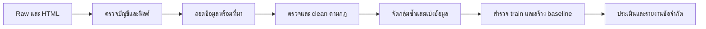

# วิธีทำ ENNXO จาก raw ให้ตรวจสอบและทำซ้ำได้

## เป้าหมายและหน่วยข้อมูล

ทำนาย **ราคาตั้งขายมือถือมือสอง หน่วยบาท** จากข้อมูลสินค้าที่ผู้ใช้ระบุ หนึ่งแถวคือหนึ่งประกาศ ไม่ใช่หนึ่งเครื่องหรือหนึ่งการซื้อขายสำเร็จ ราคาที่ผู้ขายกรอกเป็น target ที่ยังต้องตรวจว่าเป็นราคาเงินสดของโทรศัพท์รายชิ้น

Snapshot เริ่มเก็บ 2026-10-05 เวลา 23:18:33 และจบหน้ารวมเวลา 23:22:46 (Asia/Bangkok) หมวดมือถือ ENNXO มีหลายยี่ห้อ รวม 58 หน้ารวมและ 1,381 ประกาศ ครบตาม pagination ที่เก็บในรอบนั้น ไม่ใช่การรับรองทุกประกาศที่เคยมีบนเว็บไซต์ เก็บทุกวันที่และยังไม่ใช้ cutoff ย้อนหลัง

HTML เป็นหลักฐานต้นทาง `listings.jsonl` และ `ennxo_public_payload.json` เป็นข้อมูลที่โค้ดเดิมถอดจาก HTML จึงต้องตรวจ parser อีกชั้น งานใหม่ไม่ใช้คำตัดสินจาก pipeline เก่า

## ลำดับงานและสิ่งที่ต้องส่งมอบ



| ขั้น | สิ่งที่ทำ | ผลที่ต้องตรวจได้ | สถานะ |
|---|---|---|---|
| 1. ตรวจ raw | ตรวจ hash จำนวน schema ค่าขาด URL และ HTML | รายงาน audit กับบัญชีไฟล์ | ทำแล้ว |
| 2. ถอดข้อมูลใหม่ | อ่านข้อความ/ช่องสินค้าจาก HTML จับคู่ด้วยรหัสประกาศ | ทุกแถวมีค่าเดิมและตำแหน่งหลักฐาน | ทำแล้ว |
| 3. ตรวจและ clean | แปลงรูปแบบตามกฎ ตรวจข้อขัดแย้ง ขอบเขต ราคา และสภาพ | ค่าใหม่ เหตุผล กฎที่ใช้ และรายการที่พัก | รันกฎแล้ว; คิวตรวจยังค้าง |
| 4. จัดกลุ่มและแบ่ง | ตรวจประกาศซ้ำก่อน split กำหนด seed/เวลาและแช่แข็ง test | บัญชี train/validation/test และกลุ่มซ้ำ | ยังไม่ทำ |
| 5. EDA และ baseline | สำรวจ train สร้างตัวทำนายง่ายเพื่อใช้เทียบ | รายงานกลุ่มข้อมูลและคะแนน validation | ยังไม่ทำ |
| 6. ประเมิน | ทดสอบโมเดลที่เลือกกับ test ที่กันไว้ | MAE หน่วยบาท คะแนนแยกกลุ่มและข้อจำกัด | ยังไม่ทำ |

## ขั้นที่ 1 — ทำซ้ำได้อย่างไร

จากรากโปรเจค ใช้ Python 3.10 ขึ้นไปและ dependencies ที่ระบุเวอร์ชัน:

```bash
python3 -m venv .venv
.venv/bin/python -m pip install -r requirements-lock.txt
.venv/bin/python -B script/preparation/ennxo/audit_ennxo_raw.py
.venv/bin/python -B -m unittest discover -s script/tests -t . -p 'test_*.py'
```

ต้องมี raw snapshot ในเครื่อง การติดตั้ง dependencies ต้องใช้อินเทอร์เน็ต แต่สคริปต์ audit อ่านไฟล์ที่มีเท่านั้น ไม่เรียก ENNXO ไม่แก้ raw ไม่เติมค่า และไม่ตัดประกาศออก Output แยกอยู่ที่ `data/intermediate/ennxo/ennxo_20261005T231833_239519_Asia-Bangkok/raw_audit/`

| ไฟล์ผลลัพธ์ | ใช้ทำอะไร |
|---|---|
| `report.md` | สรุปอ่านง่ายสำหรับรายงาน/นำเสนอ |
| `profile.json` | ข้อค้นพบทั้งหมด จำนวนซ้ำ ค่าขาด ช่วงราคา และข้อจำกัด |
| `field_profile.csv` | ตรวจทุกฟิลด์ว่า absent/null/blank และชนิดข้อมูลเป็นอะไร |
| `issues.csv` | แถวที่มีข้อสังเกต พร้อม URL; ไม่ใช่รายการตัดออก |
| `page_accounting.json` | เทียบจำนวนและ URL ใน JSON กับการ์ดใน HTML ทีละหน้า |
| `raw_checksums.json` | SHA-256 ของไฟล์ raw ทุกไฟล์ |
| `run_metadata.json` | เวลา Python/BeautifulSoup/SoupSieve และ hash ของโค้ดที่ใช้ |

เมื่อ raw, โค้ด และ environment เดียวกัน ไฟล์ผลควรเหมือนกันทุก byte ยกเว้น `run_metadata.json` ซึ่งบันทึกเวลาแต่ละรัน ปรับ `--raw <raw-dir>` และ `--output <output-dir>` ได้; path ค่าเริ่มต้นอิงตำแหน่งสคริปต์ ไม่อิง working directory สคริปต์ไม่ยอมเขียนผลทับโฟลเดอร์ raw

ผลตรวจบัญชีผ่านหมายถึง URL/จำนวนในไฟล์ที่เก็บตรงกัน ยังไม่พิสูจน์ว่าเนื้อหา สเปค ราคา และสภาพสินค้าถูกต้อง `model_contains_only_brand` ตรวจชื่อยี่ห้อที่พบในชุดนี้ เป็นสัญญาณคุณภาพ ไม่ใช่การเลือกหรือแก้รุ่น

## ขั้นที่ 2 — ถอดข้อมูลจาก HTML

```bash
.venv/bin/python -B script/preparation/ennxo/extract_ennxo_raw.py
```

อ่าน HTML ใหม่ จับคู่ครบทุกประกาศ เก็บค่าการ์ด ข้อมูลฝัง และ raw เดิมแยกกันพร้อมที่มา ผลอยู่ใน `data/intermediate/ennxo/<รอบ>/extraction/` ยังไม่ clean หรือตัดออก ดู [รายละเอียดและผลที่พบ](extraction.md)

## ขั้นที่ 3 — ตรวจและ clean

```bash
.venv/bin/python -B script/preparation/ennxo/clean_ennxo.py
```

กฎเวอร์ชัน 6 พร้อม ledger และบันทึกตรวจคิว126รายการรันแล้วกับทุกประกาศ ผลแยก accepted/needs_review/excluded และนับกลับได้ครบ 1,381 แถว ดู [กฎ ตัวอย่าง คำแก้ และผลลัพธ์](cleaning.md) คิวที่ยังไม่ยืนยันไม่ถูกนำไปฝึกอัตโนมัติ หลักการที่ใช้มีดังนี้:

- แยกค่าจากการ์ด ช่องสินค้า และรายละเอียด ไม่เขียนทับกัน แต่ละค่าผูกกับ URL/รหัสประกาศและ HTML ที่ตรวจได้
- แปลงหน่วยและชื่อเฉพาะเมื่อมีกฎชัด เช่นตัวพิมพ์/ช่องว่าง ไม่เดารุ่นย่อยหรือความจุจากราคาหรือรุ่นยอดนิยม
- ถ้าค่าขัดกัน ต้องตรวจว่าเป็น parser ผิดหรือผู้ขายให้ข้อมูลขัดกัน ถ้ายืนยันไม่ได้ให้พักพร้อม reason code
- บันทึกเกณฑ์สินค้าที่รับเข้า เช่น มือสองใช้งานปกติ ราคาของโทรศัพท์รายชิ้น และวิธีจัดการของใหม่ บริการ เครื่องเสีย ราคาเงินดาวน์ หรือ bundle
- ความจุที่เป็น RAM/เมมเสริมไม่ใช่ storage; คะแนนสภาพไม่ใช่สุขภาพแบต และคำกล่าวของร้านไม่เท่ากับสภาพเครื่อง
- เก็บรายการตัดออกและเหตุผลไว้เสมอ ต้องนับกลับได้ว่า raw = รับเข้า + ตัดออก + พัก โดยไม่เสีย URL
- ราคาสูง/ต่ำและชื่อเหมือนกันเป็นข้อสังเกต ไม่ตัดออกทันทีด้วยความรู้สึก หากใช้เกณฑ์ outlier ที่เรียนจากข้อมูล ให้เรียนจาก train เท่านั้น

## การแบ่งข้อมูลและวัดโมเดลภายหลัง

ประกาศซ้ำ/ลงใหม่อาจทำให้ train และ test มีเครื่องเดียวกัน ต้องกันทั้งกลุ่มไว้ฝั่งเดียว เก็บ seed และบัญชี URL ของ split ถ้ามีวันที่ประกาศที่เชื่อถือได้และต้องการประเมินการใช้งานในอนาคต ให้พิจารณาทดสอบตามลำดับเวลา พร้อมตรวจกลุ่มซ้ำที่ข้ามช่วง

หลังกัน test ให้ใช้ train/validation เพื่อสำรวจ เลือกฟีเจอร์ และปรับโมเดล Imputer, encoder, scaler และการเรียนรู้เกณฑ์ทางสถิติต้อง fit บน train เท่านั้น หลีกเลี่ยงข้อความที่มีราคาใน input เพราะจะรั่วคำตอบ เริ่มเทียบกับ baseline ราคามัธยฐานจาก train ก่อนวัด MAE เป็นบาท และรายงานขนาดตัวอย่าง/คะแนนแยกรุ่นหรือช่วงราคา

AI ช่วยอธิบายข้อผิดปกติได้ แต่การเปลี่ยนค่าต้องมีกฎหรือหลักฐานที่ตรวจได้ กรณีอ่านรายรายการให้เก็บคำตัดสินและสุ่มตรวจความผิดพลาด แยกจากค่าต้นทาง ไม่ใช้คำตัดสิน AI เป็น ground truth

## ข้อจำกัดและสิ่งที่นำเสนอ

นี่เป็น snapshot ของประกาศบน ENNXO ไม่ใช่ตัวแทนมือถือทั้งหมดของไทย ไม่มีราคาซื้อขายสำเร็จ การอยู่ในประกาศไม่รับรองสถานะพร้อมขายหรือสภาพจริง และภาพ/ข้อความของผู้ขายอาจมีข้อมูลติดต่ออยู่ เก็บ raw ภายในสำหรับตรวจหลักฐาน ไฟล์ raw และผลลัพธ์ต้องสำรองแยกจาก Git

นำเสนอเป้าหมาย → แหล่งข้อมูล/เวลา → ผล audit → กฎ clean → จำนวนก่อน/หลัง → วิธี split → baseline/ผลทดสอบ → ข้อจำกัด ตอนนี้รายงานได้ถึงผล clean ตามกฎและคิวที่ค้าง ยังไม่รายงาน split หรือผลโมเดลเป็นงานสำเร็จ

## แนวทางอ้างอิง

โครงสร้างนี้นำหลักการบันทึกที่มา องค์ประกอบ การเก็บและเตรียมข้อมูลจาก [Datasheets for Datasets](https://www.microsoft.com/en-us/research/publication/datasheets-for-datasets/) มาปรับใช้กับโปรเจค ไม่ได้อ้างว่าเป็นการรับรองมาตรฐาน ดูแนวทางงานวิจัยที่ทำซ้ำได้ใน [Good Enough Practices in Scientific Computing](https://arxiv.org/abs/1609.00037) และการป้องกัน data leakage ใน [เอกสาร scikit-learn](https://scikit-learn.org/stable/common_pitfalls.html)
