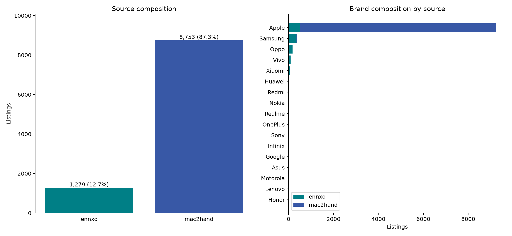
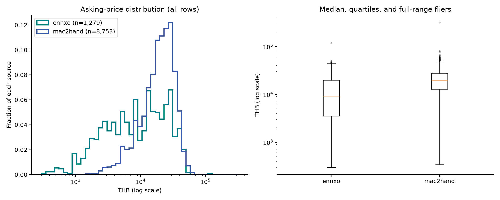
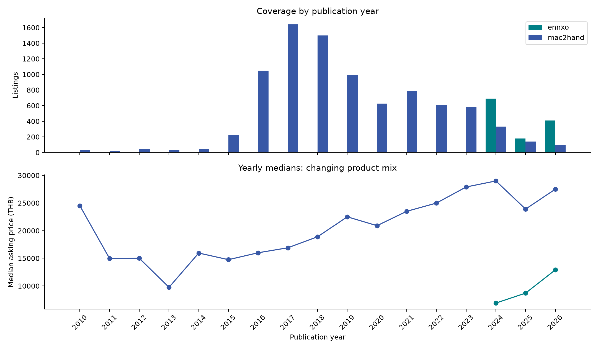
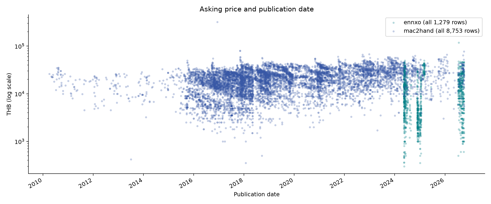
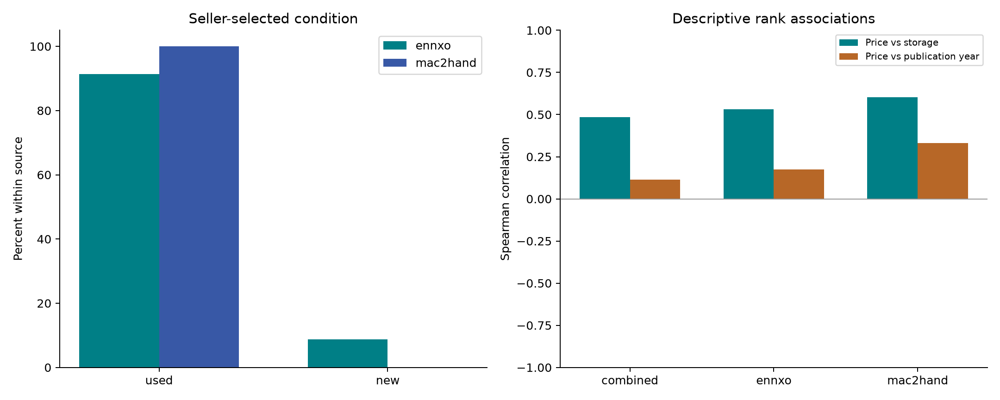

# รายงาน EDA ชุดรวม

สำรวจหลัง clean และรวม schema ก่อนแบ่ง train/test ใช้ทุกแถวใน snapshot ไม่เปลี่ยนข้อมูลต้นทาง

## ข้อมูลและคุณภาพ

ชุดรวม 10,032 แถว คอลัมน์หลักครบและมี source ทุกแถว ราคา median 18,990 บาท (Q1 11,500; Q3 27,000) สำรวจทุกวันที่ ไม่มีการตัดช่วง 12 เดือน

Apple 9,225 แถว (91.96%) มีรุ่น/ยี่ห้อ 308 คู่ โดย 251 คู่มีน้อยกว่า 10 แถว ไม่ควรสรุปประสิทธิภาพรุ่นที่มีตัวอย่างน้อยจากภาพรวม

ข้อมูลก่อนปี 2024 มี 8,184 แถว (81.58%) ช่วงเวลาของสองเว็บต่างกัน จึงไม่เปรียบเทียบ median รวมเป็นผลของเว็บโดยตรง

สภาพ used 9,921 และ new 111 เป็นช่องผู้ขาย ไม่ใช่ผลตรวจเครื่องจริง

| เว็บ | แถว | สัดส่วน (%) | median ราคา (บาท) | วันแรก | วันสุดท้าย |
|---|---|---|---|---|---|
| ennxo | 1279 | 12.75 | 8,980.00 | 2024-05-11 | 2026-10-05 |
| mac2hand | 8753 | 87.25 | 19,900.00 | 2010-04-02 | 2026-10-06 |

## ราคาและ outlier

IQR ภายในเว็บ/รุ่น/ความจุ/สภาพ/ปี ระบุ 205 แถวจากกลุ่มที่ประเมินได้ 7,543 แถว เป็นสัญญาณตรวจ ไม่ใช่ข้อยืนยันว่าราคาผิด

ข้ามกลุ่มเล็ก 2,467 แถว และกลุ่ม IQR=0 22 แถว จึงไม่ควรตีความว่าแถวที่ไม่ถูก flag ทุกแถวได้รับการยืนยัน

ราคาเป็นราคาตั้งขาย ไม่ใช่ราคาปิดการขาย ตรวจราคาที่มีข้อมูลดาวน์/ผ่อนและราคาอาจพิมพ์ผิดจากหลักฐานเดิม แต่ไม่เดาราคาทดแทนเอง

## ความสัมพันธ์และความต่างระหว่างเว็บ

กลุ่มรุ่น/ความจุ/สภาพ/ปีที่มีอย่างน้อย 3 แถวต่อเว็บสำหรับเทียบ median มี 27 กลุ่ม รวม 403 แถว ไม่ใช่การทดลองควบคุมสภาพเครื่องหรือผู้ขาย

| เว็บ | แถว | Spearman ราคา–ความจุ | Spearman ราคา–ปีประกาศ |
|---|---|---|---|
| combined | 10032 | 0.49 | 0.11 |
| ennxo | 1279 | 0.53 | 0.17 |
| mac2hand | 8753 | 0.60 | 0.33 |

Spearman ใช้ average ranks เมื่อค่าซ้ำ ไม่มีการทดสอบนัยสำคัญ ค่าเหล่านี้ปะปนรุ่น/สภาพ/ปี ไม่ใช่ผลเชิงเหตุและผล โดยเฉพาะความจุสูงมักอยู่ในรุ่นใหม่กว่า

## ประกาศที่อาจซ้ำ

candidate จากข้อความมี 280 components รวม 617 แถว หลังรวมกลุ่มที่ซ้อนกัน; สัญญาณภาพซ้ำแยกไว้ เพราะอาจเป็นรูปตัวอย่างร้าน

ตรวจข้อความจาก 10,032 แถว พบกลุ่มข้อความตรงกันข้ามเว็บ 0 กลุ่ม วิธีนี้ไม่ครอบคลุมข้อความที่แก้คำหรือรูปที่ใช้ URL ต่างกัน

จำนวนกลุ่มแยกวิธี: exact_description 261, source_text_candidate 185 กลุ่มระหว่างวิธีซ้อนกันได้ จึงบวกแทนจำนวนเครื่องไม่ได้

ใช้ candidate เดิมของแต่ละเว็บ และข้อความที่ normalize Unicode/case/ช่องว่างตรงกันอย่างน้อย 80 ตัวอักษร พร้อมยี่ห้อ รุ่น ความจุ สภาพและราคาเดียวกัน ไม่ใช้การเหมือนฟีเจอร์อย่างเดียวเป็นหลักฐานเครื่องซ้ำ ไม่รวมภาพซ้ำเข้ากลุ่มข้อความ

## Sensitivity analysis

| กรณีสมมติ | แถว | พักในสมมติฐาน | median ราคา | mean ราคา |
|---|---|---|---|---|
| ทุกแถว | 10032 | 0 | 18,990.00 | 19,930.73 |
| สมมติพักแถวที่ IQR flag | 9827 | 205 | 18,990.00 | 19,895.91 |
| สมมติเก็บ 1 แถวต่อกลุ่มข้อความ | 9695 | 337 | 18,990.00 | 19,940.64 |

เป็นการคำนวณเชิงสมมติเพื่อดูการเปลี่ยนสถิติ ไม่สร้าง dataset ที่ลบแถว ไม่สรุปว่า candidate คือเครื่องซ้ำจริง การจำลองเลือก key แรกใน component ตาม listing_id

## ข้อจำกัดและงานถัดไป

- ตรวจ outlier และตัวอย่างราคาสูงจากข้อความต้นทาง ยืนยันราคาขายเต็มก่อนแก้; ใช้ไฟล์ price_extremes.csv ร่วมด้วย เพราะกลุ่มเล็กหรือ IQR=0 อาจไม่ถูก flag

- ทบทวน candidate ซ้ำก่อนกำหนดกลุ่ม split ไม่ถือว่ารูป/ข้อความเหมือนกันแปลว่าเครื่องเดียวกัน ถ้ายืนยันเป็นเครื่องเดียวให้ใช้ group เดียวทั้ง train/test

- กำหนดเป้าหมายราคาตามวันประกาศหรือราคาปัจจุบันให้ชัด เลือกแผนประเมินตามเวลา และรายงานผลแยกเว็บ/รุ่นที่มีตัวอย่างพอ

- หลังแบ่งข้อมูล ให้เรียนรู้กฎ preprocessing/threshold ที่ใช้ฝึกจาก train เท่านั้น ไม่ใช้ fence จาก EDA ทั้งชุดตัดข้อมูล test

ไม่มี battery health อายุเครื่อง ประวัติซ่อมที่ผ่านการตรวจจริง หรือราคาปิดขายใน schema นี้ การขาดข้อมูลส่วนนี้ไม่ใช่ missing ในช่องที่มี แต่เป็นข้อจำกัดตัวแปรของโครงการ

## กราฟ



สัดส่วนเว็บและยี่ห้อ: จำนวนใน snapshot ไม่ใช่ส่วนแบ่งตลาด



ราคาทุกแถว แกน log เพื่อเห็นทั้งราคาต่ำและสูง จุดนอกกล่องเป็น IQR ภาพรวมต่อเว็บ ต่างจากคิวตรวจที่คุมรุ่น/ปี และยังคงอยู่ใน dataset



ช่วงปีต่างกันมาก เส้น median เปลี่ยนตามรุ่นที่ปะปน ไม่ใช่ราคาของเครื่องรุ่นเดิมลดลงตามเวลา



แสดงทุกประกาศตามวันที่ ไม่มีการจำกัด 12 เดือน และยังไม่ปรับเงินเฟ้อหรือเลือกช่วงฝึก


รุ่นที่พบมากที่สุด; ตารางแนบท้ายเก็บจำนวนทุกรุ่น รวมรุ่นที่มีตัวอย่างน้อย


ความจุปะปนกับรุ่นและปี กลุ่มที่มีตัวอย่างน้อยตีความอย่างระมัดระวัง ไม่ใช่ผลของความจุต่อราคาโดยตรง



new/used เป็นช่องผู้ขาย; correlation รวมไม่ควบคุมรุ่น/สภาพ/อายุ ไม่ใช่เหตุและผล


เทียบรุ่น/ความจุ/สภาพ/ปีเดียวกัน ขั้นต่ำ 3 แถวต่อเว็บ ตัวเลขวงเล็บคือ n ของ ENNXO, Mac2Hand; ยังไม่ควบคุมเดือนหรือสภาพเครื่องจริง

## ไฟล์และวิธีทำซ้ำ

รัน `.venv/bin/python -u -B analysis/eda/run_eda.py` จากรากโปรเจค หรือใช้ absolute path จาก directory อื่น

`summary.json` เก็บสถิติหลัก `tables/*.csv` เก็บทุกรุ่น/ปี/ความจุและวิธีเทียบเว็บ `rules.json` เป็นสำเนากฎ `run_metadata.json` เก็บเวอร์ชันโค้ด dependencies และ input hashes

รายการรายแถวอยู่ใน `data/intermediate/eda/ennxo_20261005_mac2hand_20261006/` ได้แก่ `outlier_candidates.csv`, `duplicate_groups.json`, `duplicate_memberships.csv` และ `validation.json` เก็บเฉพาะเครื่อง; รายงานนี้ไม่เผยแพร่ข้อความ/ข้อมูลติดต่อจากประกาศ

<a id="stage-eda"></a>

## วิธีทำ EDA ชุดรวม

วิเคราะห์ 10,032 แถวจากชุดรวมหลัง clean ทุกวันที่ของ snapshot ไม่มีการเปลี่ยน dataset อ่าน [สรุป EDA](eda.md) หรือ [รายงานละเอียด](eda.md)

### สคริปต์ที่รัน

```bash
.venv/bin/python -u -B script/analysis/eda/run_eda.py
```

ใช้ทั้ง ENNXO และ Mac2Hand อ่าน `dataset.csv`, `dataset.jsonl`, `lineage.jsonl`, `schema.json`, `summary.json`, `run_metadata.json` ของชุดรวม และอ่าน `mac2hand_final.jsonl` เพิ่มสำหรับข้อความที่ไม่มีใน CSV dataset/schema/summary/metadata อยู่ใน `data/intermediate/combined/<รอบ>/before_selection/`; lineage/audit อยู่ใน `data/intermediate/combined/<รอบ>/audit/` และ JSONL ทุกแถว Mac2Hand อยู่ `data/intermediate/mac2hand/<รอบ>/finalization/` ใช้ `--evidence` เลือก lineage directory ตรวจ hash, ชนิดข้อมูล, จำนวน, key และความตรงกันก่อนวิเคราะห์ ตรวจ hash ซ้ำหลังทำงาน

`script/analysis/eda/run_eda.py` เรียก `eda_statistics.py` คำนวณสถิติ และ `eda_plots.py` สร้างกราฟ ค่าเริ่มต้นอิงตำแหน่งไฟล์ รันจาก `/tmp` ด้วย absolute path หรือรันโมดูลจากรากโปรเจคได้

### หลักเกณฑ์

- ตรวจฟิลด์ ค่าขาด source รหัสและ lineage; สำรวจยี่ห้อ รุ่น ความจุ สภาพ ราคาตั้งขายและวันประกาศ
- IQR ใช้ percentile แบบ linear interpolation เทียบภายใน source/brand/model/storage/condition/year กลุ่มอย่างน้อย 10 แถว fence = Q1−1.5IQR และ Q3+1.5IQR กลุ่มเล็ก/IQR=0 ข้ามและบอกจำนวน ไม่ยืนยันว่าแถวที่ไม่ flag ถูกต้องทุกแถว
- เทียบเว็บเฉพาะ brand/model/storage/condition/year ที่มีอย่างน้อย 3 แถวต่อเว็บ ยังมีความต่างเรื่องเดือน สภาพเครื่องจริง และผู้ขาย จึงไม่สรุปเป็นผลของเว็บต่อราคา
- candidate ซ้ำใช้กลุ่มเดิม และข้อความ normalize Unicode/case/ช่องว่างที่ตรงกันยาวอย่างน้อย 80 ตัวอักษร พร้อมยี่ห้อ รุ่น ความจุ สภาพ ราคาเดียวกัน รวมกลุ่มข้อความที่ซ้อนกันเป็น components ภาพซ้ำเป็นสัญญาณแยก ไม่ถือข้อความร้านหรือภาพเดียวเป็นเครื่องเดียวทันที
- Spearman ใช้ average rank สำหรับ ties ไม่ทดสอบนัยสำคัญ ไม่ตีความเชิงเหตุและผล
- sensitivity เป็นสมมติฐานเปรียบเทียบสถิติ ไม่เขียน dataset ที่ลบ outlier/duplicate การเลือก 1 แถวต่อ candidate ไม่ใช่คำตัดสินเครื่องซ้ำ

กฎและ threshold อยู่ใน `config/shared/eda_rules.json` ผล IQR ของ EDA ทั้งชุดไม่ใช้แทน threshold ที่ต้องเรียนรู้จาก train เมื่อเริ่มโมเดล

### ผลที่พบ

ราคา median รวม 18,990 บาท; ENNXO 8,980 และ Mac2Hand 19,900 บาท ความต่างของช่วงปีและรุ่นทำให้ median รวมเทียบเป็นผลเว็บไม่ได้ Apple 9,225 แถว (91.96%) และ 251 จาก 308 คู่ยี่ห้อ–รุ่นมีน้อยกว่า 10 แถว

IQR ประเมินได้ 7,543 แถว ระบุ 205 แถวสำหรับตรวจต่อ ข้ามกลุ่มเล็ก 2,467 และ IQR=0 อีก 22 แถว รวมครบ 10,032 กลุ่มข้อความ candidate หลังรวมการซ้อนกัน 280 components / 617 แถว ยังไม่ยืนยันว่าเครื่องเดียวกัน พบข้อความตรงข้ามเว็บ 0 กลุ่มจากวิธีนี้ ไม่ได้ยืนยันว่าไม่มีประกาศซ้ำข้ามเว็บจริง

ตรวจข้อความครบ 10,032 แถว 9,504 แถวยาวถึง threshold มี 27 กลุ่ม / 403 แถวที่เทียบเว็บตามเกณฑ์ได้ รายละเอียดทุกรุ่น/ปีและผลสมมติฐานอยู่ใน CSV แนบท้ายรายงาน

### โครงสร้างผลและแต่ละไฟล์

รายงานที่เก็บใน Git อยู่ใน `docs/assets/eda/ennxo_20261005_mac2hand_20261006/`

| ไฟล์/โฟลเดอร์ | เก็บอะไร |
|---|---|
| `summary.md` | สรุปสั้น ภาพรวมและประเด็นหลัก |
| `report.md` | รายงานละเอียดพร้อมกราฟและข้อจำกัด |
| `report.html` | รายงานเปิดใน browser กราฟฝังในไฟล์เดียว |
| `figures/*.png`, `*.svg` | กราฟ 8 ชุด export สำหรับอ่าน/นำเสนอ |
| `summary.json` | สถิติหลัก จำนวน candidate และ sensitivity สำหรับใช้งานต่อ |
| `rules.json` | สำเนากฎและ thresholds ที่ใช้ |
| `run_metadata.json` | เวลา dependencies โค้ดและ hash ข้อมูลเข้า |
| `validation.json` | ผลตรวจ input/lineage/จำนวนและการไม่เปลี่ยนข้อมูล |
| `output_hashes.json` | hash ของไฟล์รายงาน กราฟ และตาราง เพื่อเทียบผล/สำรอง |

ตารางใน `tables/` เป็นข้อมูลรวม ไม่มีข้อความติดต่อหรือ URL รายประกาศ

| CSV | เก็บอะไร |
|---|---|
| `source_statistics.csv` | จำนวน สัดส่วน quartile/median/mean ราคาและช่วงวันแต่ละเว็บ |
| `brand_counts.csv`, `model_counts.csv` | จำนวนยี่ห้อ/รุ่น แยกเว็บ |
| `publication_year_counts.csv` | จำนวนตามปีประกาศ แยกเว็บ ไม่ใช่ปริมาณตลาดจริง |
| `storage_counts.csv`, `condition_counts.csv` | จำนวนความจุและช่องสภาพ แยกเว็บ |
| `model_price_statistics.csv` | สถิติราคาตามเว็บ/ยี่ห้อ/รุ่น |
| `model_storage_year_statistics.csv` | สถิติกลุ่มเว็บ/รุ่น/ความจุ/สภาพ/ปี พร้อม n |
| `source_comparisons.csv` | กลุ่มที่เทียบ median ของสองเว็บได้ พร้อม n และเปอร์เซ็นต์ต่าง |
| `correlations.csv` | Spearman รวมและแยกเว็บ |
| `sensitivity.csv` | สถิติกรณีสมมติพัก flags หรือเลือก 1 แถวต่อ candidate |
| `outlier_fences.csv` | ขนาดกลุ่มและ fence ที่ใช้ตรวจ IQR |

คิวตรวจรายแถวเก็บเฉพาะเครื่องใน `data/intermediate/eda/ennxo_20261005_mac2hand_20261006/`

| ไฟล์ | เก็บอะไร |
|---|---|
| `outlier_candidates.csv` | 205 แถว พร้อม URL ราคา peer_n median/fence และงานถัดไป |
| `price_extremes.csv` | 5 ราคาสูงสุดต่อเว็บจากขั้นรวม สำหรับตรวจร่วมกับ IQR |
| `duplicate_groups.json` | ทุกกลุ่ม candidate พร้อมวิธีและ listing_id ที่เกี่ยวข้อง กลุ่มซ้อนกันได้ |
| `duplicate_memberships.csv` | mapping แต่ละแถวเข้ากลุ่ม candidate; listing_id อาจซ้ำเมื่ออยู่หลายกลุ่ม |
| `text_candidate_components.json` | กลุ่มข้อความหลังรวมการซ้อนกัน 280 กลุ่ม / 617 แถว |
| `validation.json` | สำเนาผลตรวจความครบและไม่เปลี่ยน input |

### การตรวจงาน

ผ่าน 121 tests ครอบคลุม percentile/ties, การแยกปีและกลุ่ม, zero IQR, กลุ่มซ้ำซ้อนและภาพ, sensitivity ไม่เปลี่ยนข้อมูล, supplementary text ที่ตรง CSV, การป้องกัน output ทับ input, CSV/JSONL ตรงกัน และการสร้างรายงาน/กราฟแยกจากคิวส่วนตัว ตรวจกราฟด้วยภาพจริงและตรวจรันซ้ำจาก directory อื่น

ขั้นต่อไปคือตรวจ candidate/outlier ตามหลักฐาน แล้วกำหนด split และนโยบายข้อมูลฝึก การทำ EDA รอบนี้ไม่ได้รับรองสภาพเครื่องจริงหรือสร้างโมเดล

นโยบายล่าสุด2026-10-11: ผู้ใช้เลือกตัดสมาชิกคิวEDAทั้งหมด822แถวและหยุดreview ชุดโมเดล9,210แถวอยู่ขั้น [คัดชุดก่อนเทรน](data.md#stage-model_input) รายงานEDAนี้เป็นผลก่อนคัด10,032แถว
