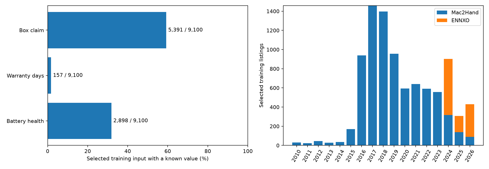

# การวิเคราะห์ข้อมูลเชิงสำรวจ (EDA)

หนึ่งแถวแทนหนึ่งประกาศจาก ENNXO หรือ Mac2Hand ราคาเป็นราคาตั้งขาย หน่วยบาท

## 1. ขอบเขตข้อมูล

ใช้ข้อมูลมือถือมือสองที่ผ่านการทำความสะอาดและคัดเลือกสำหรับฝึก V2 จำนวน **9,100 ประกาศ**

สถิติชุดปัจจุบันคำนวณจากข้อมูลที่ใช้ฝึก V2 สภาพเป็นข้อมูลจากผู้ขาย ไม่ใช่ผลตรวจเครื่องจริง และไม่ใช้เป็นฟีเจอร์ในรอบนี้

## 2. การกระจายชุดข้อมูลปัจจุบัน

| เว็บไซต์ | จำนวนประกาศ | มัธยฐานราคา (บาท) | ช่วงวันประกาศ |
|---|---|---|---|
| ennxo | 1,092 | 7,990 | 2024-05-12 ถึง 2026-10-05 |
| mac2hand | 8,008 | 19,990 | 2010-04-02 ถึง 2026-10-06 |

| ตัวชี้วัด | ชุดฝึก 9,100 แถว |
|---|---:|
| Apple | 8,408 (92.40%) |
| คู่ยี่ห้อ–รุ่น | 281 |
| คู่ยี่ห้อ–รุ่นที่มีน้อยกว่า 10 ประกาศ | 224 |
| ประกาศก่อนปี 2024 | 7,463 (82.01%) |

ราคาชุดฝึก: มัธยฐาน **18,990 บาท**; Q1–Q3 **11,590–27,000 บาท** ข้อมูลกระจุกตัวใน Apple และประกาศเก่า จึงไม่เป็นตัวแทนตลาดปัจจุบันทุกยี่ห้อ

## 3. ความครบถ้วนของข้อมูลประกอบ

| ข้อมูล | มีค่าในชุดฝึก | ไม่ทราบ | ความครอบคลุม (%) | ใช้ในโมเดล |
|---|---|---|---|---|
| สุขภาพแบตเตอรี่ | 2,898 | 6,202 | 31.85 | ใช้ |
| ประกันเหลือ | 157 | 8,943 | 1.73 | ไม่ใช้ |
| กล่อง | 5,391 | 3,709 | 59.24 | ใช้ |

ค่าที่ไม่ทราบคงเป็นค่าขาดหาย แยกจากศูนย์ แบตเตอรี่และกล่องสกัดจากข้อความที่ระบุชัด ประกันไม่ใช้เนื่องจากความครอบคลุมต่ำ ไม่มีข้อมูลรอยตำหนิ ประวัติซ่อม และอายุเครื่องจริงที่ผ่านการตรวจพร้อมฝึก

## 4. ผลสำรวจชุดก่อนคัด 10,032 แถว

กราฟและสถิติในส่วนนี้ใช้ชุดก่อนคัด ไม่ใช่ชุดฝึกปัจจุบัน

| ประเด็น | ผลสำรวจ |
|---|---|
| ราคามัธยฐาน; Q1–Q3 | 18,990; 11,500–27,000 บาท |
| IQR ภายในเว็บ/รุ่น/ความจุ/สภาพ/ปี | ระบุ 205 แถว จาก 7,543 แถวที่ประเมินได้ |
| กลุ่มที่ไม่ประเมิน IQR | กลุ่มเล็ก 2,467 แถว; IQR เป็นศูนย์ 22 แถว |
| กลุ่มข้อความที่อาจซ้ำ | 280 กลุ่ม รวม 617 แถว หลังรวมกลุ่มซ้อนกัน |
| กลุ่มที่เทียบสองเว็บได้ | 27 กลุ่ม รวม 403 แถว; อย่างน้อย 3 แถวต่อเว็บ |
| Spearman ราคา–ความจุ | 0.49 |
| Spearman ราคา–ปีประกาศ | 0.11 |

ค่าผิดปกติและข้อความซ้ำเป็นสัญญาณตรวจสอบ ไม่ยืนยันว่าราคาผิดหรือเป็นเครื่องเดียวกัน การเปรียบเทียบเว็บไซต์และสหสัมพันธ์ไม่แสดงความสัมพันธ์เชิงเหตุและผล

## 5. วิธีวิเคราะห์และข้อจำกัด

ตรวจความตรงกันของข้อมูลและ lineage ก่อนสรุปจำนวน การกระจายราคา IQR ภายในกลุ่ม และข้อความที่อาจซ้ำ ใช้ `script/analysis/eda/run_eda.py`; สถิติชุดปัจจุบันสร้างด้วย `script/analysis/eda/refresh_model_input_eda.py`

- การคัด 822 แถวทำก่อนแบ่งข้อมูลตามเวลา จึงมีความเอนเอียงจากการคัดเลือก ผลโมเดลต้องอ่านเป็นการประเมินย้อนหลัง
- จำนวนรุ่นและช่วงเวลาของสองเว็บไซต์ต่างกัน ความต่างของราคามัธยฐานไม่ใช่ผลของเว็บไซต์เพียงอย่างเดียว เว็บไซต์จึงเก็บเพื่อที่มาและรายงานแยกกลุ่ม
- สภาพเป็นคำระบุของผู้ขาย ไม่มีการตรวจเครื่องจริงหรือราคาปิดการขาย

หลักฐาน: [ความครบถ้วนแยกเว็บไซต์](assets/eda/tables/model_input_optional_coverage.csv) · [จำนวนและวันที่แยกรุ่น](assets/eda/tables/model_input_model_support.csv) · [จำนวนแยกปี](assets/eda/tables/model_input_year_source.csv) · [ข้อมูลกำกับและสถิติเดิม](assets/eda/metadata.json)

อ่านต่อ: [การคัดข้อมูล](data.md#stage-model_input) · [โมเดลและผลประเมิน](modeling.md)
