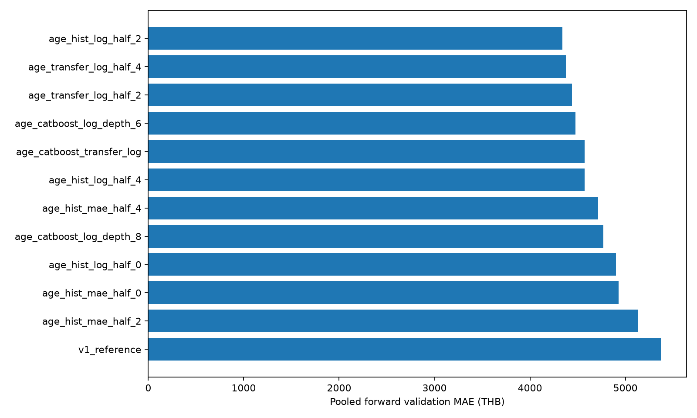
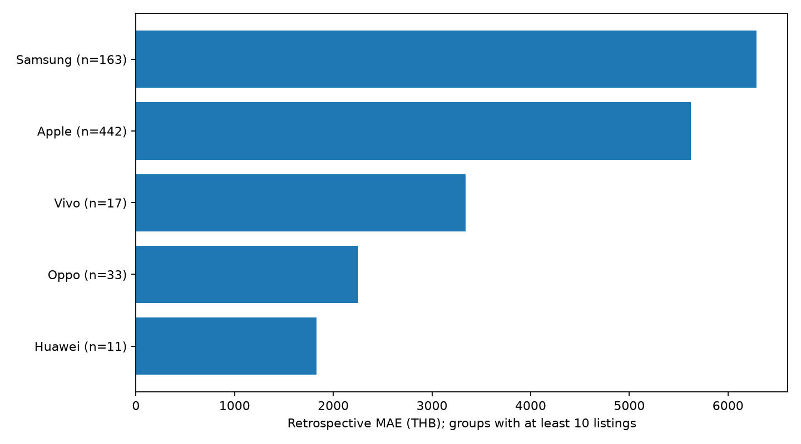
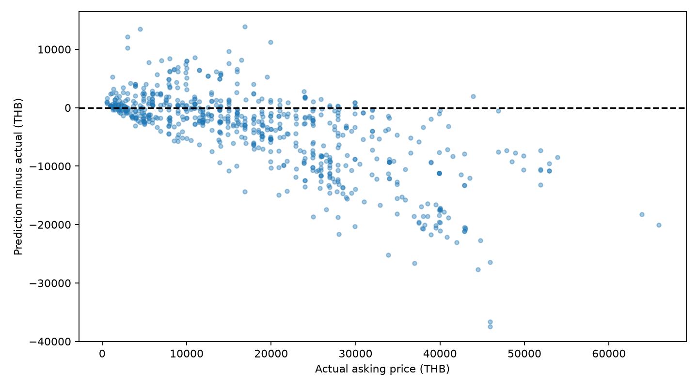
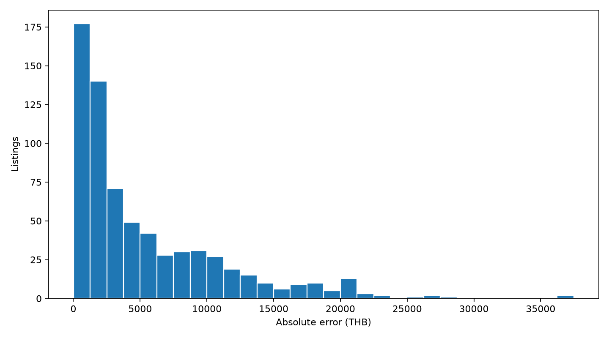

# รายงานโมเดลราคาตั้งขายมือถือ — V2

รายงานหลักเรื่องโมเดล: อ่านวิธีเลือกข้อมูล วิธีเทรน กราฟ ตัววัด ผลแยกกลุ่ม และคำสั่งทำซ้ำได้ในไฟล์นี้ เอกสาร HTML เป็นเนื้อหาเดียวกันสำหรับเปิดใน browser; JSON/CSV เป็นหลักฐานตัวเลข ไม่ใช่คู่มืออีกชุด

## สรุปผลก่อนอ่านรายละเอียด

เลือก **HistGradientBoosting + log(price) + recency half-life 2 ปี** (`age_hist_log_half_2`) จาก 12 ตัวเลือกด้วย validation ตามเวลา 2 ช่วง MAE validation **4,339.41 บาท**

เปรียบเทียบย้อนหลังบน **693 ประกาศเดิม**: MAE ลดจาก **8,107.82** เป็น **5,339.30 บาท** หรือ **34.15%**; R² **0.6192**; ทำนายใน ±20% ของราคาประกาศได้ **40.55%**

**ผลนี้เป็นการประเมินย้อนหลังบนชุดเดิมที่เคยเปิดดูระหว่างพัฒนา ไม่ใช่ holdout ใหม่** โมเดลสำหรับใช้งานฝึกครบ 9,210 แถวและยังไม่มีคะแนนทดสอบอิสระของตัวที่ฝึกครบ

## 1. เลือกข้อมูลอะไรและตัดอะไรออก

หนึ่งแถวคือหนึ่งประกาศ ราคาเป้าหมายคือ **ราคาตั้งขาย หน่วยบาท** ไม่ใช่ราคาปิดการขาย ใช้ทุกวันที่ใน snapshot ไม่มีการจำกัด 12 เดือน

| ขั้น | ENNXO | Mac2Hand | รวม |
|---|---:|---:|---:|
| ประกาศดิบใน snapshot | 1,381 | 10,220 | 11,601 |
| ผ่าน clean ก่อนคัด EDA | 1,279 | 8,753 | 10,032 |
| ชุดใช้สำหรับโมเดลหลังคัด | 1,202 | 8,008 | 9,210 |

Clean ตรวจรุ่น ความจุ ราคา วันที่และขอบเขตสินค้า อิงรายละเอียดที่มีหลักฐาน เก็บ source/product_id/url/lineage ค่าที่ไม่ระบุหรือขัดกันไม่เดา แยกเครื่องเสีย/ล็อกและแถวที่ไม่ผ่านก่อนรวม; ป้ายสภาพ `new` ไม่ทำให้ถูกตัดอย่างเดียวตามนโยบายโครงการ

EDA ระบุคิวจาก IQR, ข้อความ candidate ซ้ำ และรายการราคาสูงสุด ผู้ใช้เลือกตัดสมาชิกคิวทั้งหมด **822 รหัส** โดยนับ union ของเหตุผลที่ซ้อนกัน ไม่ใช่ยืนยันว่าทั้ง 822 แถวผิดทั้งหมด คัดด้วย `script/preparation/shared/select_model_input.py` ตาม `config/shared/model_input_policy.json` คง raw และเหตุผลไว้

`data/final/dataset.csv` มี 13 คอลัมน์ / 9,210 แถว ข้อมูลส่วนใหญ่เป็น Apple และ Mac2Hand; กลุ่มย่อยไม่สมดุล การคัดใช้ EDA ทั้ง snapshot ก่อน split จึงมี selection bias คะแนนอธิบายชุดหลังคัดนี้ ไม่ใช่ประกาศทุกประเภทบนเว็บ

## 2. ใช้ features และจัดการ missing อย่างไร

ใช้ **22 features**:

- หมวดหมู่ 7 ตัว: `source, brand, model, brand_model, model_family, condition, device_tier`
- ตัวเลข/ตัวบ่งชี้ 15 ตัว: `storage_gb, log_storage, model_number, publication_days, publication_year, publication_month, release_year, model_age_years, release_known, battery_health_pct, battery_missing, warranty_days, warranty_missing, box_mentioned, box_missing`

Features หลักคือเว็บ ยี่ห้อ รุ่น ความจุ สภาพและวันประกาศ เพิ่ม family/tier ของรุ่น ปีเปิดตัว iPhone จาก Apple และอายุรุ่น ณ เดือนประกาศโดยประมาณ ไม่ใช่อายุเครื่องจริง Android ที่ไม่มี catalog คงปีเปิดตัว missing

Battery health %, ประกันวันและกล่องถอดจากข้อความด้วยกฎ เฉพาะคำระบุชัดและค่าเดียว ตรวจ listing_id/source/price ตรง lineage ค่าขัดกันหรือไม่ระบุคง missing; กล่องมี/ไม่มีใช้ 1/0 และไม่ทราบเป็น missing แยกจากศูนย์ ไม่ป้อน title/description ทั้งหมดหรือราคาในข้อความให้โมเดล

One-hot encoding ใช้ unknown category ได้ ตัวเลขเติม median จาก train พร้อมคงคอลัมน์ที่ missing ทั้งหมดตาม imputer แล้ว scale จาก train ของ fold เท่านั้น ไม่เขียนค่าที่เติมกลับลง dataset เก็บ optional values ใน `data/final/condition_features.csv` จับคู่ด้วย listing_id ส่วนราคาเป้าหมาย ID และ URL ไม่ใช้เป็น features

## 3. แบ่ง train / validation / evaluation ตามเวลา

เรียงตามวันประกาศและรหัส ไม่สุ่มประกาศเก่ากับใหม่ปนกัน วันเดียวกันอยู่ฝั่งเดียว ป้องกันเรียนรู้ข้อมูลอนาคตใน preprocessing และน้ำหนักข้อมูล

| Fold | Train n | Train ถึง | Validation n | Validation เริ่ม | Validation ถึง |
|---|---|---|---|---|---|
| 1 | 7463 | 2023-12-30 | 364 | 2024-01-02 | 2024-05-21 |
| 2 | 7827 | 2024-05-21 | 690 | 2024-05-22 | 2025-01-07 |


Validation สองช่วงรวม **1,054 แถว** จำนวน train ที่ทับกันระหว่าง folds ไม่ใช่ข้อมูลเพิ่ม เกณฑ์เลือกคือ MAE ของ prediction validation ทั้งสองช่วงรวมตามจำนวนแถวจริง

หลังเลือกวิธีแล้ว ฝึก evaluation artifact **8,517 แถวก่อน 2025-01-09** ประเมินบน **693 แถววันที่ 2025-01-09 ถึง 2026-10-06** cutoff เดียวกับ V1 รอบนี้ไม่ใช้ชุด 693 แถวเลือกพารามิเตอร์ แต่เคยเห็นชุดนี้ในการพัฒนาเดิม จึงเรียกการเปรียบเทียบย้อนหลัง

สุดท้ายฝึก operational artifact แยกด้วย **9,210 แถว** เพื่อเรียนรู้ 300 รุ่นจนถึง 2026-10-06 การฝึกครบทำให้คะแนนย้อนหลังของ evaluation artifact ไม่ใช่คะแนนอิสระของ operational artifact

## 4. เทรนอย่างไร และเลือกตัวไหน

ทดลอง reference V1, HGB target ราคา/log(price), recency half-life เท่ากัน/2/4 ปี, transfer candidates ที่ลดการพึ่งชื่อรุ่น และ CatBoost depth 6/8 ไม่ได้ทำ exhaustive search ทุกพารามิเตอร์

วิธีชนะ: HGB loss `squared_error` บน log(price), `max_iter=400`, `max_leaf_nodes=31`, `learning_rate=0.07`, `l2_regularization=8`, `early_stopping=False`; seed **42**, threads **4** แปลงกลับด้วย exp ก่อนวัด error เป็นบาท ราคาทำนาย floor ที่ 1 บาทตาม inference เดิม

Recency half-life 2 ปี: น้ำหนักก่อน normalize = max(0.01, 2^(−อายุข้อมูลปี/2)) อายุข้อมูลนับจากวันล่าสุดใน train ของ fold แล้ว normalize ให้เฉลี่ย 1 ไม่ลบข้อมูลเก่า ทดลอง CatBoost 800 iterations, learning rate 0.045, RMSE บน log target, fixed iterations และ `has_time=True`

| ตัวเลือก | Validation MAE (บาท) | RMSE (บาท) | fit (วินาที) |
|---|---|---|---|
| age_hist_log_half_2 | 4,339.41 | 6,518.78 | 18.11 |
| age_transfer_log_half_4 | 4,377.55 | 6,633.11 | 7.5 |
| age_transfer_log_half_2 | 4,442.13 | 6,583.16 | 7.94 |
| age_catboost_log_depth_6 | 4,477.19 | 7,009.32 | 11.27 |
| age_catboost_transfer_log | 4,570.96 | 7,175.46 | 8.99 |
| age_hist_log_half_4 | 4,571.61 | 6,798.44 | 17.26 |
| age_hist_mae_half_4 | 4,713.19 | 7,151.32 | 27.72 |
| age_catboost_log_depth_8 | 4,770.10 | 7,341.57 | 21.61 |
| age_hist_log_half_0 | 4,899.77 | 6,896.68 | 16.85 |
| age_hist_mae_half_0 | 4,929.66 | 7,456.31 | 22.14 |
| age_hist_mae_half_2 | 5,134.67 | 7,427.15 | 24.64 |
| v1_reference | 5,372.14 | 7,969.50 | 11.52 |




**อ่านกราฟ:** แท่งสั้นคือ MAE ต่ำกว่า ใช้กราฟนี้และตัวเลข validation เลือกวิธี ไม่เลือกด้วยคะแนนชุดย้อนหลัง ตาราง [fold_metrics.csv](assets/modeling/asking_price_v2/tables/fold_metrics.csv) เก็บผลแต่ละ fold เพื่อดูความเปลี่ยนแปลงตามเวลา

## 5. ใช้ตัววัดสถิติอะไร ได้ค่าเท่าไร

กำหนด y = ราคาประกาศจริง, ŷ = ราคาที่ทำนาย ตัววัดทั้งหมดคำนวณหลังแปลงกลับเป็นบาท บน 693 แถวเดียวกันสำหรับ V1/V2

| ตัววัด | ความหมาย | V1 | V2 |
|---|---|---|---|
| MAE | เฉลี่ย abs(ŷ−y); ยิ่งต่ำยิ่งดี | 8,107.82 บาท | 5,339.30 บาท |
| RMSE | รากของเฉลี่ย (ŷ−y)²; ไวต่อ error ก้อนใหญ่ | 11,774.11 บาท | 7,867.29 บาท |
| Median absolute error | มัธยฐานของ abs(ŷ−y); ครึ่งหนึ่งมี error ไม่เกินค่านี้ | 4,732.28 บาท | 2,909.01 บาท |
| R² | 1−SSE/SST; เทียบกับการทำนายด้วยค่าเฉลี่ยของชุดประเมิน | 0.1470 | 0.6192 |
| MAPE | เฉลี่ย abs(ŷ−y)/y ×100; ราคาต่ำทำให้เปอร์เซ็นต์สูงง่าย | 44.02 % | 33.42 % |
| ภายใน ±20% | สัดส่วนแถวที่ abs(ŷ−y)/y ≤0.20; ยิ่งสูงยิ่งดี | 26.98 % | 40.55 % |
| Bias | เฉลี่ย (ŷ−y); ลบหมายถึงทำนายต่ำโดยเฉลี่ย | -6,177.61 บาท | -3,830.01 บาท |


MAE คือจำนวนบาทที่คลาดเคลื่อนเฉลี่ย RMSE สูงกว่า MAE เพราะให้น้ำหนัก error ใหญ่ Median absolute error บอกผลทั่วไปที่ไม่ถูกบางแถวลากมาก Bias ติดลบหมายถึงมีแนวโน้มทำนายต่ำ R² ไม่ใช่เปอร์เซ็นต์ accuracy และ MAPE ไม่ใช่อัตราผ่าน ±20%

**มี hypothesis test หรือ p-value หรือไม่:** งานนี้ยังไม่ได้ทำ t-test, ANOVA, Wilcoxon หรือทดสอบนัยสำคัญของความต่างโมเดล จึงไม่มี test statistic/p-value และไม่สรุปว่าดีขึ้นอย่างมีนัยสำคัญทางสถิติ MAE/RMSE/R² เป็น evaluation metrics ไม่ใช่ hypothesis tests การมีเพียง 2 folds และการใช้ test เดิมซ้ำไม่เพียงพอให้ตีความ 34.15% ว่าเป็นหลักฐานอิสระของประสิทธิภาพในอนาคต

## 6. ผลแยกเว็บและยี่ห้อ

| เว็บ | n | MAE (บาท) | RMSE (บาท) | R² | ภายใน ±20% |
|---|---|---|---|---|---|
| ennxo | 479 | 6,089.79 | 8,790.50 | 0.4246 | 25.26% |
| mac2hand | 214 | 3,659.47 | 5,241.39 | 0.8335 | 74.77% |


จำนวนและส่วนผสมรุ่นต่างกัน จึงไม่ถือว่าคะแนนเว็บหนึ่งดีกว่าเพราะชื่อเว็บอย่างเดียว กลุ่มเล็กไม่ใช้รับรองความแม่นยำ



**อ่านกราฟ:** แสดงเฉพาะยี่ห้อที่มีอย่างน้อย 10 แถว พร้อม n; แท่งสั้นคือ error น้อย ดู [retrospective_by_group.csv](assets/modeling/asking_price_v2/tables/retrospective_by_group.csv) สำหรับทุกยี่ห้อ ปี สภาพ และรุ่นเคยเห็น/ไม่เคยเห็น กลุ่มน้อยกว่า 10 ยังคงอยู่ในตาราง ไม่ถูกลบจากผลประเมิน

## 7. กราฟวิเคราะห์ error


**อ่านกราฟ:** จุดใกล้เส้นประคือทำนายใกล้ราคาประกาศ จุดใต้เส้นคือทำนายต่ำ จุดเหนือเส้นคือสูง ไม่ได้เทียบกับราคาขายสำเร็จ



**อ่านกราฟ:** residual = ŷ−y เส้นศูนย์คือถูกพอดี จุดต่ำกว่าศูนย์คือทำนายต่ำ ใช้ดูว่าราคาสูงมี error ทางเดียวมากหรือไม่ ไม่ได้ทดสอบว่าข้อสมมติ residual ผ่านทางสถิติ



**อ่านกราฟ:** แกนนอนคือ error เป็นบาท แกนตั้งคือจำนวนประกาศ หางด้านขวาคือกลุ่มที่คลาดเคลื่อนสูง ไม่ใช่ confidence interval ของราคาทำนาย

## 8. ข้อจำกัดและข้อสรุปที่ใช้ได้

V2 ให้ MAE ต่ำกว่า V1 ในการเปรียบเทียบย้อนหลังเดียวกัน แต่มีอคติจากการคัดข้อมูลก่อน split ข้อมูลเว็บ/รุ่น/สภาพไม่สมดุล รุ่นใหม่/Android มีข้อจำกัดและสภาพจากผู้ขายอาจไม่ครบ ไม่มีการยืนยันว่าเป็นเครื่องคนละเครื่องทางกายภาพ

Catalog Apple รวบรวมภายหลัง ใช้ปีเปิดตัวที่ทราบ ณ วันประกาศ ไม่อ้างว่าระบบรู้ข้อมูลรุ่นที่ยังไม่เปิดตัวได้ในอดีต อายุมีความละเอียดระดับปี วันนอกช่วงฝึกหรือค่าที่ไม่ทราบมี coverage flags ซึ่งไม่ใช่ค่าความเชื่อมั่นทางสถิติ

โมเดลพร้อมทดลองประเมิน **ราคาตั้งขายของเครื่องปกติ** ก่อนรับรองประสิทธิภาพจริงควรประเมินชุดใหม่หลัง 2026-10-06 ที่ไม่เคยใช้พัฒนา ไม่อ้างราคาปิดขายหรือความแม่นยำ 100%

## 9. รันอะไร อ่านอะไร และผลเก็บที่ไหน

| สคริปต์ใน script/modeling/ | หน้าที่ / input | output |
|---|---|---|
| `prepare_features_v2.py` | อ่าน core/lineage/full-text และตรวจหลักฐาน ถอด optional claims | enrichment dataset/audit ใน intermediate (ต้องมีหลักฐาน private) |
| `rebuild_features_v2.py` | core + public condition sidecar ตรวจ hashes | enriched CSV byte ตรงรอบจริง ไม่ต้องใช้ raw |
| `features_v2.py` | สร้าง 22 features จากข้อมูลและ frozen catalog | โมดูลประกอบ ไม่รันแยก |
| `train_improved.py` | 2 temporal folds เลือก → evaluation → fit ครบ | artifacts, reports และ predictions รายแถว |
| `report_improved.py` | อ่านผลจริง/ตัวเลขสร้างรายงานนี้และกราฟ | docs/modeling.md, HTML และ figures |
| `predict.py` | ตรวจ checksum โหลด artifact และทำนาย | JSON หน้าจอ หรือ --output |

| ไฟล์/โฟลเดอร์ | เก็บอะไร |
|---|---|
| `data/final/dataset.csv`, `condition_features.csv` | core 9,210 แถวและ optional values รวม Git |
| `config/modeling/improved.json`, `iphone_release_years.json` | candidates, folds, weights, seed, input hashes และ catalog 54 รุ่นจาก Apple |
| `models/asking_price_v2/evaluation.joblib` | fit ก่อน cutoff สำหรับคะแนนย้อนหลัง |
| `models/asking_price_v2/model.joblib`, `metadata.json` | fit ครบสำหรับใช้งาน พร้อม checksum/version/บทบาท |
| `data/intermediate/modeling/asking_price_v2/evaluation/` | actual/prediction/error รายแถวในเครื่อง |
| `docs/modeling.md` | รายงานโมเดลหลักไฟล์เดียว |
| `docs/assets/modeling/asking_price_v2/` | figures PNG/SVG, tables CSV, HTML, config/folds/selection, summary.json, validation และ hashes |

```bash
# หลัง clone: rebuild จาก public core + sidecar แล้วเทรน
.venv/bin/python -B script/modeling/rebuild_features_v2.py
.venv/bin/python -u -B script/modeling/train_improved.py
# ใช้ผลตัวเลือกที่ทำครบต่อเมื่อหยุด และ config/hash เดิม
.venv/bin/python -u -B script/modeling/train_improved.py --resume
# ทำนายด้วย operational artifact
.venv/bin/python -B script/modeling/predict.py --source mac2hand --brand Apple --model 'iPhone 16 Pro' --storage-gb 256 --condition used --published-at 2026-10-06 --battery-health-pct 90
```

Batch ใช้ --input-csv และ --output; รองรับ absolute path จาก directory อื่น Binary/raw/ข้อความต้นทาง/predictions รายแถวไม่ขึ้น Git; code/config/core/sidecar/รายงานผลรวมขึ้น Git ได้ เวลา pipeline ที่บันทึกล่าสุด 121.8 วินาที (resume ไม่รวมเวลาก่อนหยุด) เวลา fit ตัวเลือกที่บันทึกรวม 195.6 วินาที ไม่รวมเขียนโค้ด/เตรียม feature

แหล่งนิยาม: [scikit-learn regression metrics](https://scikit-learn.org/stable/modules/model_evaluation.html#regression-metrics), [HGB](https://scikit-learn.org/stable/modules/generated/sklearn.ensemble.HistGradientBoostingRegressor.html), [Apple iPhone release years](https://support.apple.com/en-us/108044)
