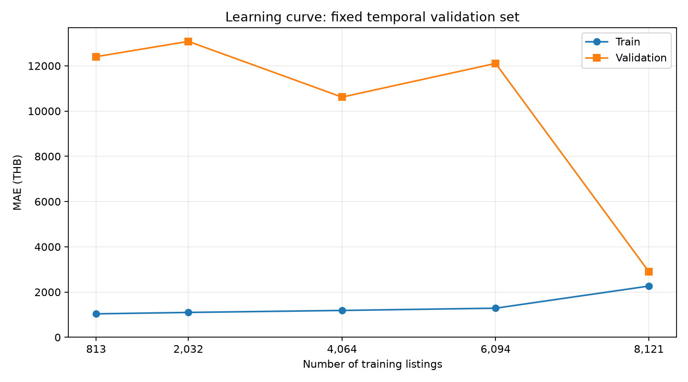

# โมเดลประเมินราคาตั้งขายมือถือมือสอง — V2

ใช้กับเครื่องที่ทำงานปกติ เป้าหมายคือราคาประกาศขาย หน่วยบาท

**ผลประเมินย้อนหลัง 682 ประกาศ:** MAE **3,597.24 บาท** · R² **0.7738** · คลาดเคลื่อนไม่เกิน ±20% **59.09%**

ผลนี้ไม่ใช่ holdout ใหม่ ชุดประเมินเคยใช้ระหว่างพัฒนา โมเดลใช้งานที่ฝึกครบยังไม่มีคะแนนทดสอบอิสระ

## 1. ข้อมูลที่ใช้

ใช้ข้อมูลมือถือมือสอง **9,100 ประกาศ** จาก ENNXO และ Mac2Hand หลังทำความสะอาดและคัดเลือก

สภาพเป็นข้อมูลที่ผู้ขายระบุในตลาดมือสอง ไม่ใช่ผลตรวจเครื่องจริง รายละเอียดการเตรียมข้อมูลอยู่ใน [รายงานข้อมูล](data.md#stage-model_input)

## 2. ฟีเจอร์และการเตรียมข้อมูล

ใช้ **13 ฟีเจอร์**

| กลุ่ม | ฟีเจอร์ |
|---|---|
| หมวดหมู่ | `brand, model, model_family, device_tier` |
| ความจุและวันประกาศ | `storage_gb, publication_days` |
| ปีเปิดตัวและอายุรุ่น | `release_year, model_age_years, release_known` |
| แบตเตอรี่และกล่อง | `battery_health_pct, battery_missing, box_mentioned, box_missing` |

อายุรุ่นคำนวณจากปีเปิดตัว ไม่ใช่อายุเครื่องจริง บัญชีปีเปิดตัวครอบคลุม iPhone; รุ่นที่ไม่มีข้อมูลคงค่าขาดหาย

แบตเตอรี่และกล่องใช้เฉพาะข้อความที่ระบุชัด ค่าที่ไม่ทราบแยกจากศูนย์ HGB ใช้ one-hot encoding และเติมค่าตัวเลขด้วยมัธยฐานจาก train แต่ละช่วง ส่วน CatBoost จัดการหมวดหมู่และค่าตัวเลขขาดหายภายในโมเดล

| ไม่ใช้ | เหตุผล |
|---|---|
| `source` | เว็บไซต์ไม่ใช่คุณสมบัติเครื่อง เก็บไว้ตรวจที่มาและรายงานแยกกลุ่ม |
| `condition` | คงที่ในชุดฝึกรอบนี้ |
| ประกัน | มีค่าเพียง 157 จาก 9,100 แถว |
| ตัวแปรซ้ำและเลขจากชื่อรุ่น | ซ้ำกับข้อมูลเดิมหรือเปรียบเทียบข้ามยี่ห้อไม่ได้ |
| ราคาเป้าหมาย รหัส URL และข้อความเต็ม | ไม่ใช้เป็นตัวแปรทำนาย |

### 2.1 Correlation matrix ของฟีเจอร์ตัวเลขและราคา

ใช้ **Pearson correlation** ของฟีเจอร์ตัวเลขที่โมเดลเลือกไว้ 9 ตัวร่วมกับ `price_thb` หน่วยบาท บนชุดฝึกโมเดลประเมิน **8,418 แถวก่อน 2025-01-09** ซึ่งรวม validation เดิมหลังเลือกโมเดลแล้ว แต่ไม่รวมชุดประเมินย้อนหลัง 682 แถว ไม่แปลงราคาเป็น log และไม่ใส่รหัสแทนฟีเจอร์หมวดหมู่ เช่น brand/model

ค่า r อยู่ระหว่าง −1 ถึง +1: ค่าบวกหมายถึงมีแนวโน้มเพิ่มไปด้วยกัน ค่าลบหมายถึงมีแนวโน้มสวนทางกัน ส่วนค่าใกล้ศูนย์หมายถึงความสัมพันธ์เชิงเส้นน้อย คำนวณแต่ละคู่จากแถวที่มีค่าทั้งสองตัวโดย **ไม่เติมค่าขาดหาย** จึงใช้จำนวนข้อมูลไม่เท่ากัน `N/A` หมายถึงคำนวณไม่ได้เพราะข้อมูลคู่ไม่พอหรือมีตัวแปรคงที่ในคู่ที่ใช้ ไม่ใช่ค่า correlation เท่ากับศูนย์

| ฟีเจอร์ | Pearson r กับราคา | จำนวนคู่ข้อมูล |
|---|---|---|
| storage_gb | 0.495 | 8,418 |
| publication_days | 0.148 | 8,418 |
| release_year | 0.645 | 7,976 |
| model_age_years | -0.768 | 7,976 |
| release_known | 0.243 | 8,418 |
| battery_health_pct | 0.419 | 2,527 |
| battery_missing | -0.173 | 8,418 |
| box_mentioned | 0.100 | 5,135 |
| box_missing | -0.268 | 8,418 |

ค่าในกราฟเป็นความสัมพันธ์รวม ไม่ได้ควบคุมรุ่น ยี่ห้อ หรือช่วงเวลา จึงไม่ใช่เหตุและผลหรือ feature importance ของโมเดล และค่า r ต่ำไม่ได้แปลว่าไม่มีประโยชน์ต่อโมเดลต้นไม้ ตัวแปรปีเปิดตัว อายุรุ่น และวันประกาศสัมพันธ์กันจากวิธีคำนวณ ขณะที่ตัวแปร missing บางคู่คงที่เมื่อเลือกเฉพาะแถวที่มีข้อมูล จึงเกิด N/A ได้

หลักฐาน: [ค่า correlation](assets/modeling/tables/correlation_matrix.csv) · [จำนวนข้อมูลของแต่ละคู่](assets/modeling/tables/correlation_pair_counts.csv)

## 3. การแบ่งข้อมูลตามเวลา

ใช้ expanding-window validation **5 ช่วง ช่วงละ 75 วันเท่ากัน** กำหนดช่วงต่อเนื่องย้อนจากวันเริ่มประเมินย้อนหลัง 2025-01-09 รวม 375 วัน โดยไม่ใช้ราคาเลือกขอบเขต Train ใช้ข้อมูลก่อนแต่ละช่วงและขยายตามเวลา ประกาศวันเดียวกันอยู่ฝั่งเดียวกัน

| ช่วง | Train | Train ถึง | Validation | เริ่ม | ถึง | วัน |
|---|---|---|---|---|---|---|
| 1 | 7,463 | 2023-12-30 | 91 | 2023-12-31 | 2024-03-14 | 75 |
| 2 | 7,554 | 2024-03-10 | 275 | 2024-03-15 | 2024-05-28 | 75 |
| 3 | 7,829 | 2024-05-28 | 216 | 2024-05-29 | 2024-08-11 | 75 |
| 4 | 8,045 | 2024-08-08 | 76 | 2024-08-12 | 2024-10-25 | 75 |
| 5 | 8,121 | 2024-10-24 | 297 | 2024-10-26 | 2025-01-08 | 75 |

จำนวนประกาศแต่ละช่วงต่างกันตามข้อมูลที่เกิดขึ้นจริง แม้ระยะเวลาเท่ากัน Validation รวม **955 แถว** เลือกน้ำหนักด้วย MAE ของผลทำนายรวมทุกแถว ไม่เฉลี่ยคะแนนแต่ละช่วงเท่ากัน

| ขั้นตอนหลังเลือกน้ำหนัก | ข้อมูล |
|---|---|
| ฝึกโมเดลประเมินย้อนหลัง | **8,418 แถวก่อน 2025-01-09** รวม train และ validation |
| ประเมินย้อนหลัง | **682 แถววันที่ 2025-01-09 ถึง 2026-10-06** |
| ฝึกโมเดลใช้งาน | **9,100 แถว** ครอบคลุม 281 รุ่น |

การฝึกใหม่ใช้ข้อมูลก่อนวันตัดครบหลังเลือกน้ำหนักแล้ว ส่วนโมเดลใช้งานรวมข้อมูลล่าสุดด้วย คะแนนย้อนหลังจึงเป็นของโมเดลประเมิน ไม่ใช่คะแนนทดสอบโมเดลที่ฝึกครบ

## 4. วิธีฝึกและเลือกน้ำหนัก

ใช้ gradient boosting สองแบบ: HGB แบ่งค่าตัวเลขเป็นช่วงเพื่อสร้างต้นไม้ และ CatBoost รองรับตัวแปรหมวดหมู่โดยตรง ทั้งสองเรียนรู้จาก log ราคา แล้วแปลงกลับเป็นบาทก่อนเฉลี่ย

| การตั้งค่า | HGB | CatBoost |
|---|---|---|
| จำนวนรอบ | 400 | 800 |
| Learning rate | 0.07 | 0.045 |
| ความซับซ้อนต้นไม้ | สูงสุด 31 ใบ | depth 6 |
| การตั้งค่าเพิ่มเติม | L2 = 8; ไม่ใช้ early stopping | `has_time=True` |

ให้น้ำหนักข้อมูลล่าสุดมากกว่า โดยน้ำหนักลดครึ่งหนึ่งทุก 2 ปี อ้างอิงวันล่าสุดใน train ของแต่ละช่วง; seed = 42

กำหนดฟีเจอร์และพารามิเตอร์หลักก่อนประเมิน ใช้ validation เลือกเฉพาะสัดส่วนผสม 3 แบบ ไม่ได้ค้นหาพารามิเตอร์ทุกค่า ตัวเปรียบเทียบ V1, source และประกันอยู่ใน [ผลทดลองทั้งหมด](assets/modeling/tables/validation_comparison.csv)

| สัดส่วน HGB : CatBoost | Validation MAE (บาท) | RMSE (บาท) |
|---|---|---|
| 50 : 50 | 3,829.66 | 5,986.92 |
| 75 : 25 | 3,849.51 | 6,069.31 |
| 25 : 75 | 3,896.20 | 6,102.92 |

เลือก **HGB 50% + CatBoost 50%** จาก MAE รวมบน validation 5 ช่วง

## 5. ผลประเมินย้อนหลัง

เปรียบเทียบ V1 reference ที่ฝึกใหม่กับ V2 บนข้อมูลและวันตัดเดียวกัน จำนวน 682 ประกาศ

| ตัวชี้วัด | V1 reference | V2 |
|---|---|---|
| MAE (บาท) | 7,709.22 | 3,597.24 |
| RMSE (บาท) | 11,182.84 | 6,038.96 |
| R² | 0.2244 | 0.7738 |
| ภายใน ±20% | 26.25% | 59.09% |

MAE ลดลง **53.34%**; R² ไม่ใช่ร้อยละความแม่นยำ ไม่มีการทดสอบนัยสำคัญทางสถิติ

### 5.1 Learning curve

ใช้ชุด train และ validation ของช่วงเวลาล่าสุดที่มีอยู่เดิมเพียงช่วงเดียว: training **8,121 แถว** ก่อนวันที่ **2024-10-26** และ validation **297 แถว** ช่วง **2024-10-26 ถึง 2025-01-08** เลือกช่วงล่าสุดตามลำดับเวลา

ฝึกโมเดลใหม่ **5 ครั้ง** ด้วยข้อมูล training ขนาด **10%, 25%, 50%, 75%, 100%** ใช้วิธี พารามิเตอร์ ฟีเจอร์ และสัดส่วน HGB/CatBoost เดิมทุกครั้ง แต่ละขนาดใช้ข้อมูลเรียงจากเก่าไปใหม่และรวมวันตัดให้ครบวัน จึงอาจมีจำนวนแถวเกินสัดส่วนที่ระบุเล็กน้อย การเตรียมข้อมูลและน้ำหนักความใหม่เรียนรู้จาก training ที่ใช้ในครั้งนั้นเท่านั้น

ประเมินแต่ละโมเดลบน training ที่ใช้ฝึกและ **validation ชุดเดิมทุกขนาด** แกน X คือ **จำนวนข้อมูลฝึกจริง (แถว)** แกน Y คือ **MAE หน่วยบาท** ยิ่งต่ำยิ่งดี คำนวณหลังแปลง log ราคากลับและผสมโมเดลแล้ว โดยไม่ถ่วงน้ำหนักตอนวัด error **gap = validation error − training error** จุด 100% ตรวจตรงกับผลเดิมของช่วงนี้

| Training | จำนวนฝึก (แถว) | Train MAE (บาท) | Validation MAE (บาท) | MAE gap (บาท) |
|---|---|---|---|---|
| 10% | 813 | 1,037.31 | 12,404.67 | 11,367.36 |
| 25% | 2,032 | 1,099.48 | 13,080.70 | 11,981.22 |
| 50% | 4,064 | 1,187.67 | 10,617.58 | 9,429.90 |
| 75% | 6,094 | 1,286.78 | 12,107.32 | 10,820.54 |
| 100% | 8,121 | 2,264.67 | 2,897.38 | 632.70 |

เมื่อเพิ่ม training จาก 10% เป็น 100% validation MAE เปลี่ยนจาก **12,404.67** เป็น **2,897.38 บาท** และช่องว่าง train/validation เปลี่ยนจาก **11,367.36** เป็น **632.70 บาท** ใช้ดูแนวโน้มเมื่อเพิ่มข้อมูลและความห่างของ error ทั้งสองชุด

Training error วัดบนข้อมูลที่โมเดลเคยเรียน กราฟเปลี่ยนทั้งจำนวนและช่วงเวลาของ training พร้อมกัน จึงยังแยกผลของจำนวนข้อมูลออกจากการเปลี่ยนแปลงราคาและรุ่นตามเวลาไม่ได้ Validation นี้เคยใช้เลือกสัดส่วนโมเดลแล้ว กราฟจึงใช้วิเคราะห์พฤติกรรมของโมเดลที่เลือก ไม่ใช่ผลทดสอบอิสระ และไม่ใช้ชุดประเมินย้อนหลังในการสร้างกราฟ

หลักฐาน: [ผลทั้ง 5 ขนาด รวม MAE/RMSE](assets/modeling/tables/learning_curve.csv)

## 6. ผลแยกเว็บไซต์และความครอบคลุมรุ่น

| เว็บไซต์ | จำนวน | MAE (บาท) | ภายใน ±20% |
|---|---|---|---|
| ennxo | 468 | 4,135.57 | 47.01% |
| mac2hand | 214 | 2,419.97 | 85.51% |

| รุ่นในชุดประเมิน | จำนวน | MAE (บาท) | ภายใน ±20% |
|---|---|---|---|
| เคยอยู่ในชุดฝึก | 443 | 2,163.35 | 67.49% |
| ไม่เคยอยู่ในชุดฝึก | 239 | 6,255.04 | 43.51% |

เว็บไซต์และรุ่นมีส่วนผสมข้อมูลต่างกัน จึงไม่ตีความความต่างของคะแนนเป็นผลจากเว็บไซต์โดยตรง ดู [ผลแยก Android และ iOS](#7-ผลการประเมินแยก-android-และ-ios)

## 7. ผลการประเมินแยก Android และ iOS

| กลุ่ม | จำนวน | MAE (บาท) | RMSE (บาท) | R² | ภายใน ±20% |
|---|---|---|---|---|---|
| iOS (iPhone) | 432 | 2,623.01 | 3,552.85 | 0.9144 | 77.55% |
| Android (อนุมาน) | 239 | 5,445.43 | 8,998.86 | 0.1827 | 26.78% |
| ยังไม่ยืนยัน OS | 11 | 1,701.80 | 2,425.77 | 0.5765 | 36.36% |

อนุมานกลุ่มจากยี่ห้อและรุ่น เนื่องจากไม่มีข้อมูล OS ที่ตรวจยืนยัน กลุ่มยังไม่ยืนยัน OS ได้แก่ Huawei

ชุดฝึกโมเดลประเมินมี Apple 7,976/8,418 แถว (94.75%) และข้อมูลปีเปิดตัวมีเฉพาะ iPhone ผล Android ต่ำกว่าจึงอาจเกี่ยวข้องกับข้อมูลที่น้อยและความครอบคลุมรุ่นที่ต่างกัน ยังไม่พิสูจน์สาเหตุ ควรเพิ่มข้อมูล Android โดยเฉพาะรุ่นใหม่และประเมินช่วงเวลาใหม่

## 8. ข้อจำกัด

- การคัด 822 แถวอาศัย EDA ก่อนแบ่งข้อมูล จึงมีความเอนเอียงจากการคัดเลือก และไม่ยืนยันว่าทุกแถวที่ตัดเป็นข้อมูลผิด
- ชุดประเมินย้อนหลังเคยใช้ระหว่างพัฒนา จึงยังสรุปว่าไม่มี overfitting หรือรับรองผลในอนาคตไม่ได้ ต้องประเมินข้อมูลใหม่ที่ไม่เคยใช้พัฒนา
- ข้อมูลเก่าและ Apple มีสัดส่วนสูง รุ่นที่ไม่เคยพบให้ความคลาดเคลื่อนมากกว่า ผลรวมไม่รับรองทุกรุ่น
- ไม่มีราคาปิดขาย สภาพที่ตรวจจริง ประวัติซ่อม หรืออายุเครื่องจริง โมเดลไม่รองรับเครื่องเสียหรือล็อก

## 9. สคริปต์และหลักฐาน

| รายการ | หน้าที่ |
|---|---|
| `script/modeling/model_v2/rebuild_features_v2.py` | สร้างข้อมูลฟีเจอร์จากข้อมูลต้นทางและ sidecar |
| `script/modeling/model_v2/train_improved.py` | แบ่งเวลา เลือกน้ำหนัก ฝึกโมเดลประเมินและโมเดลใช้งาน |
| `script/modeling/model_v2/learning_curve.py` | ฝึกใหม่ 5 ขนาดบนชุด train ของช่วงล่าสุด ใช้ validation ชุดเดิมทุกขนาด |
| `script/modeling/model_v2/correlation_matrix.py` | คำนวณ Pearson correlation ของฟีเจอร์ตัวเลขและราคาจากชุดฝึกก่อนประเมินย้อนหลัง |
| `config/modeling/current.json` | พารามิเตอร์ วันตัด และตัวเลือกที่ทดลอง |
| `models/asking_price_v2/evaluation.joblib` | โมเดลสำหรับผลประเมินย้อนหลัง |
| `models/asking_price_v2/model.joblib` | โมเดลใช้งานที่ฝึกครบ |

หลักฐาน: [ผลแต่ละช่วง](assets/modeling/tables/fold_metrics.csv) · [ผลแยกกลุ่ม](assets/modeling/tables/retrospective_by_group.csv) · [ข้อมูลกำกับ](assets/modeling/metadata.json) · [โครงสร้างโครงการ](project.md)

## 10. ประวัติการพัฒนาโมเดล

| เวอร์ชัน | บทบาท |
|---|---|
| V1 | โมเดลพื้นฐาน; หลักฐานใน `docs/assets/modeling/history.zip` |
| V2 | โมเดลใช้งานปัจจุบัน HGB + CatBoost จำนวน 13 ฟีเจอร์ |

การทดลองฟีเจอร์และน้ำหนักโมเดลเป็นการพัฒนาภายใน V2
