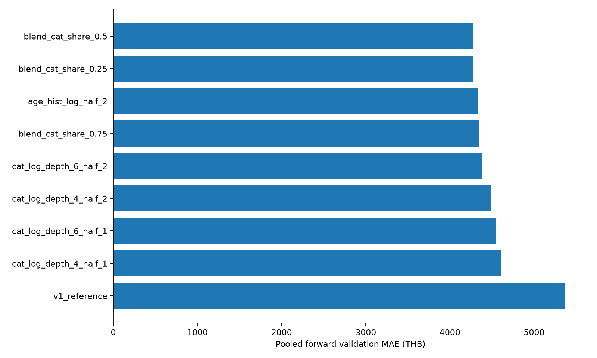
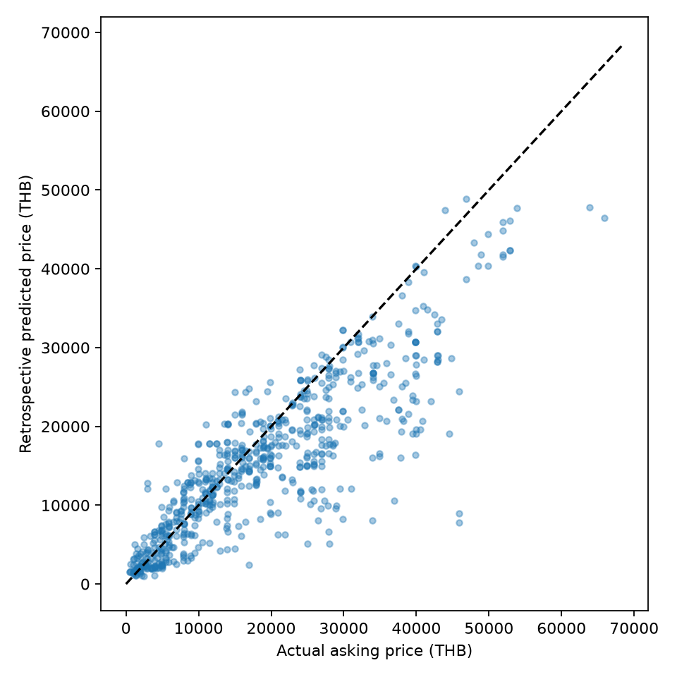
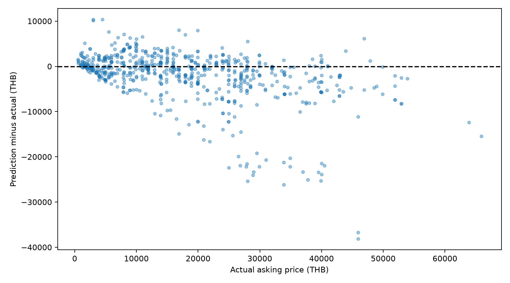
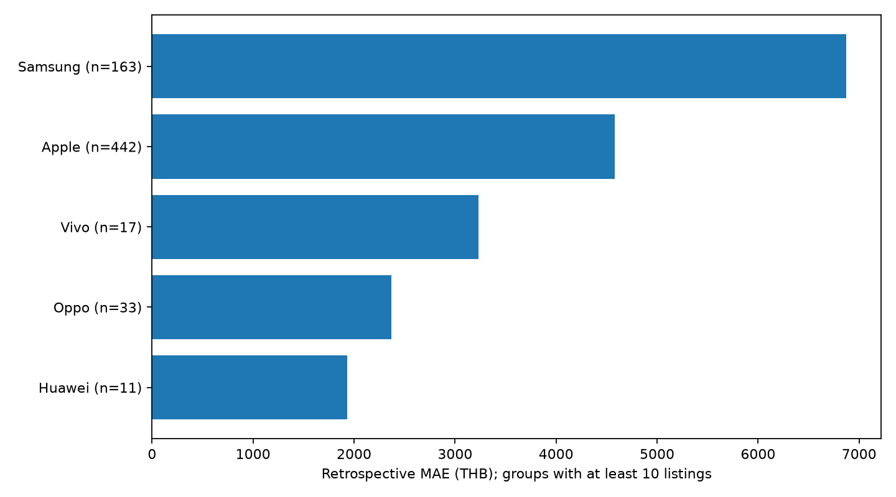

# โมเดลประเมินราคาตั้งขายมือถือมือสอง — V2

ใช้กับเครื่องที่ทำงานปกติ เป้าหมายคือราคาประกาศขาย หน่วยบาท

**ผลประเมินย้อนหลัง 682 ประกาศ:** MAE **3,597.24 บาท** · R² **0.7738** · คลาดเคลื่อนไม่เกิน ±20% **59.09%**

ผลนี้ไม่ใช่ holdout ใหม่ ชุดประเมินเคยใช้ระหว่างพัฒนา โมเดลใช้งานที่ฝึกครบยังไม่มีคะแนนทดสอบอิสระ

## 1. ข้อมูลที่ใช้

ใช้ข้อมูลมือถือมือสอง **9,100 ประกาศ** จาก ENNXO และ Mac2Hand หลังทำความสะอาดและคัดเลือก

สภาพเป็นข้อมูลที่ผู้ขายระบุในตลาดมือสอง ไม่ใช่ผลตรวจเครื่องจริง รายละเอียดการเตรียมข้อมูลอยู่ใน [รายงานข้อมูล](data.md#stage-model_input)

## 2. ฟีเจอร์และการเตรียมข้อมูล

ใช้ **13 ฟีเจอร์**

| กลุ่ม | ฟีเจอร์ |
|---|---|
| หมวดหมู่ | `brand, model, model_family, device_tier` |
| ความจุและวันประกาศ | `storage_gb, publication_days` |
| ปีเปิดตัวและอายุรุ่น | `release_year, model_age_years, release_known` |
| แบตเตอรี่และกล่อง | `battery_health_pct, battery_missing, box_mentioned, box_missing` |

อายุรุ่นคำนวณจากปีเปิดตัว ไม่ใช่อายุเครื่องจริง บัญชีปีเปิดตัวครอบคลุม iPhone; รุ่นที่ไม่มีข้อมูลคงค่าขาดหาย

แบตเตอรี่และกล่องใช้เฉพาะข้อความที่ระบุชัด ค่าที่ไม่ทราบแยกจากศูนย์ HGB ใช้ one-hot encoding และเติมค่าตัวเลขด้วยมัธยฐานจาก train แต่ละช่วง ส่วน CatBoost จัดการหมวดหมู่และค่าตัวเลขขาดหายภายในโมเดล

| ไม่ใช้ | เหตุผล |
|---|---|
| `source` | เว็บไซต์ไม่ใช่คุณสมบัติเครื่อง เก็บไว้ตรวจที่มาและรายงานแยกกลุ่ม |
| `condition` | คงที่ในชุดฝึกรอบนี้ |
| ประกัน | มีค่าเพียง 157 จาก 9,100 แถว |
| ตัวแปรซ้ำและเลขจากชื่อรุ่น | ซ้ำกับข้อมูลเดิมหรือเปรียบเทียบข้ามยี่ห้อไม่ได้ |
| ราคาเป้าหมาย รหัส URL และข้อความเต็ม | ไม่ใช้เป็นตัวแปรทำนาย |

## 3. การแบ่งข้อมูลตามเวลา

เรียงตามวันประกาศ โดยวันเดียวกันอยู่ฝั่งเดียวกัน ใช้ expanding-window validation ให้ train มาก่อน validation

| ช่วง | Train | Train ถึง | Validation | เริ่ม | ถึง |
|---|---|---|---|---|---|
| 1 | 7,463 | 2023-12-30 | 270 | 2024-01-02 | 2024-05-21 |
| 2 | 7,733 | 2024-05-21 | 685 | 2024-05-22 | 2025-01-07 |

Validation รวม **955 แถว** เลือกน้ำหนักด้วย MAE ของผลทำนายรวมทุกแถว ไม่เฉลี่ยคะแนนแต่ละช่วงเท่ากัน

| ขั้นตอนหลังเลือกน้ำหนัก | ข้อมูล |
|---|---|
| ฝึกโมเดลประเมินย้อนหลัง | **8,418 แถวก่อน 2025-01-09** รวม train และ validation |
| ประเมินย้อนหลัง | **682 แถววันที่ 2025-01-09 ถึง 2026-10-06** |
| ฝึกโมเดลใช้งาน | **9,100 แถว** ครอบคลุม 281 รุ่น |

การฝึกใหม่ใช้ข้อมูลก่อนวันตัดครบหลังเลือกน้ำหนักแล้ว ส่วนโมเดลใช้งานรวมข้อมูลล่าสุดด้วย คะแนนย้อนหลังจึงเป็นของโมเดลประเมิน ไม่ใช่คะแนนทดสอบโมเดลที่ฝึกครบ

## 4. วิธีฝึกและเลือกน้ำหนัก

ใช้ gradient boosting สองแบบ: HGB แบ่งค่าตัวเลขเป็นช่วงเพื่อสร้างต้นไม้ และ CatBoost รองรับตัวแปรหมวดหมู่โดยตรง ทั้งสองเรียนรู้จาก log ราคา แล้วแปลงกลับเป็นบาทก่อนเฉลี่ย

| การตั้งค่า | HGB | CatBoost |
|---|---|---|
| จำนวนรอบ | 400 | 800 |
| Learning rate | 0.07 | 0.045 |
| ความซับซ้อนต้นไม้ | สูงสุด 31 ใบ | depth 6 |
| การตั้งค่าเพิ่มเติม | L2 = 8; ไม่ใช้ early stopping | `has_time=True` |

ให้น้ำหนักข้อมูลล่าสุดมากกว่า โดยน้ำหนักลดครึ่งหนึ่งทุก 2 ปี อ้างอิงวันล่าสุดใน train ของแต่ละช่วง; seed = 42

กำหนดฟีเจอร์และพารามิเตอร์หลักก่อนประเมิน ใช้ validation เลือกเฉพาะสัดส่วนผสม 3 แบบ ไม่ได้ค้นหาพารามิเตอร์ทุกค่า ตัวเปรียบเทียบ V1, source และประกันอยู่ใน [ผลทดลองทั้งหมด](assets/modeling/tables/validation_comparison.csv)

| สัดส่วน HGB : CatBoost | Validation MAE (บาท) | RMSE (บาท) |
|---|---|---|
| 50 : 50 | 3,698.34 | 6,034.70 |
| 75 : 25 | 3,753.40 | 6,073.86 |
| 25 : 75 | 3,799.88 | 6,194.78 |

เลือก **HGB 50% + CatBoost 50%** ใช้ validation 2 ช่วงเป็นแผนหลัก ผลทดลอง 5 ช่วงเป็นหลักฐานประกอบใน [รายงานเปรียบเทียบ](../.local/experiments/v2_fold_comparison/comparison.md) โดยทั้งสองแผนเลือกน้ำหนักเดียวกัน การใช้ 5 ช่วงลด MAE รวมเพียง 0.89% แต่ RMSE สูงขึ้น จึงคงแผน 2 ช่วง

## 5. ผลประเมินย้อนหลัง

เปรียบเทียบ V1 reference ที่ฝึกใหม่กับ V2 บนข้อมูลและวันตัดเดียวกัน จำนวน 682 ประกาศ

| ตัวชี้วัด | V1 reference | V2 |
|---|---|---|
| MAE (บาท) | 7,709.22 | 3,597.24 |
| RMSE (บาท) | 11,182.84 | 6,038.96 |
| R² | 0.2244 | 0.7738 |
| ภายใน ±20% | 26.25% | 59.09% |

MAE ลดลง **53.34%**; R² ไม่ใช่ร้อยละความแม่นยำ ไม่มีการทดสอบนัยสำคัญทางสถิติ

## 6. ผลแยกเว็บไซต์และความครอบคลุมรุ่น

| เว็บไซต์ | จำนวน | MAE (บาท) | ภายใน ±20% |
|---|---|---|---|
| ennxo | 468 | 4,135.57 | 47.01% |
| mac2hand | 214 | 2,419.97 | 85.51% |

| รุ่นในชุดประเมิน | จำนวน | MAE (บาท) | ภายใน ±20% |
|---|---|---|---|
| เคยอยู่ในชุดฝึก | 443 | 2,163.35 | 67.49% |
| ไม่เคยอยู่ในชุดฝึก | 239 | 6,255.04 | 43.51% |

เว็บไซต์และรุ่นมีส่วนผสมข้อมูลต่างกัน จึงไม่ตีความความต่างของคะแนนเป็นผลจากเว็บไซต์โดยตรง ดู [ผลแยก Android และ iOS](#7-ผลการประเมินแยก-android-และ-ios)

## 7. ผลการประเมินแยก Android และ iOS

| กลุ่ม | จำนวน | MAE (บาท) | RMSE (บาท) | R² | ภายใน ±20% |
|---|---|---|---|---|---|
| iOS (iPhone) | 432 | 2,623.01 | 3,552.85 | 0.9144 | 77.55% |
| Android (อนุมาน) | 239 | 5,445.43 | 8,998.86 | 0.1827 | 26.78% |
| ยังไม่ยืนยัน OS | 11 | 1,701.80 | 2,425.77 | 0.5765 | 36.36% |

อนุมานกลุ่มจากยี่ห้อและรุ่น เนื่องจากไม่มีข้อมูล OS ที่ตรวจยืนยัน กลุ่มยังไม่ยืนยัน OS ได้แก่ Huawei

ชุดฝึกโมเดลประเมินมี Apple 7,976/8,418 แถว (94.75%) และข้อมูลปีเปิดตัวมีเฉพาะ iPhone ผล Android ต่ำกว่าจึงอาจเกี่ยวข้องกับข้อมูลที่น้อยและความครอบคลุมรุ่นที่ต่างกัน ยังไม่พิสูจน์สาเหตุ ควรเพิ่มข้อมูล Android โดยเฉพาะรุ่นใหม่และประเมินช่วงเวลาใหม่

## 8. ข้อจำกัด

- การคัด 822 แถวอาศัย EDA ก่อนแบ่งข้อมูล จึงมีความเอนเอียงจากการคัดเลือก และไม่ยืนยันว่าทุกแถวที่ตัดเป็นข้อมูลผิด
- ชุดประเมินย้อนหลังเคยใช้ระหว่างพัฒนา จึงยังสรุปว่าไม่มี overfitting หรือรับรองผลในอนาคตไม่ได้ ต้องประเมินข้อมูลใหม่ที่ไม่เคยใช้พัฒนา
- ข้อมูลเก่าและ Apple มีสัดส่วนสูง รุ่นที่ไม่เคยพบให้ความคลาดเคลื่อนมากกว่า ผลรวมไม่รับรองทุกรุ่น
- ไม่มีราคาปิดขาย สภาพที่ตรวจจริง ประวัติซ่อม หรืออายุเครื่องจริง โมเดลไม่รองรับเครื่องเสียหรือล็อก

## 9. สคริปต์และหลักฐาน

| รายการ | หน้าที่ |
|---|---|
| `script/modeling/model_v2/rebuild_features_v2.py` | สร้างข้อมูลฟีเจอร์จากข้อมูลต้นทางและ sidecar |
| `script/modeling/model_v2/train_improved.py` | แบ่งเวลา เลือกน้ำหนัก ฝึกโมเดลประเมินและโมเดลใช้งาน |
| `config/modeling/current.json` | พารามิเตอร์ วันตัด และตัวเลือกที่ทดลอง |
| `models/asking_price_v2/evaluation.joblib` | โมเดลสำหรับผลประเมินย้อนหลัง |
| `models/asking_price_v2/model.joblib` | โมเดลใช้งานที่ฝึกครบ |

หลักฐาน: [ผลแต่ละช่วง](assets/modeling/tables/fold_metrics.csv) · [ผลแยกกลุ่ม](assets/modeling/tables/retrospective_by_group.csv) · [ข้อมูลกำกับ](assets/modeling/metadata.json) · [โครงสร้างโครงการ](project.md)

## 10. ประวัติการพัฒนาโมเดล

| เวอร์ชัน | บทบาท |
|---|---|
| V1 | โมเดลพื้นฐาน; หลักฐานใน `docs/assets/modeling/history.zip` |
| V2 | โมเดลใช้งานปัจจุบัน HGB + CatBoost จำนวน 13 ฟีเจอร์ |

การทดลองฟีเจอร์และจำนวนช่วง validation เป็นการพัฒนาภายใน V2
