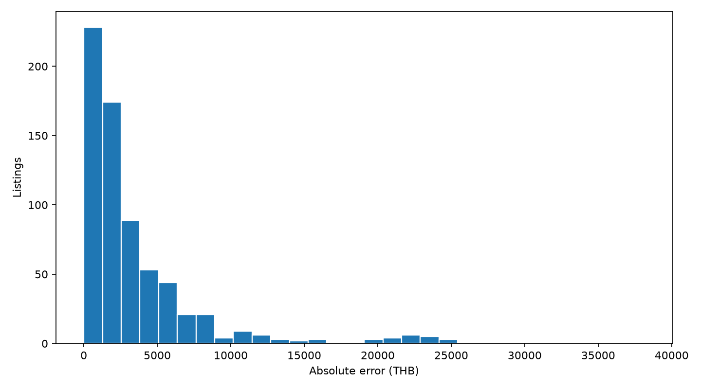

# รายงานโมเดลราคาตั้งขายมือถือ — V2

รายงานหลักเรื่องโมเดล: อ่านวิธีเลือกข้อมูล วิธีเทรน กราฟ ตัววัด ผลแยกกลุ่ม และหลักฐานประกอบได้ในไฟล์นี้ เอกสาร HTML เป็นเนื้อหาเดียวกันสำหรับเปิดใน browser; JSON/CSV เป็นหลักฐานตัวเลข ไม่ใช่คู่มืออีกชุด

## สรุปผลการประเมิน

เลือก **HGB / CatBoost weighted ensemble + price (THB)** (`blend_cat_share_0.5`) จาก 9 ตัวเลือกด้วย validation ตามเวลา 2 ช่วง MAE validation **4,277.71 บาท**

เปรียบเทียบย้อนหลังบน **693 ประกาศเดิม**: MAE ลดจาก **8,107.82** เป็น **4,811.09 บาท** หรือ **40.66%**; R² **0.6780**; ทำนายใน ±20% ของราคาประกาศได้ **43.72%**

เทียบกับโมเดลที่ใช้งานก่อนรอบนี้ บนประกาศย้อนหลังชุดเดียวกัน:

| ตัววัด | ก่อนปรับ | รอบนี้ |
|---|---|---|
| MAE (บาท) | 5,339.30 | 4,811.09 |
| RMSE (บาท) | 7,867.29 | 7,234.01 |
| R² | 0.6192 | 0.6780 |


**ผลนี้เป็นการประเมินย้อนหลังบนชุดเดิมที่เคยเปิดดูระหว่างพัฒนา ไม่ใช่ holdout ใหม่** โมเดลสำหรับใช้งานฝึกครบ 9,210 แถวและยังไม่มีคะแนนทดสอบอิสระของตัวที่ฝึกครบ

อ่าน [ผลประเมินแยก Android และ iOS](#7-ผลการประเมินแยก-android-และ-ios) จาก **test เดิม 693 ประกาศ** ในหัวข้อ 7

## 1. ข้อมูลที่เลือกใช้และข้อมูลที่ตัดออก

หนึ่งแถวคือหนึ่งประกาศ ราคาเป้าหมายคือ **ราคาตั้งขาย หน่วยบาท** ไม่ใช่ราคาปิดการขาย ใช้ทุกวันที่ใน snapshot ไม่มีการจำกัด 12 เดือน

| ขั้น | ENNXO | Mac2Hand | รวม |
|---|---:|---:|---:|
| ประกาศดิบใน snapshot | 1,381 | 10,220 | 11,601 |
| ผ่าน clean ก่อนคัด EDA | 1,279 | 8,753 | 10,032 |
| ชุดใช้สำหรับโมเดลหลังคัด | 1,202 | 8,008 | 9,210 |

Clean ตรวจรุ่น ความจุ ราคา วันที่และขอบเขตสินค้า อิงรายละเอียดที่มีหลักฐาน เก็บ source/product_id/url/lineage ค่าที่ไม่ระบุหรือขัดกันไม่เดา แยกเครื่องเสีย/ล็อกและแถวที่ไม่ผ่านก่อนรวม; ป้ายสภาพ `new` ไม่ทำให้ถูกตัดอย่างเดียวตามนโยบายโครงการ

EDA ระบุคิวจาก IQR, ข้อความ candidate ซ้ำ และรายการราคาสูงสุด ผู้ใช้เลือกตัดสมาชิกคิวทั้งหมด **822 รหัส** โดยนับ union ของเหตุผลที่ซ้อนกัน ไม่ใช่ยืนยันว่าทั้ง 822 แถวผิดทั้งหมด คัดด้วย `script/preparation/shared/select_model_input.py` ตาม `config/shared/model_input_policy.json` คง raw และเหตุผลไว้

`data/final/dataset.csv` มี 13 คอลัมน์ / 9,210 แถว ข้อมูลส่วนใหญ่เป็น Apple และ Mac2Hand; กลุ่มย่อยไม่สมดุล การคัดใช้ EDA ทั้ง snapshot ก่อน split จึงมี selection bias คะแนนอธิบายชุดหลังคัดนี้ ไม่ใช่ประกาศทุกประเภทบนเว็บ

## 2. ตัวแปรที่ใช้และการจัดการค่าขาดหาย

ใช้ **22 features**:

- หมวดหมู่ 7 ตัว: `source, brand, model, brand_model, model_family, condition, device_tier`
- ตัวเลข/ตัวบ่งชี้ 15 ตัว: `storage_gb, log_storage, model_number, publication_days, publication_year, publication_month, release_year, model_age_years, release_known, battery_health_pct, battery_missing, warranty_days, warranty_missing, box_mentioned, box_missing`

Features หลักคือเว็บ ยี่ห้อ รุ่น ความจุ สภาพและวันประกาศ เพิ่ม family/tier ของรุ่น ปีเปิดตัว iPhone จาก Apple และอายุรุ่น ณ เดือนประกาศโดยประมาณ ไม่ใช่อายุเครื่องจริง Android ที่ไม่มี catalog คงปีเปิดตัว missing

Battery health %, ประกันวันและกล่องถอดจากข้อความด้วยกฎ เฉพาะคำระบุชัดและค่าเดียว ตรวจ listing_id/source/price ตรง lineage ค่าขัดกันหรือไม่ระบุคง missing; กล่องมี/ไม่มีใช้ 1/0 และไม่ทราบเป็น missing แยกจากศูนย์ ไม่ป้อน title/description ทั้งหมดหรือราคาในข้อความให้โมเดล

ฝั่ง HGB ใช้ one-hot encoding ที่รับ unknown category ได้ ตัวเลขเติม median และ scale จาก train ของ fold เท่านั้น ส่วน CatBoost ใช้ categorical features และ numeric missing ตาม native behavior ไม่ใช้ target encoding จาก validation ไม่เขียนค่าที่เติมกลับลง dataset เก็บ optional values ใน `data/final/condition_features.csv` จับคู่ด้วย listing_id ส่วนราคาเป้าหมาย ID และ URL ไม่ใช้เป็น features

## 3. การแบ่งข้อมูลตามเวลา

เรียงตามวันประกาศและรหัส ไม่สุ่มประกาศเก่ากับใหม่ปนกัน วันเดียวกันอยู่ฝั่งเดียว ป้องกันเรียนรู้ข้อมูลอนาคตใน preprocessing และน้ำหนักข้อมูล

| Fold | Train n | Train ถึง | Validation n | Validation เริ่ม | Validation ถึง |
|---|---|---|---|---|---|
| 1 | 7463 | 2023-12-30 | 364 | 2024-01-02 | 2024-05-21 |
| 2 | 7827 | 2024-05-21 | 690 | 2024-05-22 | 2025-01-07 |


Validation สองช่วงรวม **1,054 แถว** จำนวน train ที่ทับกันระหว่าง folds ไม่ใช่ข้อมูลเพิ่ม เกณฑ์เลือกคือ MAE ของ prediction validation ทั้งสองช่วงรวมตามจำนวนแถวจริง

หลังเลือกวิธีแล้ว ฝึก evaluation artifact **8,517 แถวก่อน 2025-01-09** ประเมินบน **693 แถววันที่ 2025-01-09 ถึง 2026-10-06** cutoff เดียวกับ V1 รอบนี้ไม่ใช้ชุด 693 แถวเลือกพารามิเตอร์ แต่เคยเห็นชุดนี้ในการพัฒนาเดิม จึงเรียกการเปรียบเทียบย้อนหลัง

สุดท้ายฝึก operational artifact แยกด้วย **9,210 แถว** เพื่อเรียนรู้ 300 รุ่นจนถึง 2026-10-06 การฝึกครบทำให้คะแนนย้อนหลังของ evaluation artifact ไม่ใช่คะแนนอิสระของ operational artifact

## 4. กระบวนการฝึกและการเลือกโมเดล

ทดลอง 9 ตัวเลือกตาม frozen config มี reference V1 และโมเดลที่ใช้ก่อนปรับ รวมถึงการปรับ loss, ความซับซ้อน และแนวโน้มราคา ไม่ได้ทำ exhaustive search ทุกพารามิเตอร์ ทุกตัวใช้ folds และแถวเดียวกัน

วิธีชนะ: **HGB / CatBoost weighted ensemble + price (THB)**; seed **42**, threads **4** พารามิเตอร์ตัวเลือกที่ชนะ:

```json
{
  "name": "blend_cat_share_0.5",
  "kind": "blend",
  "components": [
    {
      "name": "age_hist_log_half_2",
      "kind": "hist",
      "log_target": true,
      "loss": "squared_error",
      "half_life": 2
    },
    {
      "name": "age_catboost_log_depth_6",
      "kind": "catboost",
      "depth": 6,
      "log_target": true,
      "half_life": 2
    }
  ],
  "blend_weights": [
    0.5,
    0.5
  ],
  "half_life": 2
}
```

ตัวเลือก log target แปลงกลับด้วย exp ก่อนวัด error เป็นบาท ราคาทำนาย floor ที่ 1 บาทตาม inference เดิม HGB ไม่ใช้ early stopping ส่วน CatBoost ใช้ fixed iterations และ `has_time=True`

Recency half-life ของวิธีชนะ **2 ปี**: ถ้าเป็นศูนย์ให้น้ำหนักเท่ากัน ถ้ามากกว่าศูนย์ใช้ max(0.01, 2^(−อายุข้อมูลปี/half-life)) อายุข้อมูลนับจากวันล่าสุดใน train ของ fold แล้ว normalize ให้เฉลี่ย 1 ไม่ลบข้อมูลเก่า

Ensemble ฝึกสมาชิกแยกกันบน log ราคา แล้วเฉลี่ยราคาที่แปลงกลับเป็นบาทด้วยสัดส่วนที่กำหนดไว้ก่อน scoring; HGB default: 400 iterations, 31 leaves, learning rate 0.07, l2=8; CatBoost default: 800 iterations, depth 6, learning rate 0.045, RMSE บน log target สมาชิกได้รับ sample weights ชุดเดียวกัน ไม่มี stacking ที่เรียนจาก test

ตัวเลือก trend ใช้ Ridge บน log ราคา เพิ่ม interaction รุ่น/ระดับเครื่องกับอายุ และยี่ห้อกับปีประกาศ เติม missing/encode/scale จาก train เท่านั้น แล้วทดลอง HGB เรียนรู้ residual โดยไม่อ่านราคา validation เป็น feature

| ตัวเลือก | Validation MAE (บาท) | RMSE (บาท) | fit (วินาที) |
|---|---|---|---|
| blend_cat_share_0.5 | 4,277.71 | 6,586.75 | 43.73 |
| blend_cat_share_0.25 | 4,281.49 | 6,506.39 | 39.97 |
| age_hist_log_half_2 | 4,339.41 | 6,518.78 | 75.32 |
| blend_cat_share_0.75 | 4,342.08 | 6,756.56 | 59.5 |
| cat_log_depth_6_half_2 | 4,380.89 | 6,935.75 | 33.29 |
| cat_log_depth_4_half_2 | 4,490.36 | 6,821.56 | 32.33 |
| cat_log_depth_6_half_1 | 4,543.18 | 6,993.23 | 38.8 |
| cat_log_depth_4_half_1 | 4,610.48 | 6,914.70 | 45.44 |
| v1_reference | 5,372.14 | 7,969.50 | 57.01 |


**อ่านกราฟ:** แท่งสั้นคือ MAE ต่ำกว่า ใช้กราฟนี้และตัวเลข validation เลือกวิธี ไม่เลือกด้วยคะแนนชุดย้อนหลัง ตาราง [fold_metrics.csv](assets/modeling/tables/fold_metrics.csv) เก็บผลแต่ละ fold เพื่อดูความเปลี่ยนแปลงตามเวลา

## 5. ตัวชี้วัดและผลการประเมิน

กำหนด y = ราคาประกาศจริง, ŷ = ราคาที่ทำนาย ตัววัดทั้งหมดคำนวณหลังแปลงกลับเป็นบาท บน 693 แถวเดียวกันสำหรับ V1/V2

| ตัววัด | ความหมาย | V1 | V2 |
|---|---|---|---|
| MAE | เฉลี่ย abs(ŷ−y); ยิ่งต่ำยิ่งดี | 8,107.82 บาท | 4,811.09 บาท |
| RMSE | รากของเฉลี่ย (ŷ−y)²; ไวต่อ error ก้อนใหญ่ | 11,774.11 บาท | 7,234.01 บาท |
| Median absolute error | มัธยฐานของ abs(ŷ−y); ครึ่งหนึ่งมี error ไม่เกินค่านี้ | 4,732.28 บาท | 2,676.36 บาท |
| R² | 1−SSE/SST; เทียบกับการทำนายด้วยค่าเฉลี่ยของชุดประเมิน | 0.1470 | 0.6780 |
| MAPE | เฉลี่ย abs(ŷ−y)/y ×100; ราคาต่ำทำให้เปอร์เซ็นต์สูงง่าย | 44.02 % | 31.20 % |
| ภายใน ±20% | สัดส่วนแถวที่ abs(ŷ−y)/y ≤0.20; ยิ่งสูงยิ่งดี | 26.98 % | 43.72 % |
| Bias | เฉลี่ย (ŷ−y); ลบหมายถึงทำนายต่ำโดยเฉลี่ย | -6,177.61 บาท | -3,251.33 บาท |


MAE คือจำนวนบาทที่คลาดเคลื่อนเฉลี่ย RMSE สูงกว่า MAE เพราะให้น้ำหนัก error ใหญ่ Median absolute error บอกผลทั่วไปที่ไม่ถูกบางแถวลากมาก Bias ติดลบหมายถึงมีแนวโน้มทำนายต่ำ R² ไม่ใช่เปอร์เซ็นต์ accuracy และ MAPE ไม่ใช่อัตราผ่าน ±20%

**มี hypothesis test หรือ p-value หรือไม่:** งานนี้ยังไม่ได้ทำ t-test, ANOVA, Wilcoxon หรือทดสอบนัยสำคัญของความต่างโมเดล จึงไม่มี test statistic/p-value และไม่สรุปว่าดีขึ้นอย่างมีนัยสำคัญทางสถิติ MAE/RMSE/R² เป็น evaluation metrics ไม่ใช่ hypothesis tests การมีเพียง 2 folds และการใช้ test เดิมซ้ำไม่เพียงพอให้ตีความเปอร์เซ็นต์การปรับปรุงว่าเป็นหลักฐานอิสระของประสิทธิภาพในอนาคต

## 6. ผลการประเมินแยกเว็บไซต์และยี่ห้อ

| เว็บ | n | MAE (บาท) | RMSE (บาท) | R² | ภายใน ±20% |
|---|---|---|---|---|---|
| ennxo | 479 | 5,623.05 | 8,195.31 | 0.4999 | 27.14% |
| mac2hand | 214 | 2,993.66 | 4,373.99 | 0.8841 | 80.84% |


| รุ่นในชุดประเมิน | n | MAE (บาท) | ภายใน ±20% |
|---|---|---|---|
| เคยอยู่ในชุดฝึก | 455 | 3,246.90 | 54.29% |
| ไม่เคยอยู่ในชุดฝึก | 238 | 7,801.45 | 23.53% |


Apple ในชุดฝึก 93.80% เทียบกับ 63.78% ในชุดประเมิน มี 238 แถวที่เป็นรุ่นไม่เคยอยู่ในชุดฝึก แสดงว่าข้อมูลต่างช่วงมีส่วนผสมต่างกัน

จำนวนและส่วนผสมรุ่นต่างกัน จึงไม่ถือว่าคะแนนเว็บหนึ่งดีกว่าเพราะชื่อเว็บอย่างเดียว กลุ่มเล็กไม่ใช้รับรองความแม่นยำ


**อ่านกราฟ:** แสดงเฉพาะยี่ห้อที่มีอย่างน้อย 10 แถว พร้อม n; แท่งสั้นคือ error น้อย ดู [retrospective_by_group.csv](assets/modeling/tables/retrospective_by_group.csv) สำหรับทุกยี่ห้อ ปี สภาพ และรุ่นเคยเห็น/ไม่เคยเห็น กลุ่มน้อยกว่า 10 ยังคงอยู่ในตาราง ไม่ถูกลบจากผลประเมิน


## 7. ผลการประเมินแยก Android และ iOS

| ตัววัด | iOS (iPhone) | Android (อนุมาน) | ยังไม่ยืนยัน OS |
|---|---|---|---|
| จำนวนประกาศ | 442 | 240 | 11 |
| MAE (บาท) | 4,583.66 | 5,361.96 | 1,930.68 |
| RMSE (บาท) | 6,492.90 | 8,547.14 | 2,995.64 |
| Median absolute error (บาท) | 2,750.02 | 2,515.53 | 587.28 |
| R² | 0.7145 | 0.2664 | 0.3542 |
| MAPE | 20.99% | 50.21% | 26.23% |
| ทำนายใน ±20% | 56.11% | 20.83% | 45.45% |
| Bias (บาท) | -3,475.22 | -2,904.42 | -1,823.90 |

ใช้ราคาจริงและผลทำนายของ evaluation artifact บน 693 ประกาศย้อนหลังชุดเดิม ไม่ฝึกโมเดลแยกหรือเปลี่ยนพารามิเตอร์เพื่อคำนวณตารางนี้ Dataset ไม่มีฟิลด์ OS จริง จึงจัด Apple ที่ระบุรุ่น iPhone เป็น iOS และยี่ห้อ Android ตาม allowlist ที่บันทึกไว้ กลุ่มที่ยืนยันไม่ได้แยกไว้ครบ

กลุ่มยังไม่ยืนยัน OS มี 11 แถว ได้แก่ Huawei จึงไม่รวมเป็น Android อัตโนมัติ ตารางนี้ไม่ยืนยัน OS ที่ติดตั้งจริงหรือการดัดแปลงเครื่อง

**อ่านผล:** iOS มี MAE 4,583.66 บาท และ R² 0.7145 ส่วน Android มี MAE 5,361.96 บาท และ R² 0.2664; ทำนายใน ±20% ได้ 56.11% และ 20.83% ตามลำดับ ดูทั้งความคลาดเคลื่อนเป็นบาทและสัดส่วนราคา Bias ติดลบหมายถึงแนวโน้มทำนายต่ำ

**ข้อมูลฝึก:** evaluation artifact มี Apple 7,989 จาก 8,517 แถว (93.80%) ส่วน catalog อายุรุ่นมีเฉพาะ iPhone จึงมีทั้งความไม่สมดุลของข้อมูลและความต่างของข้อมูลประกอบ

**ข้อจำกัด:** รุ่น ช่วงราคา และช่วงเวลาของแต่ละกลุ่มต่างกัน R² เทียบกับค่าเฉลี่ยภายในกลุ่ม และไม่ใช่เปอร์เซ็นต์ accuracy ผลนี้ไม่พิสูจน์ว่า OS เป็นสาเหตุของความแม่นยำ ไม่ได้ทดสอบนัยสำคัญทางสถิติ และยังไม่ใช่คะแนน holdout ใหม่ ควรเพิ่มข้อมูล Android และประเมินช่วงเวลาใหม่ก่อนรับรองผลแยกแพลตฟอร์ม

## 8. กราฟวิเคราะห์ความคลาดเคลื่อน


**อ่านกราฟ:** จุดใกล้เส้นประคือทำนายใกล้ราคาประกาศ จุดใต้เส้นคือทำนายต่ำ จุดเหนือเส้นคือสูง ไม่ได้เทียบกับราคาขายสำเร็จ


**อ่านกราฟ:** residual = ŷ−y เส้นศูนย์คือถูกพอดี จุดต่ำกว่าศูนย์คือทำนายต่ำ ใช้ดูว่าราคาสูงมี error ทางเดียวมากหรือไม่ ไม่ได้ทดสอบว่าข้อสมมติ residual ผ่านทางสถิติ



**อ่านกราฟ:** แกนนอนคือ error เป็นบาท แกนตั้งคือจำนวนประกาศ หางด้านขวาคือกลุ่มที่คลาดเคลื่อนสูง ไม่ใช่ confidence interval ของราคาทำนาย

## 9. ข้อจำกัดและขอบเขตการสรุปผล

V2 ให้ MAE ต่ำกว่า V1 ในการเปรียบเทียบย้อนหลังเดียวกัน แต่มีอคติจากการคัดข้อมูลก่อน split ข้อมูลเว็บ/รุ่น/สภาพไม่สมดุล รุ่นใหม่/Android มีข้อจำกัดและสภาพจากผู้ขายอาจไม่ครบ ไม่มีการยืนยันว่าเป็นเครื่องคนละเครื่องทางกายภาพ

Catalog Apple รวบรวมภายหลัง ใช้ปีเปิดตัวที่ทราบ ณ วันประกาศ ไม่อ้างว่าระบบรู้ข้อมูลรุ่นที่ยังไม่เปิดตัวได้ในอดีต อายุมีความละเอียดระดับปี วันนอกช่วงฝึกหรือค่าที่ไม่ทราบมี coverage flags ซึ่งไม่ใช่ค่าความเชื่อมั่นทางสถิติ

โมเดลพร้อมทดลองประเมิน **ราคาตั้งขายของเครื่องปกติ** ก่อนรับรองประสิทธิภาพจริงควรประเมินชุดใหม่หลัง 2026-10-06 ที่ไม่เคยใช้พัฒนา ไม่อ้างราคาปิดขายหรือความแม่นยำ 100%

## 10. เครื่องมือ ข้อมูลเข้า และผลลัพธ์

| สคริปต์ใน script/modeling/ | หน้าที่ / input | output |
|---|---|---|
| `model_v2/prepare_features_v2.py` | อ่าน core/lineage/full-text และตรวจหลักฐาน ถอด optional claims | enrichment dataset/audit ใน intermediate (ต้องมีหลักฐาน private) |
| `model_v2/rebuild_features_v2.py` | core + public condition sidecar ตรวจ hashes | enriched CSV byte ตรงรอบจริง ไม่ต้องใช้ raw |
| `model_v2/features_v2.py` | สร้าง 22 features จากข้อมูลและ frozen catalog | โมดูลประกอบ ไม่รันแยก |
| `trend.py` | Ridge/residual, age normalization และ fixed-weight ensemble | โมดูล estimator สำหรับทดลอง ไม่รันแยก |
| `model_v2/train_improved.py` | 2 temporal folds เลือก → evaluation → fit ครบ | artifacts, reports และ predictions รายแถว |
| `model_v2/report_improved.py` | อ่านผลจริง/ตัวเลขสร้างรายงานนี้และกราฟ | docs/modeling.md, HTML และ figures |
| `predict.py` | ตรวจ checksum โหลด artifact และทำนาย | ราคาทำนายที่ส่งให้หน้าเว็บ |

| ไฟล์/โฟลเดอร์ | เก็บอะไร |
|---|---|
| `data/final/dataset.csv`, `condition_features.csv` | core 9,210 แถวและ optional values รวม Git |
| `config/modeling/current.json`, `iphone_release_years.json` | candidates, folds, weights, seed, input hashes และ catalog 54 รุ่นจาก Apple |
| `models/asking_price_v2/evaluation.joblib` | fit ก่อน cutoff สำหรับคะแนนย้อนหลัง |
| `models/asking_price_v2/model.joblib`, `metadata.json` | fit ครบสำหรับใช้งาน พร้อม checksum/version/บทบาท |
| `data/intermediate/modeling/asking_price_v2/evaluation/` | actual/prediction/error รายแถวในเครื่อง |
| `docs/modeling.md` | รายงานโมเดลหลักไฟล์เดียว |
| `docs/assets/modeling/` | metadata.json รวม summary/config/folds/selection/provenance/validation/hashes; figures, tables, HTML; history.zip เก็บผลทดลองเดิม |


เวลา pipeline ที่บันทึกล่าสุด 109.0 วินาที (resume ไม่รวมเวลาก่อนหยุด) เวลา fit ตัวเลือกที่บันทึกรวม 425.4 วินาที ไม่รวมเขียนโค้ด/เตรียม feature

แหล่งนิยาม: [scikit-learn regression metrics](https://scikit-learn.org/stable/modules/model_evaluation.html#regression-metrics), [HGB](https://scikit-learn.org/stable/modules/generated/sklearn.ensemble.HistGradientBoostingRegressor.html), [Apple iPhone release years](https://support.apple.com/en-us/108044)


## 11. รอบปรับปรุง 2026-10-12

ทดลอง **33 ตัวเลือกไม่ซ้ำ** โดยคงข้อมูล 9,210 แถวและ folds/cutoff เดิม ไม่ตัดประกาศเพิ่มเพื่อให้คะแนนดีขึ้น ค่า MAE/R² ทุกตัววัดบนแถวเดิม

| กลุ่มทดลอง | ตัวเลือกที่ชนะ validation | Validation MAE (บาท) | สถานะ |
|---|---|---|---|
| loss / complexity / linear trend | hist_log_leaves_63 | 4,297.22 | ไม่เปลี่ยนโมเดลด้วยผลกลุ่มนี้ |
| age normalization | age_hist_log_half_2 | 4,339.41 | ไม่เปลี่ยนโมเดลด้วยผลกลุ่มนี้ |
| CatBoost log / ensemble | blend_cat_share_0.5 | 4,277.71 | ใช้ ensemble |


เลือก ensemble HGB + CatBoost 50/50 เพราะมี MAE validation ต่ำสุดในทุกตัวเลือก และผ่านการตรวจย้อนหลัง: MAE ลดประมาณ 9.89%, RMSE ลด และ R² เพิ่ม ส่วน HGB 63 leaves แม้ validation ดีขึ้นเล็กน้อยแต่ผลย้อนหลังแย่ลง จึงไม่ใช้แทนตัวเดิม

ผลรวมดีขึ้น แต่ไม่ได้ดีขึ้นทุกยี่ห้อ ต้องดู trade-off ต่อไปนี้ โดยเฉพาะ Samsung ที่ยังเป็นข้อจำกัด:

| ยี่ห้อ (อย่างน้อย 10 แถว) | n | MAE ก่อน (บาท) | MAE รอบนี้ (บาท) |
|---|---|---|---|
| Apple | 442 | 5,624.15 | 4,583.66 |
| Huawei | 11 | 1,831.98 | 1,930.68 |
| Oppo | 33 | 2,254.93 | 2,371.09 |
| Samsung | 163 | 6,290.16 | 6,873.85 |
| Vivo | 17 | 3,339.67 | 3,233.30 |


ดูทุกกลุ่มใน [ตารางก่อน/หลังแยกกลุ่ม](assets/modeling/tables/tuning_group_comparison.csv) ไม่ตัดกลุ่มที่ผลแย่ลงออกจากการรายงาน

ตรวจความจุกับสเปก Apple เพิ่ม พบ 15 แถวที่ความจุประกาศไม่อยู่ในรายการของรุ่นที่ normalize ไว้ ยังไม่เดาว่ารุ่นหรือความจุผิด และไม่แก้ชุดฝึกในการเปรียบเทียบนี้ ต้องตรวจรายละเอียดต้นทางก่อน หน้าเว็บใช้ตัวเลือกจากสเปกผู้ผลิตสำหรับ iPhone เพื่อกันค่าที่ไม่รองรับ ดู [ผลตรวจความจุ](assets/modeling/tables/storage_reference_audit.csv) และ [Apple Support](https://support.apple.com/en-us/108044)

ใช้ MAE validation เลือกพารามิเตอร์ แล้วตรวจผลย้อนหลังเพื่อรับหรือปฏิเสธการเปลี่ยนโมเดลใช้งาน ผลย้อนหลังจึงมีส่วนใน การเลือกโมเดลใช้งาน และยังเป็นข้อมูลที่เคยเห็น ห้ามตีความเป็นการทดสอบอิสระหรือรับประกันผลในอนาคต

อ่าน [ตัวเลข validation ทุกตัวเลือก](assets/modeling/tables/tuning_validation.csv) และ [บัญชีการทดลอง/ที่มาผล](assets/modeling/metadata.json#tuning_review) สำหรับ config, hashes, สถานะและค่าก่อนปรับ ข้อมูลรายแถวและ binary ของโมเดลทดลองอยู่ในเครื่อง

กลุ่มทดลองเก็บแผนใน `experiments.json` และผลย้อนหลังใน `history.zip`; แผนหลัก `current.json` ใช้สร้างโมเดลใช้งานปัจจุบัน

หน้าที่ไฟล์ทั้งหมดดู [ตารางไฟล์ในโครงการ](project.md)
