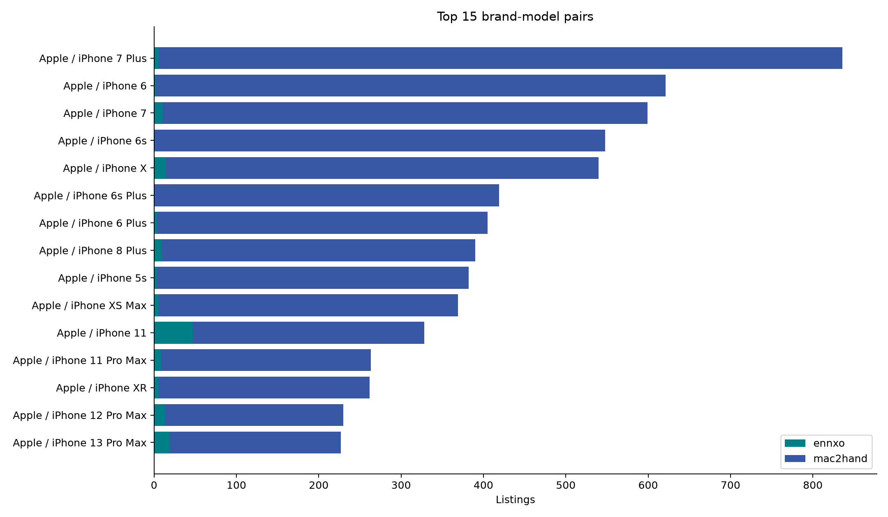
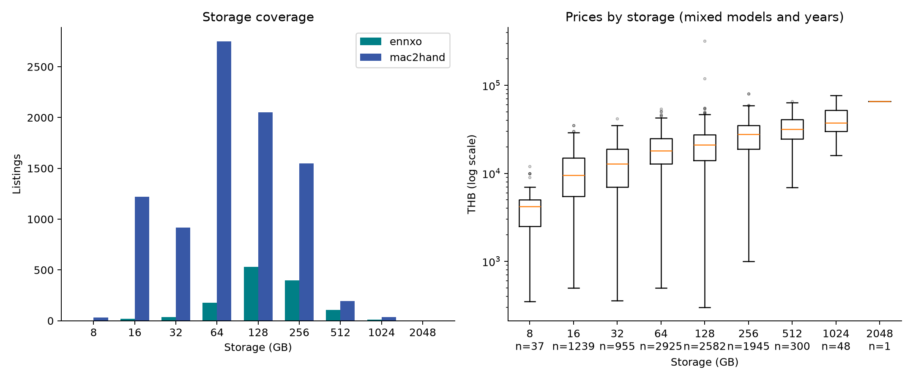
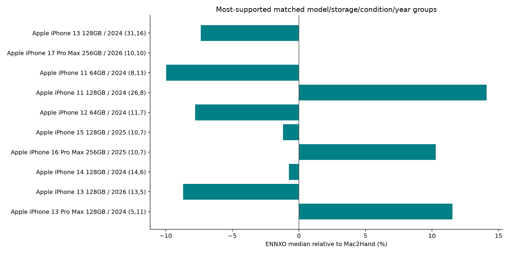

# รายงาน EDA ชุดรวม

สำรวจหลัง clean และรวม schema ก่อนแบ่ง train/test ใช้ทุกแถวใน snapshot ไม่เปลี่ยนข้อมูลต้นทาง

## ข้อมูลและคุณภาพ

ชุดรวม 10,032 แถว คอลัมน์หลักครบและมี source ทุกแถว ราคา median 18,990 บาท (Q1 11,500; Q3 27,000) สำรวจทุกวันที่ ไม่มีการตัดช่วง 12 เดือน

Apple 9,225 แถว (91.96%) มีรุ่น/ยี่ห้อ 308 คู่ โดย 251 คู่มีน้อยกว่า 10 แถว ไม่ควรสรุปประสิทธิภาพรุ่นที่มีตัวอย่างน้อยจากภาพรวม

ข้อมูลก่อนปี 2024 มี 8,184 แถว (81.58%) ช่วงเวลาของสองเว็บต่างกัน จึงไม่เปรียบเทียบ median รวมเป็นผลของเว็บโดยตรง

สภาพ used 9,921 และ new 111 เป็นช่องผู้ขาย ไม่ใช่ผลตรวจเครื่องจริง

| เว็บ | แถว | สัดส่วน (%) | median ราคา (บาท) | วันแรก | วันสุดท้าย |
|---|---|---|---|---|---|
| ennxo | 1279 | 12.75 | 8,980.00 | 2024-05-11 | 2026-10-05 |
| mac2hand | 8753 | 87.25 | 19,900.00 | 2010-04-02 | 2026-10-06 |

## ราคาและ outlier

IQR ภายในเว็บ/รุ่น/ความจุ/สภาพ/ปี ระบุ 205 แถวจากกลุ่มที่ประเมินได้ 7,543 แถว เป็นสัญญาณตรวจ ไม่ใช่ข้อยืนยันว่าราคาผิด

ข้ามกลุ่มเล็ก 2,467 แถว และกลุ่ม IQR=0 22 แถว จึงไม่ควรตีความว่าแถวที่ไม่ถูก flag ทุกแถวได้รับการยืนยัน

ราคาเป็นราคาตั้งขาย ไม่ใช่ราคาปิดการขาย ตรวจราคาที่มีข้อมูลดาวน์/ผ่อนและราคาอาจพิมพ์ผิดจากหลักฐานเดิม แต่ไม่เดาราคาทดแทนเอง

## ความสัมพันธ์และความต่างระหว่างเว็บ

กลุ่มรุ่น/ความจุ/สภาพ/ปีที่มีอย่างน้อย 3 แถวต่อเว็บสำหรับเทียบ median มี 27 กลุ่ม รวม 403 แถว ไม่ใช่การทดลองควบคุมสภาพเครื่องหรือผู้ขาย

| เว็บ | แถว | Spearman ราคา–ความจุ | Spearman ราคา–ปีประกาศ |
|---|---|---|---|
| combined | 10032 | 0.49 | 0.11 |
| ennxo | 1279 | 0.53 | 0.17 |
| mac2hand | 8753 | 0.60 | 0.33 |

Spearman ใช้ average ranks เมื่อค่าซ้ำ ไม่มีการทดสอบนัยสำคัญ ค่าเหล่านี้ปะปนรุ่น/สภาพ/ปี ไม่ใช่ผลเชิงเหตุและผล โดยเฉพาะความจุสูงมักอยู่ในรุ่นใหม่กว่า

## ประกาศที่อาจซ้ำ

candidate จากข้อความมี 280 components รวม 617 แถว หลังรวมกลุ่มที่ซ้อนกัน; สัญญาณภาพซ้ำแยกไว้ เพราะอาจเป็นรูปตัวอย่างร้าน

ตรวจข้อความจาก 10,032 แถว พบกลุ่มข้อความตรงกันข้ามเว็บ 0 กลุ่ม วิธีนี้ไม่ครอบคลุมข้อความที่แก้คำหรือรูปที่ใช้ URL ต่างกัน

จำนวนกลุ่มแยกวิธี: exact_description 261, source_text_candidate 185 กลุ่มระหว่างวิธีซ้อนกันได้ จึงบวกแทนจำนวนเครื่องไม่ได้

ใช้ candidate เดิมของแต่ละเว็บ และข้อความที่ normalize Unicode/case/ช่องว่างตรงกันอย่างน้อย 80 ตัวอักษร พร้อมยี่ห้อ รุ่น ความจุ สภาพและราคาเดียวกัน ไม่ใช้การเหมือนฟีเจอร์อย่างเดียวเป็นหลักฐานเครื่องซ้ำ ไม่รวมภาพซ้ำเข้ากลุ่มข้อความ

## Sensitivity analysis

| กรณีสมมติ | แถว | พักในสมมติฐาน | median ราคา | mean ราคา |
|---|---|---|---|---|
| ทุกแถว | 10032 | 0 | 18,990.00 | 19,930.73 |
| สมมติพักแถวที่ IQR flag | 9827 | 205 | 18,990.00 | 19,895.91 |
| สมมติเก็บ 1 แถวต่อกลุ่มข้อความ | 9695 | 337 | 18,990.00 | 19,940.64 |

เป็นการคำนวณเชิงสมมติเพื่อดูการเปลี่ยนสถิติ ไม่สร้าง dataset ที่ลบแถว ไม่สรุปว่า candidate คือเครื่องซ้ำจริง การจำลองเลือก key แรกใน component ตาม listing_id

## ข้อจำกัดและงานถัดไป

- ตรวจ outlier และตัวอย่างราคาสูงจากข้อความต้นทาง ยืนยันราคาขายเต็มก่อนแก้; ใช้ไฟล์ price_extremes.csv ร่วมด้วย เพราะกลุ่มเล็กหรือ IQR=0 อาจไม่ถูก flag

- ทบทวน candidate ซ้ำก่อนกำหนดกลุ่ม split ไม่ถือว่ารูป/ข้อความเหมือนกันแปลว่าเครื่องเดียวกัน ถ้ายืนยันเป็นเครื่องเดียวให้ใช้ group เดียวทั้ง train/test

- กำหนดเป้าหมายราคาตามวันประกาศหรือราคาปัจจุบันให้ชัด เลือกแผนประเมินตามเวลา และรายงานผลแยกเว็บ/รุ่นที่มีตัวอย่างพอ

- หลังแบ่งข้อมูล ให้เรียนรู้กฎ preprocessing/threshold ที่ใช้ฝึกจาก train เท่านั้น ไม่ใช้ fence จาก EDA ทั้งชุดตัดข้อมูล test

ไม่มี battery health อายุเครื่อง ประวัติซ่อมที่ผ่านการตรวจจริง หรือราคาปิดขายใน schema นี้ การขาดข้อมูลส่วนนี้ไม่ใช่ missing ในช่องที่มี แต่เป็นข้อจำกัดตัวแปรของโครงการ

## กราฟ

สัดส่วนเว็บและยี่ห้อ: จำนวนใน snapshot ไม่ใช่ส่วนแบ่งตลาด

ราคาทุกแถว แกน log เพื่อเห็นทั้งราคาต่ำและสูง จุดนอกกล่องเป็น IQR ภาพรวมต่อเว็บ ต่างจากคิวตรวจที่คุมรุ่น/ปี และยังคงอยู่ใน dataset

ช่วงปีต่างกันมาก เส้น median เปลี่ยนตามรุ่นที่ปะปน ไม่ใช่ราคาของเครื่องรุ่นเดิมลดลงตามเวลา

แสดงทุกประกาศตามวันที่ ไม่มีการจำกัด 12 เดือน และยังไม่ปรับเงินเฟ้อหรือเลือกช่วงฝึก

รุ่นที่พบมากที่สุด; ตารางแนบท้ายเก็บจำนวนทุกรุ่น รวมรุ่นที่มีตัวอย่างน้อย

ความจุปะปนกับรุ่นและปี กลุ่มที่มีตัวอย่างน้อยตีความอย่างระมัดระวัง ไม่ใช่ผลของความจุต่อราคาโดยตรง

new/used เป็นช่องผู้ขาย; correlation รวมไม่ควบคุมรุ่น/สภาพ/อายุ ไม่ใช่เหตุและผล

เทียบรุ่น/ความจุ/สภาพ/ปีเดียวกัน ขั้นต่ำ 3 แถวต่อเว็บ ตัวเลขวงเล็บคือ n ของ ENNXO, Mac2Hand; ยังไม่ควบคุมเดือนหรือสภาพเครื่องจริง

## ไฟล์และวิธีทำซ้ำ

รัน `.venv/bin/python -u -B analysis/eda/run_eda.py` จากรากโปรเจค หรือใช้ absolute path จาก directory อื่น

`summary.json` เก็บสถิติหลัก `tables/*.csv` เก็บทุกรุ่น/ปี/ความจุและวิธีเทียบเว็บ `rules.json` เป็นสำเนากฎ `run_metadata.json` เก็บเวอร์ชันโค้ด dependencies และ input hashes

รายการรายแถวอยู่ใน `data/intermediate/eda/ennxo_20261005_mac2hand_20261006/` ได้แก่ `outlier_candidates.csv`, `duplicate_groups.json`, `duplicate_memberships.csv` และ `validation.json` เก็บเฉพาะเครื่อง; รายงานนี้ไม่เผยแพร่ข้อความ/ข้อมูลติดต่อจากประกาศ
