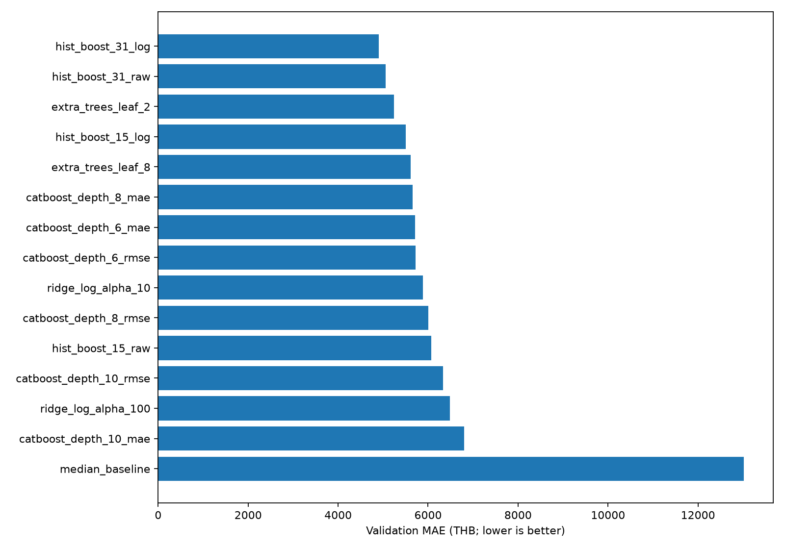
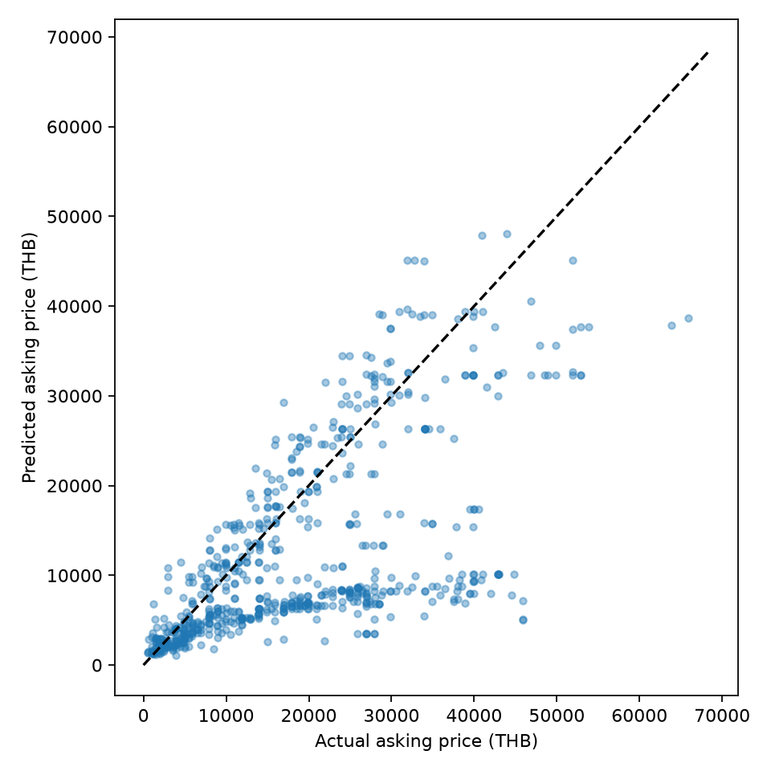
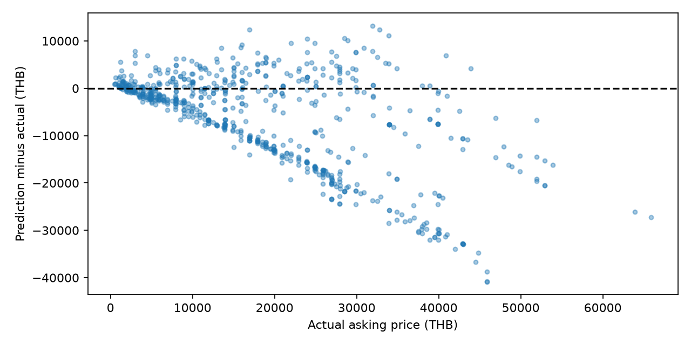
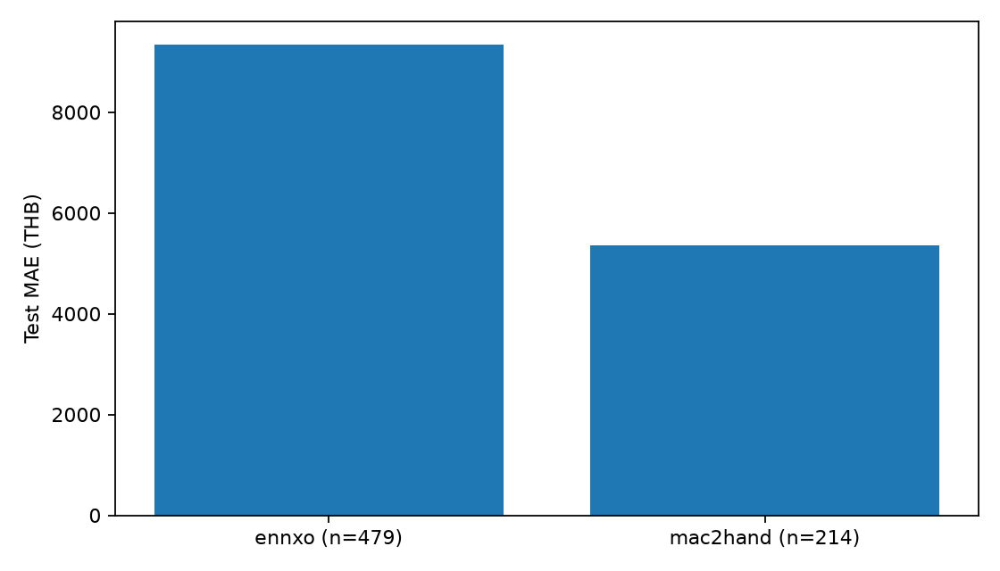

# ผลโมเดลรอบแรก

เทรนแล้วจากชุด 9,210 แถว โมเดลที่ได้ validation MAE ต่ำสุดใน 15 ตัวเลือกคือ **hist_boost_31_log** จากนั้นฟิตใหม่ด้วย train + validation 8,517 แถว และประเมิน test 693 แถวที่กันไว้

**Test MAE 8,108 บาท · RMSE 11,774 บาท · R² 0.147**
ราคาทำนายอยู่ใน ±20% ของราคาประกาศ 27.0% ของ test; MAE ดีขึ้นจาก median baseline 23.5%

| ชุด | จำนวน | ช่วงประกาศ | ENNXO / Mac2Hand |
|---|---|---|---|
| train | 7827 | 2010-04-02 ถึง 2024-05-21 | 202 / 7625 |
| validation | 690 | 2024-05-22 ถึง 2025-01-07 | 521 / 169 |
| test | 693 | 2025-01-09 ถึง 2026-10-06 | 479 / 214 |

| เว็บ | Test | MAE (บาท) | RMSE (บาท) | คลาดเคลื่อนไม่เกิน 20% |
|---|---|---|---|---|
| ennxo | 479 | 9,336 | 13,254 | 15.4% |
| mac2hand | 214 | 5,359 | 7,463 | 52.8% |

ใช้ทำนาย **ราคาตั้งขาย** ไม่ใช่ราคาซื้อขายสำเร็จ ข้อมูลเก่ามากและสัดส่วนเว็บ/ยี่ห้อเปลี่ยนตามเวลา รุ่นที่ไม่เคยอยู่ในชุดฝึก 238 แถวใน test ต้องอ่านผลแยกกลุ่มก่อนใช้งาน คะแนนนี้ใช้กับชุดที่ตัดคิว EDA ออกแล้ว การคัดเกิดก่อนแบ่งข้อมูลจึงมี selection bias

อ่าน [รายงานรายละเอียด](report.md) และ [ตัวเลขทั้งหมด](summary.json) โมเดลอยู่ `models/asking_price_v1/model.joblib` ใช้ `script/modeling/predict.py` สำหรับทำนาย ยังเก็บ test แยกจากข้อมูลฝึกของโมเดลส่งมอบ

## วิธีทดลองและป้องกันข้อมูลรั่ว

1. ตรึง CSV ด้วย SHA-256 `a630520c2f7efc8ed793591aaa01e780d1198fa630410da3c335c27c6bd0e5c6` และประกาศรายการโมเดล/พารามิเตอร์ใน `config/modeling/training.json` ก่อนวัด test
2. เรียงตามวันที่และรหัสประกาศ แบ่งประมาณ 85%/7.5%/7.5%; วันที่เดียวกันอยู่ชุดเดียว เหตุผลที่เลือกสัดส่วนนี้คือ train ต้องมีทั้งสองเว็บ ช่วง 70–80% แรกมีเพียง Mac2Hand
3. ฟิต encoding/scaling เฉพาะ train ไม่ส่งราคา รหัสสินค้า URL หรือ snapshot เข้าเป็น feature สร้างความจุ รุ่น/ตระกูลรุ่น และเวลาประกาศด้วยกฎที่ไม่ใช้ target
4. เปรียบเทียบ median, Ridge, Extra Trees, HistGradientBoosting และ CatBoost; Ridge/boosting บางตัวทดลอง log(price) โดยแปลงกลับเป็นบาทก่อนวัด MAE CatBoost ใช้ categorical features โดยตรง และ `has_time=True`; early stopping ใช้ validation MAE เท่านั้น จำกัดสูงสุด 1,200 iterations
5. เลือก validation MAE ต่ำสุด จำนวน iterations ที่เลือกถูกตรึงก่อน refit train + validation ไม่มี early stopping หรือ tuning จาก test ประเมินเฉพาะผู้ชนะและ median baseline ที่กำหนดไว้ล่วงหน้า
6. บันทึกโมเดลและตรวจโหลดกลับแล้วให้ผลตรงเดิม test ยังคงกันไว้นอก artifact ไม่ใช้ผล test เพื่อแก้พารามิเตอร์รอบนี้

จำนวนแถวต่อช่วงไม่เท่ากันเพราะกันวันที่ประกาศทั้งวัน ไม่มี seed ในการแบ่งเวลา seed=42 ใช้กับอัลกอริทึมที่มี randomness ไม่ทำ random split หรือ random cross-validation; validation ช่วงเดียวเหมาะกับการส่งมอบรอบแรก แต่ยังไม่ใช่การรับรองเสถียรภาพทุกช่วงตลาด

## ผลเลือกโมเดล

| ตัวเลือก | Validation MAE | RMSE | จำนวนต้นไม้ที่เลือก | เวลา fit (วินาที) |
|---|---|---|---|---|
| hist_boost_31_log | 4,905.26 | 6,848.95 | — | 8.94 |
| hist_boost_31_raw | 5,059.04 | 6,895.04 | — | 7.465 |
| extra_trees_leaf_2 | 5,246.51 | 7,675.83 | — | 13.923 |
| hist_boost_15_log | 5,507.54 | 7,307.26 | — | 5.244 |
| extra_trees_leaf_8 | 5,616.10 | 7,720.39 | — | 13.766 |
| catboost_depth_8_mae | 5,661.41 | 7,549.31 | 883 | 10.99 |
| catboost_depth_6_mae | 5,713.38 | 7,654.55 | 1170 | 9.597 |
| catboost_depth_6_rmse | 5,722.25 | 7,489.17 | 1196 | 7.726 |
| ridge_log_alpha_10 | 5,886.93 | 9,180.35 | — | 0.231 |
| catboost_depth_8_rmse | 6,006.61 | 7,845.47 | 1200 | 13.215 |
| hist_boost_15_raw | 6,068.15 | 7,667.31 | — | 5.261 |
| catboost_depth_10_rmse | 6,336.93 | 8,151.68 | 1198 | 23.318 |
| ridge_log_alpha_100 | 6,490.38 | 9,077.96 | — | 0.135 |
| catboost_depth_10_mae | 6,805.88 | 8,827.38 | 561 | 14.464 |
| median_baseline | 13,021.47 | 14,452.00 | — | 0.301 |

## ผล test และขอบเขตที่เรียนรู้

MAE คือค่าเฉลี่ยความผิดพลาดเป็นบาท RMSE ให้น้ำหนักกับความผิดพลาดก้อนใหญ่ ส่วน R² เทียบความแปรปรวนกับค่าเฉลี่ย test; MAPE ให้น้ำหนักกับของราคาถูกมากกว่าจึงไม่ใช้เลือกโมเดล Median absolute error = 4,732 บาท, MAPE = 44.0%, bias = -6,178 บาท (บวกหมายถึงทำนายแพงกว่า)

| รุ่น | Test | MAE (บาท) |
|---|---|---|
| seen | 455 | 6,631 |
| unseen | 238 | 10,932 |

ตาราง [test_by_group.csv](tables/test_by_group.csv) มี source, brand, ปี, condition, รุ่นเคยเห็น/ไม่เคยเห็น และ brand:model รวมจำนวน MAE/RMSE/median error/R²/MAPE/bias กลุ่มเล็กมีความไม่แน่นอนสูง ไม่ตีความค่า R² จากกลุ่มแถวเดียว

## ข้อจำกัดและสิ่งที่ยังไม่รับรอง

- การตัด 822 แถวทำจาก EDA ทั้งชุดก่อนแบ่ง โดยรวมแถวที่ราคาผิดปกติและข้อความอาจซ้ำ คะแนนอาจดีกว่าการรับประกาศใหม่ทุกประเภท; การคัดไม่ใช่หลักฐานว่าแถวที่ตัดผิดจริง
- ทั้งชุดเป็น Apple ประมาณ 92% และเก่าครอบคลุม 2010–2026; train มี ENNXO เพียง 202 แถวก่อน validation สัดส่วนกลุ่มเปลี่ยนชัดเมื่อเวลาเดินหน้า ผลรวมจึงแทนทุกยี่ห้อ/เว็บไม่ได้
- test มีรุ่นใหม่ที่ไม่เคยฝึกและประกาศหลังวันฝึกสูงสุด โมเดล tree ไม่รับรองการ extrapolate เทคโนโลยีหรือระดับราคาอนาคต; CLI แสดง coverage flags แทนการซ่อนข้อจำกัด
- ตรวจรหัส/URL ซ้ำและกันวันประกาศแล้ว แต่ไม่มี serial number/ผู้ขายที่เชื่อถือได้สำหรับยืนยันเครื่องเดียวกันข้ามเว็บ จึงไม่รับรองว่าไม่มีเครื่องซ้ำทางกายภาพ
- condition คือค่าผู้ขายเลือก อาจมี new ในหมวดมือสองตามนโยบายผู้ใช้ ไม่มี battery health, warranty, ประวัติซ่อม/ราคาปิดขายที่ครบและตรวจยืนยันได้
- ผล test ใช้ประเมินโมเดลรอบนี้แล้ว หากปรับโมเดลจากข้อค้นพบนี้ควรมี holdout ใหม่หรือ rolling temporal evaluation ไม่ใช้ test เดิมเพื่ออ้างผลใหม่ที่เป็นอิสระ

## สคริปต์และไฟล์ส่งมอบ

| ที่อยู่ | เก็บอะไร |
|---|---|
| `script/modeling/features.py` | ตรวจ input และสร้าง 12 features จากหกฟิลด์ที่ทราบตอนประกาศ |
| `script/modeling/split_dataset.py` | อ่าน CSV ตรึง hash แบ่งวันตามเวลา ตรวจ ID/URL และเขียน split |
| `script/modeling/train_models.py` | ทดลองตาม config เลือก/refit/test บันทึก artifact และผลตรวจ |
| `script/modeling/predict.py` | โหลด artifact ตรวจ checksum แล้วทำนายพร้อม coverage flags |
| `script/modeling/report.py` | เขียนรายงานสรุป/รายละเอียด HTML กราฟและตารางรวม |
| `data/intermediate/modeling/<รอบ>/split/` | train.csv, validation.csv, test.csv, assignments.csv, summary/validation/hashes JSON |
| `data/intermediate/modeling/<รอบ>/*predictions.csv` | ราคาจริง/ทำนาย/ความผิดพลาดรายแถว เก็บในเครื่อง |
| `models/<รอบ>/` | model.joblib (ตัวทำนาย + สัญญา feature), model.cbm เมื่อเป็น CatBoost, metadata.json |
| `reports/modeling/<รอบ>/` | summary/report, HTML, config, selection, metrics, metadata, validation และ output hashes |
| `reports/modeling/<รอบ>/figures/` | กราฟ PNG/SVG 4 ชนิด |
| `reports/modeling/<รอบ>/tables/` | ผล validation ทุกตัว และ test รวม/แยกกลุ่ม |

เวลา training pipeline 153.9 วินาที ไม่รวมติดตั้ง dependencies และเขียนโค้ด เวอร์ชันที่ใช้: numpy=2.5.4, pandas=3.0.6, scipy=1.18.1, scikit-learn=1.9.1, catboost=1.2.10, joblib=1.6.0, matplotlib=3.11.2 config, seed และ code/input/output hashes บันทึกไว้สำหรับทำซ้ำ ไม่อ้างว่าบิตของไฟล์ binary เหมือนกันบนทุกระบบ

## แหล่งหลักการ

[scikit-learn: data leakage และ pipeline](https://scikit-learn.org/stable/common_pitfalls.html), [การแบ่งข้อมูลตามเวลา](https://scikit-learn.org/stable/modules/cross_validation.html#time-series-split), [CatBoost: tuning/early stopping/has_time](https://catboost.ai/docs/en/concepts/parameter-tuning), [CatBoost: regression objectives](https://catboost.ai/docs/en/concepts/loss-functions-regression)
