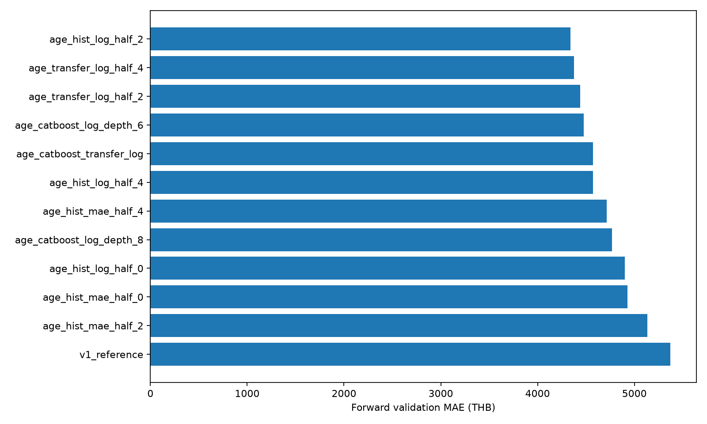
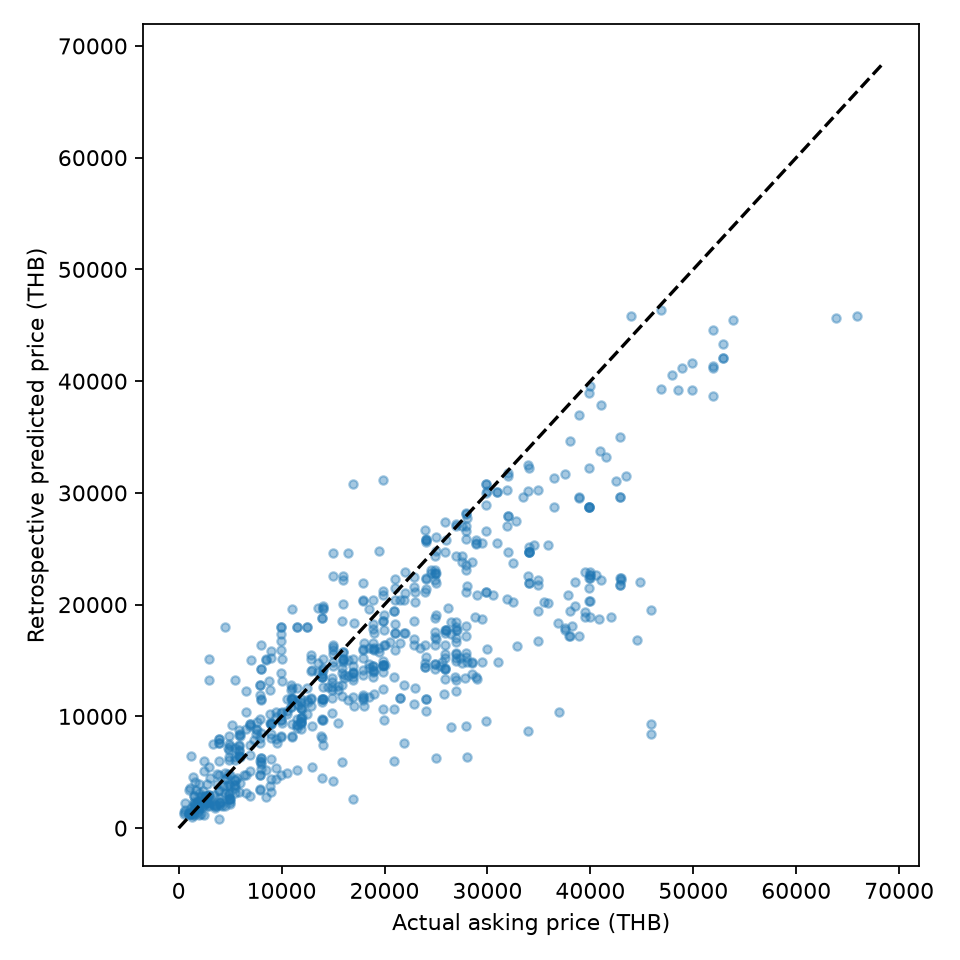

# ผลปรับโมเดลรอบ 2

เลือก **age_hist_log_half_2** จาก 12 ตัวเลือกโดย validation ตามเวลา 2 ช่วง เพิ่มอายุรุ่นจากปีเปิดตัว Apple และค่าแบต/ประกัน/กล่องที่ถอดจากรายละเอียดเดิม ทดลอง recency weights โดยเก็บข้อมูลทุกแถว

| เปรียบเทียบบน 693 แถวเดิม | MAE (บาท) | RMSE (บาท) | R² |
|---|---:|---:|---:|
| V1 cutoff เดียวกัน | 8,108 | 11,774 | 0.147 |
| V2 evaluation | 5,339 | 7,867 | 0.619 |

MAE เปลี่ยนไป 34.1% จาก V1 (ค่าบวกคือดีขึ้น) ทำนายใน ±20% ของราคาจริง 40.5%

| เว็บ | แถว | MAE (บาท) | RMSE (บาท) |
|---|---|---|---|
| ennxo | 479 | 6,090 | 8,790 |
| mac2hand | 214 | 3,659 | 5,241 |

**คะแนนข้างต้นเป็นการเปรียบเทียบย้อนหลังบน test เดิมที่เคยเปิดดูแล้ว ไม่ใช่ผลจาก holdout ใหม่ที่เป็นอิสระ** ใช้ train ก่อน 2025-01-09 เท่ากันทั้งสองตัว ไม่เลือกพารามิเตอร์จาก test ในรอบนี้ แต่การวิเคราะห์ V1 เคยเห็นข้อมูล test แล้ว

โมเดลใช้งานแยก `models/asking_price_v2/model.joblib` ฟิตครบ 9,210 แถว เพื่อเรียนรู้รุ่นล่าสุด 300 รุ่นและข้อมูลถึง 2026-10-06 หลังเลือกวิธีแล้ว ไม่มีคะแนน test อิสระของโมเดลฟิตครบ และไม่ใช้คะแนนในชุดฝึกอ้างความแม่นยำ

อ่าน [รายละเอียด](report.md) · [ทุกตัวเลข](summary.json) ใช้ `script/modeling/predict.py` ทำนาย ราคาเป็นราคาตั้งขายตามวันที่ ไม่ใช่ราคาปิดขาย

## สาเหตุและสิ่งที่ปรับ

V1 ไม่รู้อายุรุ่น ณ วันประกาศและมีรุ่นที่ไม่เคย fit 238 แถวใน test เดิม การใช้ชื่อรุ่นเพียงอย่างเดียวทำให้การถ่ายทอดราคาข้ามรุ่นจำกัด V2 เพิ่มปีเปิดตัวและอายุรุ่นโดยอ้างข้อมูล Apple ไม่อนุมานอายุเครื่องจากปีซื้อ อายุเป็นระดับปีโดยประมาณ จึงไม่ใช่วันที่เปิดตัวจริง

อ่านคำระบุ battery health %, ประกันจำนวนวัน และกล่อง จาก description ที่ผูก lineage กับ listing_id/source/price ตรงต้นทาง เก็บตัวเลขเฉพาะคำระบุชัดและค่าเดียว กรณีขัดกัน/ไม่ระบุให้ missing ไม่ใช้ข้อความเต็ม/title/ราคาในรายละเอียดเป็น feature

เพิ่ม tier เช่น Pro/Pro Max/mini/Plus สำหรับถ่ายทอดลักษณะข้ามรุ่น ทดลองลด feature ชื่อรุ่นใน transfer candidates และให้น้ำหนักอายุข้อมูล half-life 0, 2, 4 ปี ค่า 0 คือเท่ากันทุกแถว น้ำหนักอิงวันที่ล่าสุดของ fold train เท่านั้น ไม่มีการลบข้อมูลเก่า

## วิธีเลือกและแยกการประเมิน

1. ตรึง enriched dataset/catalog/config ด้วย SHA-256 ตาม config ก่อนทดลอง คง `data/final/dataset.csv` 9,210 แถวเดิม
2. Fold 1: train ก่อน 2024-01-01 → validation 2024-01-01 ถึง 2024-05-21; Fold 2: train ก่อน 2024-05-22 → validation ถึง 2025-01-07 ฟิต encoding/imputation/scaling และน้ำหนักจาก train ของแต่ละ fold เท่านั้น
3. เทียบ 12 ตัวเลือกจาก HGB และ CatBoost ทั้ง target เป็นบาท/log(price) รวม reference V1 เลือก pooled validation MAE ต่ำสุดทั้งสอง fold โดยจำนวนแถวจริง ไม่มี test ในขั้นเลือก
4. ตรึงผู้ชนะแล้วฟิต evaluation model 8,517 แถว cutoff เดียวกับ V1 วัดซ้ำบน test เดิม 693 แถวและเรียกผลย้อนหลัง ไม่อ้างว่ามี test ใหม่
5. ฟิต operational model แยกด้วยครบ 9,210 แถวเพื่อใช้งานกับรุ่นที่มีในข้อมูลถึงปัจจุบัน evaluation.joblib และ model.joblib เป็นคนละ estimator มี metadata ระบุจำนวน/บทบาท ไม่ยกคะแนน retrospective ไปอ้างเป็นคะแนนอิสระของ operational model

| ตัวเลือก | Forward validation MAE | RMSE | เวลา (วินาที) |
|---|---|---|---|
| age_hist_log_half_2 | 4,339.41 | 6,518.78 | 18.11 |
| age_transfer_log_half_4 | 4,377.55 | 6,633.11 | 7.5 |
| age_transfer_log_half_2 | 4,442.13 | 6,583.16 | 7.94 |
| age_catboost_log_depth_6 | 4,477.19 | 7,009.32 | 11.27 |
| age_catboost_transfer_log | 4,570.96 | 7,175.46 | 8.99 |
| age_hist_log_half_4 | 4,571.61 | 6,798.44 | 17.26 |
| age_hist_mae_half_4 | 4,713.19 | 7,151.32 | 27.72 |
| age_catboost_log_depth_8 | 4,770.10 | 7,341.57 | 21.61 |
| age_hist_log_half_0 | 4,899.77 | 6,896.68 | 16.85 |
| age_hist_mae_half_0 | 4,929.66 | 7,456.31 | 22.14 |
| age_hist_mae_half_2 | 5,134.67 | 7,427.15 | 24.64 |
| v1_reference | 5,372.14 | 7,969.50 | 11.52 |



## ผลย้อนหลังและการอ่านข้อจำกัด



อ่าน [retrospective_by_group.csv](tables/retrospective_by_group.csv) สำหรับคะแนนเว็บ ยี่ห้อ ปี สภาพ รุ่นเคยเห็น/ไม่เคยเห็น และรุ่นย่อย กลุ่มเล็กไม่ใช้รับรองคุณภาพ ส่วน [fold_metrics.csv](tables/fold_metrics.csv) ให้ผลแต่ละช่วง validation ไม่ซ่อนความต่างตามเวลา

ข้อมูลเดิมส่วนใหญ่เป็น iPhone เก่า และราคามีความต่างของสภาพที่คำประกาศไม่ได้ระบุครบ การตัดคิว EDA เกิดก่อน split จึงมี selection bias ไม่รับรองเครื่องไม่ซ้ำทางกายภาพหรือราคาปิดขาย Android ที่ไม่มี catalog ปีเปิดตัวจะเก็บ release_known=0 และค่าขาด; ไม่สร้างปีเดาให้

Catalog รวบรวมปัจจุบัน: reference ของรุ่นที่เปิดตัวภายหลัง cutoff เป็นข้อมูลภายนอกที่เราทราบตอนนี้ คะแนน V2 จึงเป็นการทดสอบย้อนหลังพร้อมข้อมูลปีเปิดตัวที่ทราบ ณ วันประกาศของแถวนั้น ไม่ใช่การอ้างว่าทำนายสเปกรุ่นที่ยังไม่เปิดตัวได้ในปีฝึก ข้อมูลอายุมี precision ระดับปีและอาจมีประกาศลงวันผิด; ไม่แก้ raw โดยเดา

CLI คืน coverage flags เมื่อรุ่น/ยี่ห้อใหม่หรือวันนอก fit range และระบุ optional fields ที่ไม่ให้มา ค่าขาดแบต/ประกัน/กล่องทำให้ความเชื่อมั่นน้อยลง แต่ flags ไม่ใช่ช่วง confidence ทางสถิติ

ไม่มี holdout ใหม่จากการเก็บภายนอกในงานนี้ ก่อนรับรองความแม่นยำสำหรับประกาศใหม่ต้องประเมินข้อมูลหลัง 2026-10-06 ที่ยังไม่เคยใช้พัฒนา โมเดลรอบนี้พร้อมนำไปทดลองใช้และนำเสนอผลพร้อมข้อจำกัด

## ไฟล์และการทำซ้ำ

| ตำแหน่ง | เก็บอะไร |
|---|---|
| `script/modeling/prepare_features_v2.py` | ตรวจ lineage ถอด optional claims และ parse ปีเปิดตัวจาก Apple HTML cache |
| `script/modeling/features_v2.py` | สร้าง feature อายุ/tier/optional และ missing indicators โดยไม่ใช้ target |
| `script/modeling/train_improved.py` | 2 temporal folds เลือกโมเดล วัดย้อนหลัง และ fit operational artifact |
| `config/modeling/improved.json` | 12 ตัวเลือก cutoff seed weights และ hashes |
| `config/modeling/iphone_release_years.json` | factual catalog ปีเปิดตัวพร้อม URL/hash จาก Apple |
| `data/intermediate/modeling/asking_price_v2/enrichment/` | dataset.csv และ audit.json ของ optional coverage/input hashes |
| `data/intermediate/modeling/asking_price_v2/evaluation/` | ผลจริง/ทำนายรายแถวในเครื่อง |
| `models/asking_price_v2/evaluation.joblib` | estimator ก่อน cutoff สำหรับผลย้อนหลัง |
| `models/asking_price_v2/model.joblib` | operational estimator ฝึกครบ 9,210 แถว |
| `models/asking_price_v2/metadata.json` | hashes/versions/จำนวนแถว แยกบทบาท ไม่อ้าง independent score |
| `reports/modeling/asking_price_v2/` | summary/report HTML, config, folds, selection, validation, metadata และ output hashes |
| `.../tables/`, `.../figures/` | ตารางทุกตัวเลือก/ทุกกลุ่มและกราฟ PNG/SVG |

```bash
# หลัง clone: train จะ rebuild enriched CSV จาก core + condition sidecar เมื่อยังไม่มี
# การถอดค่าจากต้นฉบับใหม่ใช้ lineage และ full-text evidence ส่วนตัว
.venv/bin/python -B script/modeling/prepare_features_v2.py
.venv/bin/python -u -B script/modeling/train_improved.py
# ทำนายด้วย operational model ระบุแบตถ้าทราบ
.venv/bin/python -B script/modeling/predict.py --model-file models/asking_price_v2/model.joblib --source mac2hand --brand Apple --model 'iPhone 16 Pro' --storage-gb 256 --condition used --published-at 2026-10-06 --battery-health-pct 90
```

เวลาสำหรับ pipeline ครั้งสุดท้าย 121.8 วินาที (รอบที่ resume ไม่รวมเวลาที่ใช้ก่อนหยุด); เวลา fit ของทุกตัวเลือกที่บันทึกไว้รวม 195.6 วินาที ไม่รวมเตรียม feature/เขียนโค้ด ไม่ต้อง scrape สองเว็บใหม่ Binary และผลทำนายรายแถวไม่ขึ้น Git; `data/final/condition_features.csv` เป็น sidecar ตัวเลข/รหัสที่รวมใน Git เพื่อ rebuild enriched CSV โดยไม่ต้องมี raw ส่วนตัว

แหล่งข้อมูล/หลักการ: [Apple: ปีเปิดตัว iPhone](https://support.apple.com/en-us/108044), [scikit-learn: HGB loss และ sample weights](https://scikit-learn.org/stable/modules/generated/sklearn.ensemble.HistGradientBoostingRegressor.html)
